<a id="0-视觉生成中的专家选择粒度"></a>
<a id="1-去噪迭代时空-token-与采样开销"></a>

## 0. 图像和视频生成为什么需要不同的专家设计

把 DiT 的 FFN 换成 MoE，可以在相近的激活计算量下增加参数容量。但图像和视频生成还有几个会直接影响专家分工的条件。

同一段视觉内容要经过多轮去噪，输入从噪声逐步变成可辨认的结构；同一轮中，背景、主体和运动边界又有不同的计算需求。文本条件与视觉 token 也不对称：文本描述希望生成什么，带噪视觉状态则要不断被更新。原生多模态模型进一步把文本预测、视觉理解和图像生成放进同一个主干，参数共享也会影响不同目标之间的训练干扰。

因此，设计 MoE 时有三件事需要分别确定：在哪个层级设置专家，用什么信号选择专家，以及每个位置获得多少专家计算。

| 设计问题 | 可以使用的信号 | 改变什么 | 对应目的 |
|---|---|---|---|
| 哪个去噪模型处理当前阶段 | timestep、噪声强度 | 整套 denoiser | 分开训练不同噪声阶段，扩大总容量 |
| 每个视觉位置使用哪些 FFN | 当前 hidden state、文本条件、空间与时间上下文 | token–expert 分派 | 在局部内容之间分配容量 |
| 每个位置分到多少计算 | expert-choice 竞争、容量预测 | 专家调用数量 | 将计算转向需求更高的位置与采样阶段 |
| 专家应怎样形成分工 | 语义原型、专家分组、模态或任务约束 | 路由训练与候选范围 | 减少无效重复或任务干扰 |
| 文本、视觉共享哪些参数 | 模态类型、理解/生成路径 | FFN、router 或更完整的 Transformer 参数 | 保留各自处理能力，同时交换语义信息 |

下面沿这些问题讨论具体实现。视觉生成中的 timestep 指扩散或 flow matching 的噪声阶段；视频自身的帧时间是另一条轴，同一个噪声阶段会同时处理许多视频帧。

<a id="2-模型级选择按-timestep-换-denoiser"></a>

## 1. 按噪声阶段切换整套 Denoiser

### 1.1 Wan2.2：按噪声区间选择模型

不同噪声阶段的输入分布不同。模型级 denoising expert 将一条采样轨迹拆成几个区间，让各套参数专门拟合自己负责的区间。

以预测噪声的参数化为例，一个 denoiser 可以写成：

$$
\hat{\epsilon}=D_{\theta}(x_t,t,c)
$$

所有 timestep 共用同一套参数 $\theta$。timestep expert 做的是先把 $t$ 或 noise level $\sigma$ 切成几个连续区间 $S_1,\cdots,S_m$，再定义一个固定映射：

$$
\begin{aligned}
g(t)&=i,\quad t\in S_i,\\
\hat{\epsilon}&=D_{\theta_i}(x_t,t,c).
\end{aligned}
$$

训练时采样到哪个 $t$，就更新对应的 $D_{\theta_{g(t)}}$；推理时 scheduler 走到哪个 $t$，也只调用对应的 expert。这里没有 token-level top-k，也没有 per-patch all-to-all。每次 denoiser 评估只执行当前区间的一个 expert；一个采样 step 是否包含 CFG 等额外评估，由 pipeline 决定。总 checkpoint/参数量变成多份，显存压力取决于专家是否同时常驻 GPU，或在 high/low 阶段之间 offload。

[eDiff-I][ediffi]先训练覆盖全噪声分布的基线，再从该基线初始化不同噪声区间的专家。[ERNIE-ViLG 2.0][ernie-vilg]将 1000 个训练 timestep 分成 10 段，每段使用一个 U-Net expert，text encoder 共享。推理时沿轨迹切换 denoiser，各个区间的专家共同完成一张图，而每次模型评估只执行其中一套。

[Wan2.2][wan22]的 A14B 系列使用 high-noise 与 low-noise 两个专家。前者负责高噪声区间，后者负责低噪声区间；每次只执行一个约 14B 的模型，总参数容量则包含两套权重。flow 模型预测的具体量可以是速度场，按噪声阶段选择参数的逻辑相同。

[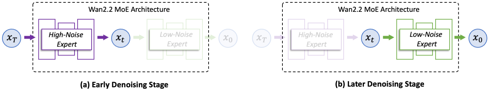](/assets/img/blog/moe-we-like-you/10-wan2-2-timestep-moe.png)

*图 1：Wan2.2 沿 denoising timestep 划分 high-noise / low-noise experts。*

代码层面，Wan2.2 的 T2V/I2V A14B pipeline 创建 `low_noise_model` 和 `high_noise_model` 两个 DiT checkpoint。采样前先算：

```python
boundary = config.boundary * num_train_timesteps
```

采样循环里，每个 step 根据当前 scheduler timestep 选择模型：

```python
if t >= boundary:
    model = high_noise_model
else:
    model = low_noise_model
```

在该 CFG 路径中，conditional / unconditional 两次 forward 都使用当前选中的模型。高、低噪声专家各执行多少次，由阈值和 scheduler 共同决定；offload 配置则决定非当前专家的权重放在哪里。同一步内，所有视觉位置都经过同一个 denoiser。

### 1.2 MOVA：视频专家切换与音视频交互分别处理

[MOVA][mova-paper]在 Wan2.2 I2V A14B 视频主干之外，加入 1.3B 音频 DiT 和 2.6B 双向 Bridge，构成约 32B total / 18B active 的联合音视频生成模型。

[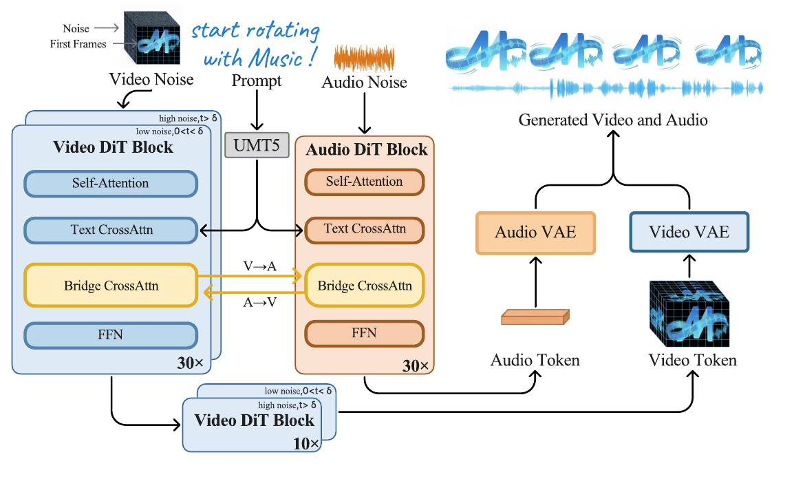](/assets/img/blog/moe-we-like-you/10-mova-dual-tower-architecture.png)

*图 2：MOVA 的视频塔继承噪声阶段专家，音频塔与视频塔通过双向 cross-attention Bridge 交换隐藏状态。*

视频塔仍按高、低噪声阶段选择模型。音视频同步由另一条机制处理：在交互层中，音频隐藏状态作为视频的 cross-attention 输入，视频隐藏状态也反向注入音频塔；位置编码将两个 VAE 的不同时间采样率对齐到同一物理时间尺度。这里的两个 tower 是模态处理路径，视频 tower 内的两个 denoiser 才是按噪声阶段选择的专家。

这一划分也影响训练。MOVA 为适配 FSDP 的计算图要求，在奇数训练步为整个 batch 采样高噪声区间并更新 high-noise DiT，偶数步采样低噪声区间并更新 low-noise DiT；音频塔和 Bridge 每步都更新。音视频各自的噪声采样还可以解耦，不要求两个模态始终处于相同噪声状态。

模型级切换为不同阶段提供了独立容量，却让同一步的所有视觉位置使用同一套参数。若希望主体、背景或不同运动区域在一轮中获得不同处理，就要把路由放进 denoiser 内部。

<a id="3-token-级选择在-dit-block-内替换-mlp"></a>

## 2. 视觉 Token 的专家选择与计算量分配

### 2.1 固定 Top-k：DiT-MoE 与 LingBot-Video

[DiT-MoE][dit-moe]在部分 DiT block 中用 sparse MoE 替换 MLP，保留 always-on shared experts，并通过 expert-level balance loss 约束专家使用率。对当前噪声阶段的一个 patch hidden state $h_j$，简化的输出是：

$$
\begin{aligned}
y_j&=\sum_{e\in\mathrm{TopK}(r(h_j))}p_{j,e}E_e(h_j)\\
&\quad+\sum_{s=1}^{n_s}S_s(h_j).
\end{aligned}
$$

$E_e$ 是 routed FFN，$S_s$ 是 shared FFN。每个位置独立选择 top-$k$ 个 routed experts，再加上共享路径；同一位置在不同采样轮中得到的 hidden state 不同，也可以换一组专家。

[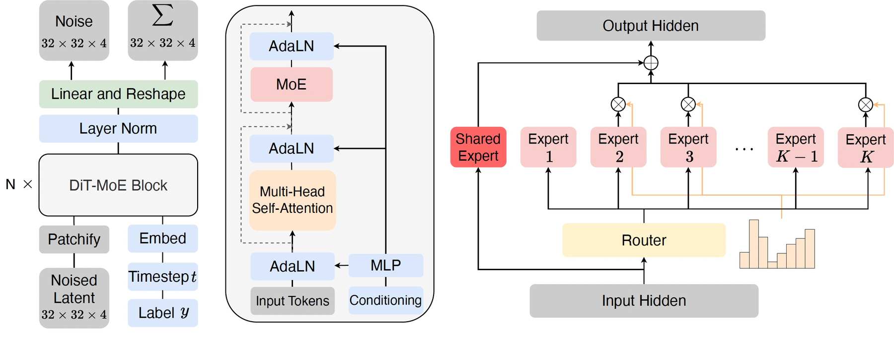](/assets/img/blog/moe-we-like-you/10-dit-moe-framework.png)

*图 3：DiT-MoE 将 FFN 容量拆为共享部分与按 token 选择的专家部分。*

论文在 ImageNet 条件生成上扩展到 16B 级别，并分析路由随空间位置、网络深度和噪声阶段的变化。被测模型中，专家对位置和 timestep 的偏好比类别条件更明显，深层路由也更分散。这里的 timestep 信息可以通过主干的条件调制进入 hidden state，router 并不需要一个显式的“阶段专家编号”。

[LingBot-Video][lingbot-video-paper]将这类 token 级结构用于 30B-A3B 视频模型，另提供 Dense 1.3B 版本。MoE 分支包含 shared experts 与 routed experts；router 使用 group-limited selection，先选专家组再在组内选 top-k，以限制分布式通信范围。训练中的在线 bias 调整只影响选择，输出混合仍使用原始 affinity。这让它同时涉及容量扩展、负载控制和通信约束。

[](/assets/img/blog/moe-we-like-you/10-lingbot-video-architecture.png)

*图 4：LingBot-Video 的 single-stream diffusion Transformer 在 attention 之后执行 shared 与 top-k routed experts。*

它支持 T2I、T2V、TI2V，训练中加入 70,000+ 小时具身数据，MoE 版本还配有 refiner。物理合理性与任务完成率的结果对应这一整套训练和生成流程；专家分工本身应根据路由与消融分析。refiner 的额外 forward 也属于最终采样时间。

固定 top-k 可以改变每个位置使用的参数，但 routed expert 调用数仍为“位置数乘 $k$”。复杂区域选了一组不同的专家，并不意味着它获得了更多计算。下面两种设计进一步改变调用数量。

### 2.2 Expert-Choice：让专家选择位置

[EC-DiT][ecdit]把选择方向反过来：每个专家对候选 token 打分，再取其中分数最高的一部分。每个专家的容量固定，一个位置被多少专家选中则可以变化。

[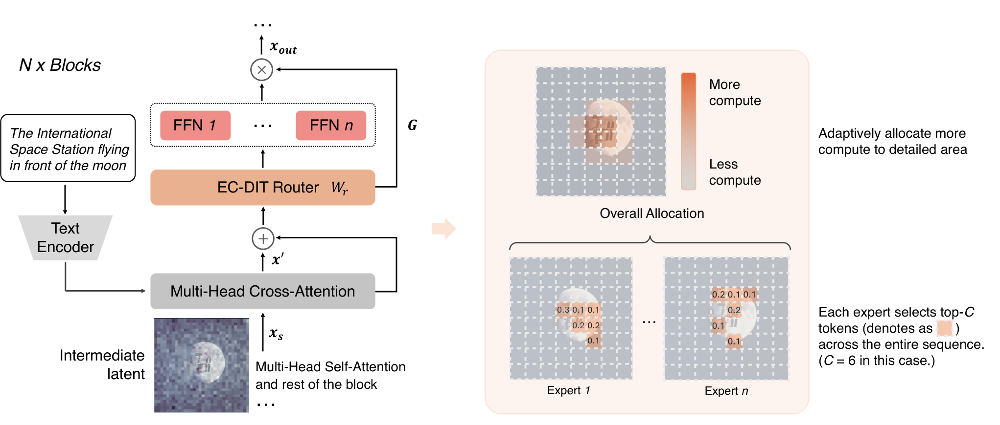](/assets/img/blog/moe-visual-generation/ecdit-expert-choice.png)

*图 5：EC-DiT 中多个专家可以共同选择细节较多的位置，部分背景位置则不进入 routed expert 分支。*

用四个位置、两个专家、每专家容量为二的示例：专家 A 选位置 1、2，专家 B 选位置 2、3。四次调用中，位置 2 得到两次，位置 1、3 各一次，位置 4 为零。容量相同，分配到各位置的计算不同；未被选择的位置仍保留 Transformer 的其它路径。

EC-DiT 将文本条件和 timestep 信息融入视觉表示，再据此选择专家输入。因此计算分配可以随内容和采样阶段变化。不过，固定每专家容量时，整组候选的 routed 调用总量仍受容量约束：变化主要发生在位置之间的分配。

### 2.3 DiffMoE：跨样本竞争与推理时容量预测

[DiffMoE][diffmoe]训练时把 batch 中的视觉 token 展平成一个全局池，让每个专家从不同样本、不同噪声阶段的 token 中选择输入。每个专家仍有固定训练容量，但不同图像分到的计算不再相同。

[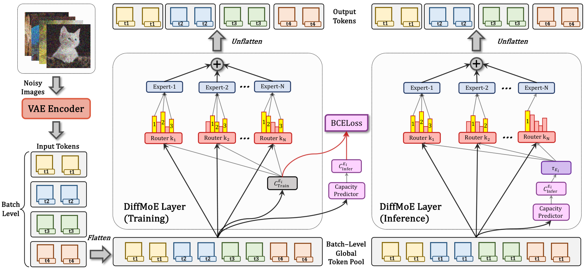](/assets/img/blog/moe-visual-generation/diffmoe-capacity-predictor.png)

*图 6：左侧按全局 token pool 进行专家选择，同时训练 capacity predictor；右侧用预测值与专家阈值决定推理中的选择。*

推理时的样本组合未必复现训练时的全局竞争。DiffMoE 用训练路由产生的选择标签，通过二元交叉熵监督一个 capacity predictor；推理时根据预测输出和每专家阈值，确定当前输入需要的 token–expert 项。因此不同样本、采样阶段可以使用不同的实际容量，阈值也提供计算量与生成质量的调节接口。

这三类分配需要分开理解：固定 token-choice 保证每位置 top-k，expert-choice 固定每专家接收量，DiffMoE 则进一步学习推理时的动态选择。专家负载更整齐与每个位置计算相同，是两种不同约束。

## 3. 视觉专家需要显式的语义分工吗

### 3.1 SplitMoE：语义专家与通用专家分开训练

视频中同一物体覆盖许多相关 patch，局部区域的出现频率又很不均匀。[SplitMoE][splitmoe]针对的冲突是：若所有专家承担相同角色，再强行把 token 均匀分散到整个池中，相关区域可能被拆到不同专家，专家也难以形成稳定的语义分工。

它将 routed experts 分为 semantic 和 generic 两组，另保留 shared expert。论文配置有 20 个语义专家、80 个通用专家，每个位置固定选择 2 个语义专家和 6 个通用专家。语义分组因此没有减少每位置的八次 routed 调用，改变的是这些调用承担的功能。

[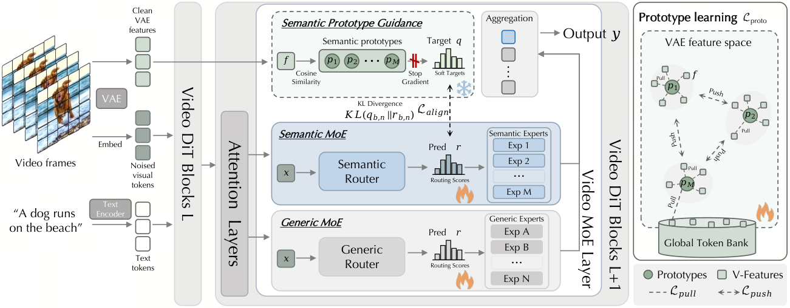](/assets/img/blog/moe-visual-generation/splitmoe-semantic-generic.png)

*图 7：训练时由干净 VAE 特征与原型构造语义路由目标；带噪 token 的语义 router 学习这些目标，通用分支负责其余表示需求。*

训练中，干净视频的 VAE 特征与可学习原型计算相似度，形成语义专家的软目标，带噪状态的 router 用对齐损失学习这个分布。原型的 pull 项让它们覆盖当前与近期 VAE 特征，push 项避免不同原型挤在一起。干净特征承担训练监督，生成时路由仍来自当前带噪 hidden state。

两组的负载规则也不同：generic experts 使用 loss-free bias 均衡，semantic experts 不施加同样的均匀负载约束，而通过语义对齐组织选择。论文从 Wan2.2 的 low-noise checkpoint 改造部分 FFN，观察到两组专家的贡献随去噪阶段变化；这属于训练后形成的行为，不是按 timestep 硬切换两个池。

### 3.2 PixelMoE：普通 Token-Choice 也能形成分工

[PixelMoE][pixelmoe]在像素空间采用另一种选择：保留早期 dense blocks，后续 FFN 使用细粒度 routed experts 加 shared expert，router 直接对当前 token hidden state 做 sigmoid 打分和固定 top-k。bias 用来调节选择，选中后的输出权重按原始分数归一化，不额外加入语义或 timestep 路由监督。

[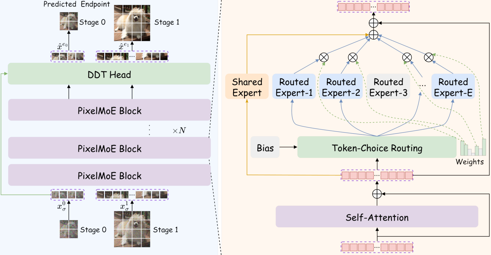](/assets/img/blog/moe-visual-generation/pixelmoe-token-choice.png)

*图 8：右侧 MoE 使用固定 top-k 与共享专家；左侧先低分辨率生成整体结构，再在全分辨率继续细化，两阶段复用主干。*

PixelMoE 同时使用分层 flow matching，让早期采样处理较少的低分辨率 token，后期再增加空间分辨率。这会改变位置总数；固定 top-k 路由则决定每个位置调用哪些专家。二者一起影响计算，但不是同一个机制。

论文在其像素空间配置中观察到类别与去噪阶段上的专家分工，标准 token-choice 也优于被测 expert-choice 配置。它与 SplitMoE 的表示空间、数据和模型改造方式不同，不能据此把两者排成通用路由排名。更具体的问题是：当前 hidden state 是否已经包含足够的语义和噪声阶段信息，以及额外的路由监督是否仍能改善同预算下的生成质量。

<a id="4-子空间选择magi-2-的-head-local-experts"></a>

## 4. 长视频的专家粒度与通信：MAGI-2

前面讨论专家的功能与选择规则，专家本身的宽度也会影响执行。长视频的一轮 forward 包含大量 token，完整 hidden state 向多个专家重复分发，会放大通信量。MAGI-2 将专家放进 head-local latent space，连同通信方式一起调整。

[MAGI-2 Preview][magi2] 公开材料里，模型约 114B total，每 token 激活约 6B 参数；主体 36 层使用 Multi-Head MoE。它把 3072 hidden 先映射成 12 个 256 维 head，每个 head 有独立 router 和 256 个专家，每个 head top-6。也就是说，一个 token 会在 12 个低维子空间里各自选择专家，最后再 merge 回 hidden state，而不是只触发几个完整宽度 FFN。

[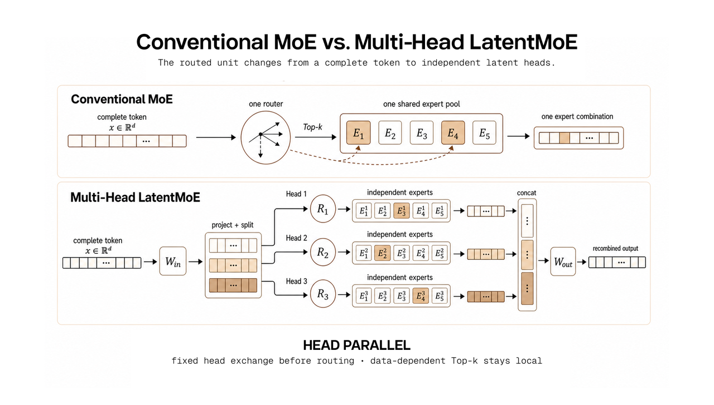](/assets/img/blog/moe-we-like-you/10-magi-2-multi-head-latentmoe.png)

*图 9：MAGI-2 将完整 hidden 拆成多个 latent heads，各 head 独立路由到 head-local experts。*

这条路来自 [Multi-Head LatentMoE and Head Parallel][latentmoe-hp] 的想法：把完整 hidden 拆成多个 latent heads，让不同子空间独立路由。通信也随之变化。普通 EP 的通信量随 top-k 增长，而且每个 batch 的 send/recv shape 由 routing 结果决定；Head Parallel 先按 head 做固定形状分发，再在 head owner 内部完成 routing 和 expert compute。跨设备通信边界更规则，动态 routing 的不规则性被留在本地。

例如，一个 token 在某个 head 中选择六个专家，这六次本地选择不再对应六次跨设备的完整 hidden 分发。跨设备先确定 head 归属，目标设备在该子空间内完成动态路由，再合并输出。专家变窄后，单次矩阵乘也变小，因而需要路由排序、连续布局和 grouped expert compute 配合；固定通信形状省下的时间，仍要扣除拆分、合并与小算子的执行开销。

<a id="6-应用案例图像视频与同步音视频"></a>

## 5. 文本条件与视觉 Token 怎样经过 MoE

### 5.1 HiDream-I1：双流阶段先分开处理，单流阶段再共享

[HiDream-I1][hidream-paper]是 17B 参数的 sparse DiT。它使用 CLIP、T5 与 Llama 的文本特征，图像则由带噪 VAE latent patchify 得到。双流 block 为文本和图像分别保留投影与 FFN，再在联合 attention 中交换信息；后续单流 block 将两类 token 拼成序列处理。

[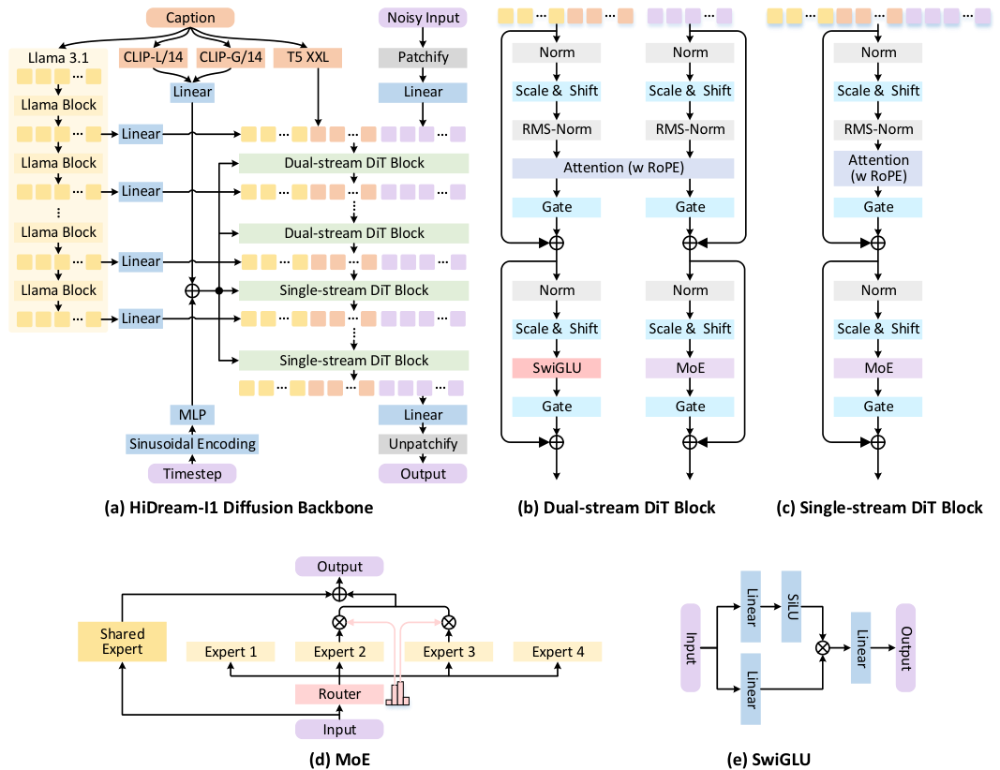](/assets/img/blog/moe-visual-generation/hidream-dual-single-stream.png)

*图 10：双流 block 中，文本使用 SwiGLU FFN，视觉使用 MoE；单流 block 在拼接序列上执行 MoE。底部展开 routed 与 shared expert 的计算。*

[官方实现][hidream-code]的双流 `HiDreamImageTransformerBlock` 中，`ff_i` 是 MoE，`ff_t` 是普通 SwiGLU。两种 token 先用各自的 Q/K/V 投影，拼接后做 attention，再回到各自的 FFN。文本可以影响视觉 hidden state，进而影响视觉路由，但文本本身在这个阶段不经过图像的 routed experts。

进入 `HiDreamImageSingleTransformerBlock` 后，文本与图像 hidden states 拼接，经过同一条 attention 和 MoE 路径；最终只取视觉位置预测图像更新量。shared expert 是对这一条 MoE 输入始终执行的 FFN，“单流共享处理”和“单个 shared expert”分别描述网络组织与专家结构。

### 5.2 HunyuanImage-3.0：一个 MoE 主干，两种预测目标

[HunyuanImage-3.0][hunyuan-report]从 Hunyuan-A13B MoE 主干扩展而来，约 80B total / 13B active，每层有 64 个 routed experts、每 token 激活 8 个，并有一个 shared MLP。它将文本 next-token prediction 与图像 diffusion prediction 放在同一个主干中。

[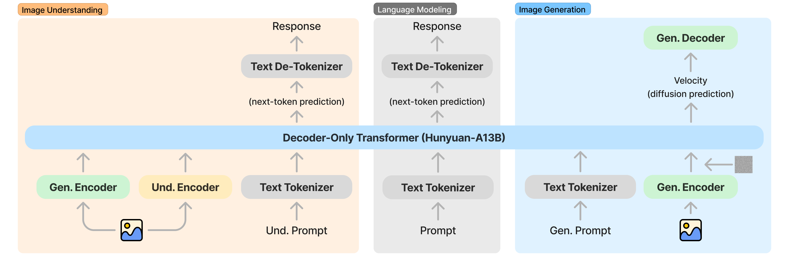](/assets/img/blog/moe-visual-generation/hunyuanimage-multimodal.png)

*图 11：文本与连续视觉表示进入统一 MoE 主干，再分别用于语言和视觉预测。*

文本使用离散 tokenizer。生成图像的带噪 VAE 特征经 timestep-modulated projector 映射到主干宽度，timestep embedding 也进入序列；条件图像则结合 VAE 与 vision encoder 的特征，让语义信息和可生成的视觉表示一起参与上下文。

两种预测目标对应不同的 attention 可见性。文本位置只能读取前面的多模态内容；同一图像段内的视觉位置可以相互读取，并读取之前的文本或条件图像。这样，模型可以先产生文本内容，再对一整段连续图像 latent 迭代去噪。整体使用自回归序列框架，不意味着图像 patch 逐个做离散 next-token prediction。

[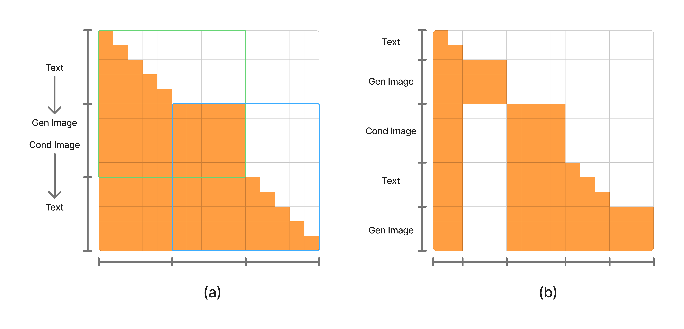](/assets/img/blog/moe-visual-generation/hunyuanimage-attention-mask.png)

*图 12：文本保持因果可见性，图像段内部使用双向可见性。多张带噪生成图像共同训练时，还会屏蔽其作为后续上下文的连接。*

报告统计了 1,000 个 prompt 的生成路由：文本与图像激活专家的分布随深度逐渐拉开。这说明该配置中出现了模态偏好；候选专家并没有因此被定义成固定的“文本一半、图像一半”。模态专门化是训练后观察到的分布，与显式按模态限制专家资格是两种设计。

### 5.3 MoT：固定模态参数仍可保留跨模态交互

另一种基线是[Mixture-of-Transformers（MoT）][mot]：根据已知模态，为 token 选择对应的 attention projection、norm 和 FFN 参数，再把得到的 Q/K/V 放回完整序列计算全局 attention。其分支选择由模态类型决定，可以进一步与 learned FFN MoE 组合。

[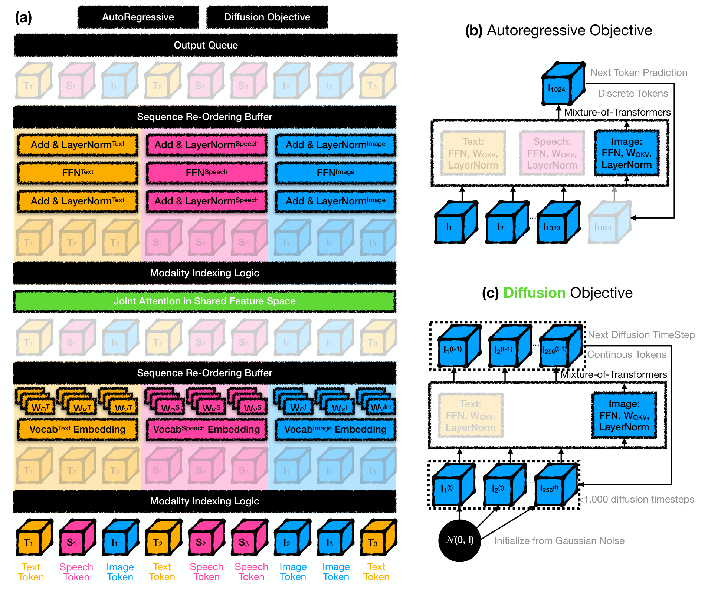](/assets/img/blog/moe-visual-generation/mot-modality-parameters.png)

*图 13：不同模态使用各自的 Transformer 参数，但 attention 仍跨模态计算。*

因此，参数分开不等于信息隔离。HiDream 的双流和单流安排、HunyuanImage 的共享 MoE，以及 MoT 的固定模态分支，分别选择了不同的共享位置。比较它们时，问题应落实到哪些变换需要专用容量、语义交互发生在哪里，以及训练目标是否争用同一组参数。

## 6. 视觉理解与生成应该共用哪些专家

### 6.1 自然形成的模态分工，不一定对应噪声阶段分工

[Beyond Language Modeling][beyond]在统一文本预测与视觉 flow matching 的预训练中，比较了专家粒度、稀疏度及 shared expert 设计。其被测配置中，每模态设置自己的 always-on shared expert，效果优于一个全局 shared expert；routed experts 则可以在共享池中学习分工。

[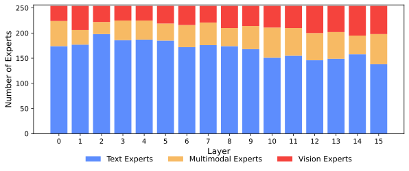](/assets/img/blog/moe-visual-generation/beyond-modality-specialization.svg)

*图 14：被测模型中，浅层以文本偏好的专家为主，深层视觉和多模态专家的比例增加。*

论文分析了一个 13.5B total、1.5B active、256 experts 的模型，观察到明显的文本/视觉专家分工；同一模型的视觉理解与生成却使用高度重叠的专家，各层选择率相关系数达到 $r\geq0.90$。视觉专家跨十个 timestep 区间的选择率变化也较小，变异系数集中在约 0.15。

[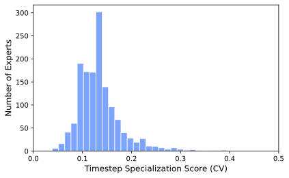](/assets/img/blog/moe-visual-generation/beyond-timestep-specialization.svg)

*图 15：跨噪声阶段的选择率变异较小。这里统计的是专家选择频率，不表示逐 token 的专家 ID 完全不变。*

这个结果与显式阶段专家、PixelMoE 中的阶段偏好形成对照：模态分工、理解/生成分工和噪声阶段分工，需要各自分析，不能由其中一种直接推出另外两种。

### 6.2 Symbiotic-MoE：为冲突目标分组，再保留共享桥梁

若从已经训练好的 VLM 出发，加入图像生成目标，还会遇到已有理解能力被新梯度干扰的问题。[Symbiotic-MoE][symbiotic]先用文本与视觉理解数据统计原有专家的激活频率，再将每层 128 个专家中的 96 个用于理解，32 个用于生成。文本和 ViT 特征进入理解组，VAE 生成特征进入生成组，各组使用独立 router，并保留处理所有 token 的 shared expert。

[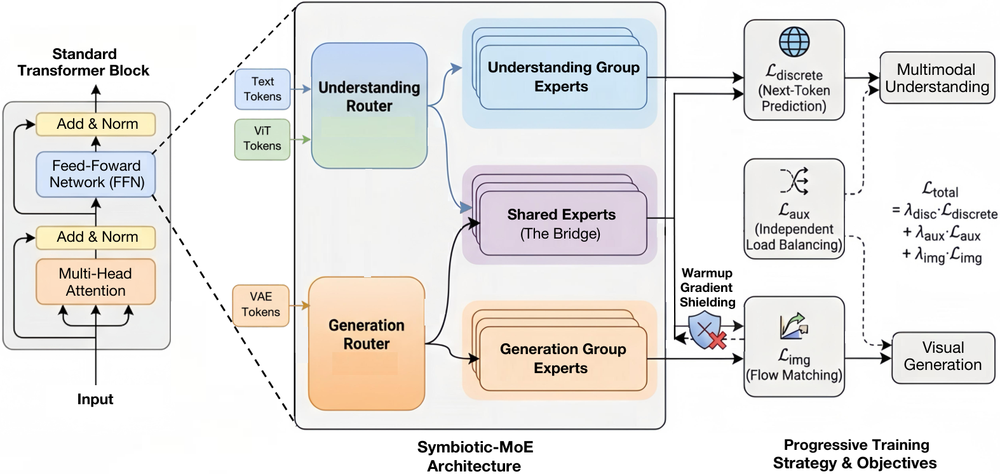](/assets/img/blog/moe-visual-generation/symbiotic-understanding-generation.png)

*图 16：专用专家分担理解与生成的不同需求，共享专家接受两类数据的训练，保留共用的语义变换。*

它还采用渐进训练、差异化学习率和早期梯度屏蔽，先保护预训练路径，再逐步引入生成学习。

两项工作的训练起点与组织方式不同。前者说明共享池可以自然学到兼容理解和生成的视觉专家，后者针对给已有 VLM 添加生成能力时的冲突，显式限制更新和专家资格。是否分组，应由共同训练或扩展训练中的干扰证据决定。

<a id="5-控制接口约束下的专家候选与混合权重"></a>

## 7. 控制条件怎样限制专家候选

前面的模态与任务约束，还可以用于视频世界模型的控制接口。相机轨迹、机器人动作与稠密动作图有不同的输入形式，模型需要共享视觉动力学，同时接收各自的控制信号。

[Worldscape-MoE][worldscape]基于 Wan2.2 的 5B video world model，把 camera trajectory、dual-arm robot action、dense action map、LIBERO single-arm action 放进一个统一 world-dynamics backbone。MoE 结构是 shared expert 加 modality-specific experts：每个样本只允许 shared expert 和由 control mask 选中的对应专家参与，router logits 从 sequence-mean pooled hidden states 计算。

[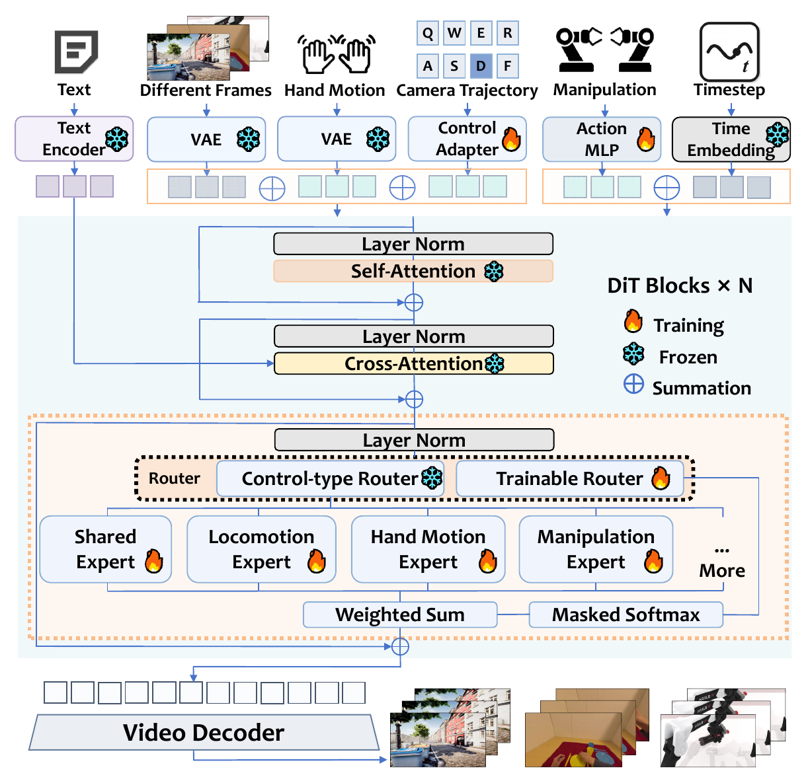](/assets/img/blog/moe-we-like-you/10-worldscape-moe-architecture.png)

*图 17：Worldscape-MoE 用 shared expert 和 control-specific experts 吸收多种控制接口。*

在这里，已知的 control mask 先限制候选分支，router 再决定混合权重。它与完全开放的 patch-token top-k 不同，也与按 timestep 切换整套模型不同。专家分工的接口含义来自控制信号约束。

这里的 modality-specific 指控制类型，选择粒度是整个样本；文本/视觉 token 路由则可以逐位置变化。新增接口时，可以增加 control-specific expert，训练新分支并复用已有的 shared dynamics。

<a id="7-专家选择粒度对应的质量与性能指标"></a>

图像和视频 MoE 的设计由此包含几种独立选择：按噪声阶段增加模型容量，按视觉位置分配专家与调用数，用语义或任务约束组织分工，再选择文本、视觉和控制路径之间共享哪些参数。选出的专家最终还要落到矩阵计算与数据传输上；完整采样时间包含这些开销，也包含 attention、VAE、CFG 和可能的 refiner。较小的 active 参数量能否转成更快的生成，取决于被减少的工作是否位于实际耗时的环节。

## 系列导航

上一篇：[第九篇：DeepEP v1/v2、MoonEP 与 EP 通信优化]()

<a id="延伸阅读"></a>

## 参考资料

- [eDiff-I: Text-to-Image Diffusion Models with an Ensemble of Expert Denoisers][ediffi]
- [ERNIE-ViLG 2.0: Improving Text-to-Image Diffusion Model with Knowledge-Enhanced Mixture-of-Denoising-Experts][ernie-vilg]
- [Wan2.2 GitHub Repository][wan22]
- [Scaling Diffusion Transformers to 16 Billion Parameters][dit-moe]
- [HiDream-I1: A High-Efficient Image Generative Foundation Model with Sparse Diffusion Transformer][hidream-paper]；[分支实现][hidream-code]
- [HunyuanImage 3.0 Technical Report][hunyuan-report]；[代码][hunyuan-image]
- [Scaling Mixture-of-Experts Video Pretraining for Embodied Intelligence][lingbot-video-paper]
- [MOVA: Towards Scalable and Synchronized Video-Audio Generation][mova-paper]
- [MAGI-2 Preview: Scaling Video Generation Models Efficiently][magi2]
- [Multi-Head LatentMoE and Head Parallel][latentmoe-hp]
- [Worldscape-MoE: A Unified Mixture-of-Experts World Model for Scalable Heterogeneous Action Control][worldscape-paper]
- [EC-DiT: Scaling Diffusion Transformers with Adaptive Expert-Choice Routing][ecdit]
- [DiffMoE: Dynamic Token Selection for Scalable Diffusion Transformers][diffmoe]
- [Breaking the Uniformity Trap: Scaling Video Diffusion Model via SplitMoE][splitmoe]
- [PixelMoE: Scaling Pixel-Space Diffusion with LLM-Style Mixture-of-Experts][pixelmoe]
- [Mixture-of-Transformers: A Sparse and Scalable Architecture for Multi-Modal Foundation Models][mot]
- [Beyond Language Modeling: An Exploration of Multimodal Pretraining][beyond]
- [Symbiotic-MoE: Unlocking the Synergy between Generation and Understanding][symbiotic]

[ediffi]: https://arxiv.org/abs/2211.01324
[ernie-vilg]: https://arxiv.org/abs/2210.15257
[wan22]: https://github.com/Wan-Video/Wan2.2
[dit-moe]: https://arxiv.org/abs/2407.11633
[hidream]: https://github.com/HiDream-ai/HiDream-I1
[hidream-paper]: https://arxiv.org/abs/2505.22705
[hunyuan-image]: https://github.com/Tencent-Hunyuan/HunyuanImage-3.0
[lingbot-video]: https://github.com/Robbyant/lingbot-video
[lingbot-video-paper]: https://arxiv.org/abs/2607.07675
[mova]: https://github.com/OpenMOSS/MOVA
[mova-paper]: https://arxiv.org/abs/2602.08794
[magi2]: https://sand.ai/blog/magi-2-preview
[magi2-github]: https://github.com/SandAI-org/MAGI-2-preview
[latentmoe-hp]: https://arxiv.org/abs/2602.04870
[worldscape]: https://github.com/EmbodiedCity/Worldscape-MoE.code
[worldscape-paper]: https://arxiv.org/abs/2607.03964
[worldscape-arch]: https://github.com/EmbodiedCity/Worldscape-MoE.code/blob/main/docs/ARCHITECTURE.md
[lingbot-architecture]: https://arxiv.org/html/2607.07675v1#S2.F2

[ecdit]: https://arxiv.org/html/2410.02098v2
[diffmoe]: https://arxiv.org/html/2503.14487v1
[splitmoe]: https://arxiv.org/html/2609.38140v1
[pixelmoe]: https://arxiv.org/html/2610.18857v3
[hidream-code]: https://github.com/HiDream-ai/HiDream-I1/blob/5f92bab45f1dfb1e794ee357286a5b837eaf4400/hi_diffusers/models/transformers/transformer_hidream_image.py#L101
[hunyuan-report]: https://arxiv.org/html/2509.23951v2
[mot]: https://arxiv.org/html/2411.04996v2
[beyond]: https://arxiv.org/html/2603.03276v1
[symbiotic]: https://arxiv.org/html/2604.07753v2
