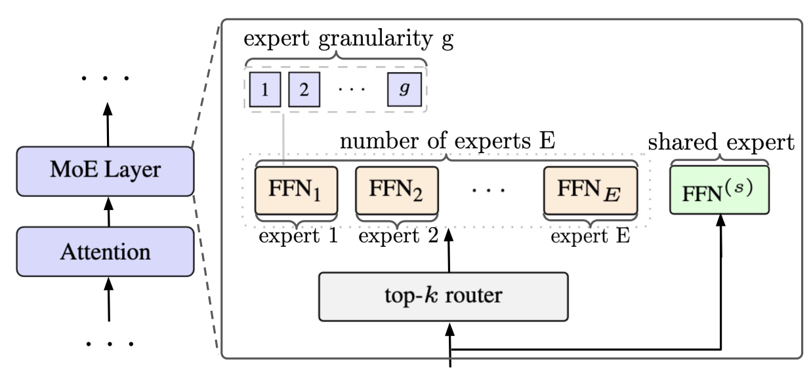
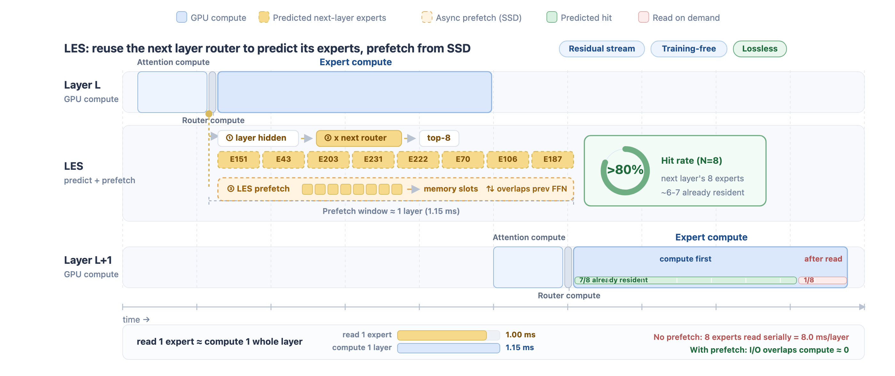
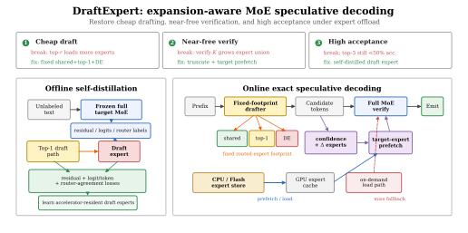
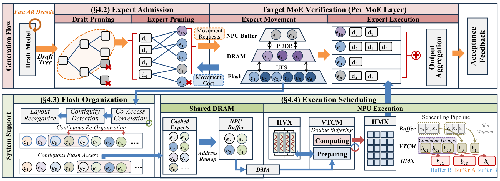
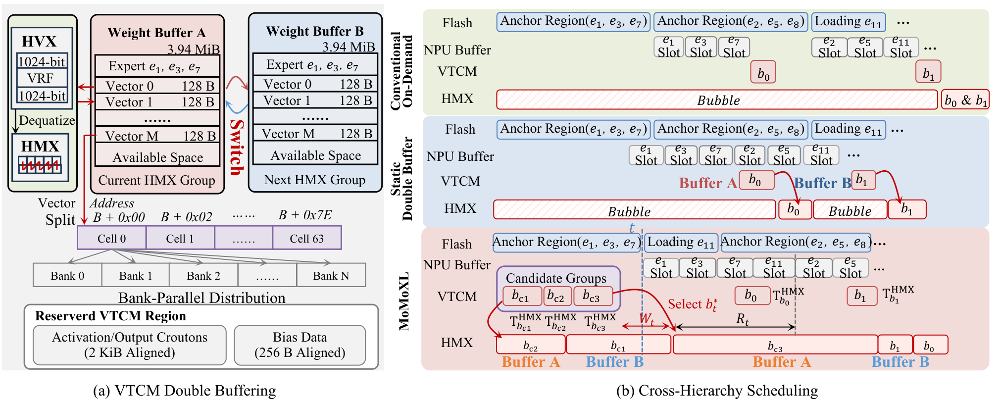

<a id="0-端侧-moe-的读取执行与加载等待"></a>

## 0. 端侧 MoE 为什么没有按 Active 参数量加速

MoE 每步只激活一部分参数，却不一定比 active compute 相近的 Dense 模型更快。Dense FFN 使用固定的连续权重；MoE 要先路由，再读取选中的多组权重，执行若干较小的矩阵乘，最后合并结果。计算量相近时，后面这些准备和调度足以拉开延迟。若完整专家池放不进内存，还会多出冷专家加载。

这里以同一设备、相同权重精度、每步激活计算量相近的 Dense 作为执行对照。MoE 的完整权重通常更多，容量需求和模型质量要另列。按 total 参数量对齐，讨论的是相同权重规模下能节省多少计算，回答不了相近 active compute 为什么仍有速度差距。

```text
Dense FFN：固定权重 → 矩阵乘 → 输出
MoE FFN： router / top-k → 准备所选专家权重 → 多个 expert FFN → 加权合并
                              ↑
                  读取常驻权重，或先加载缺失专家
```

本文以手机上的单请求交互式 decode 为主，沿这条执行链讨论加速：权重能常驻时怎样减少读取和小算子开销；放不下时怎样预取并隐藏加载；再用投机解码提高一次权重准备所能服务的有效输出，最后将验证请求与多级搬运接成流水。

<a id="1-端侧与服务器-gpu-的内存和执行差异"></a>

### Dense 对照中多出的成本

| 执行环节 | Dense FFN | MoE FFN | 单请求端侧的影响 |
|---|---|---|---|
| 选择权重 | 每层使用固定矩阵 | router 打分、top-k 与分派决定本步专家 | 增加路由与元数据处理，后续访问依赖当前 hidden state |
| 读取与计算 | 较大的连续矩阵 | 多个专家各处理很少的输入行 | 访问更分散，矩阵更小，算子调用、量化解包与合并更难摊薄 |
| 完整权重容量 | 保存本层全部 FFN 权重 | 保存全部专家，每步只用其中一部分 | active 很小仍可能放不下完整模型，触发闪存加载 |
| 后端执行 | 固定形状的矩阵算子 | 需支持动态专家索引、布局和输出回填 | CPU/GPU/NPU 的算子与内存接口决定准备开销 |

Dense 的 batch=1 decode 也常受权重带宽限制。相对同总参的 Dense，MoE 可以通过较少的 active 权重降低流量；与相近 active compute 的 Dense 比较时，专家切分、调用和加载的额外成本就更显眼。

服务器 GPU 上，多请求 batching 可以让一个专家处理更多输入行，常驻 HBM 也省去了冷加载。手机的共享 DRAM、较小可用内存和持续功耗预算，让扩大 batch 或增加设备更难成为解法。prefill 已有多个输入位置可以聚合；交互式 decode 则要等前一个输出，才能确定下一个输入。

<a id="2-单-token-执行优化量化算子融合与专家预取"></a>

## 1. 权重常驻：量化、布局与融合算子

<a id="21-常驻权重的容量与读取量"></a>

### 1.1 常驻权重的容量与读取量

先考虑完整权重常驻的方案。一个 5B total、0.8B active 的 MoE，纯 INT4 权重约为 2.5GB，这是权重容量；每步需要从中读取多少，则由实际激活路径决定。

若每份 active 权重在一次 decode 中读取一次，且没有跨 token 的缓存复用，忽略量化元数据后，INT4 权重的读取量为：

$$
B_{\mathrm{weight}}=N_{\mathrm{active}}\times\frac{4}{8}\ \text{bytes}.
$$

用假设的有效带宽 60GB/s 估算：

| active 参数量 | 纯 INT4 权重字节量 | 读取时间 |
|---:|---:|---:|
| 0.3B | 150MB | 2.5ms |
| 0.8B | 400MB | 6.7ms |
| 1.0B | 500MB | 8.3ms |

这是一组教学估算，MB、GB 均使用十进制单位。它只计算权重流量；完整 decode 还要执行 attention、读取 KV、处理量化数据并调度算子。缓存命中可以减少 DRAM 读取，实际带宽也随访问方式变化，因此表中数值不能直接当作 token 延迟。

不过，这个估算解释了一个具体收益：在相同权重精度下，减少每步访问的专家参数，可以减少需要从 DRAM 读取的字节数。收益能保留多少，取决于后面的专家计算是否引入了过多小算子与调度开销。

<a id="22-小矩阵与算子开销mobilemoe"></a>

### 1.2 小矩阵与算子开销：MobileMoE

在单请求 decode 中，一个 expert 的 projection 可能只有 `[1, H] @ [H, I]` 这样的形状。如果 top-k、token 分派、各专家 projection 和输出合并分别调用，就要为这些小操作重复付出调度成本。MobileMoE 将它们集中到融合算子中执行。

[MobileMoE][mobilemoe] 的 0.3B–0.9B active、1.3B–5.3B total 配置，面向完整量化权重能够放入手机内存的部署。其 INT4 QAT 版本的 S/M/L 权重占用分别为 0.68、1.48、2.75GB。

[](/assets/img/blog/moe-we-like-you/06-mobilemoe-expert-architecture.png)

*图 1：MobileMoE 的专家结构，展示 top-k 路由、细粒度专家切分和 shared expert。*

论文的 ExecuTorch CPU 实现先按 expert id 重排 token，使同一专家的输入连续存放；再把 top-k、dispatch、gate/up projection、SwiGLU、down projection 和加权回填放进一个 MoE 算子。这样既能按专家组织矩阵乘，也减少算子之间的调用开销。小 active 参数量与这条执行路径共同构成其端侧收益。

论文在 Galaxy S25 的 4 CPU 线程、iPhone 16 Pro 的 2 CPU 线程上，以 batch=1、INT4 权重和动态 INT8 激活测试。MobileMoE-S 相对 MobileLLM-Pro 报告约 2.2–3.4× decode 加速；两者权重占用分别为 0.68GB 和 0.55GB，QAT 后 14 项平均分为 44.0 和 45.5。这组比较对应较接近的权重容量与质量，不能解释为同一模型只替换了 kernel 后的加速。

<a id="23-冷专家加载与预取les"></a>

## 2. 专家卸载：预取、连续读取与就绪调度

模型扩大到几十 B total 后，完整权重可能超过应用可用内存。卸载部署将冷专家留在闪存，在内存中为专家保留有限的缓存：命中时复用已有权重，miss 时加载，并在空间不足时换出其它专家。缓存决定哪些历史权重继续保留，预取则尝试在真实路由确定之前准备未来权重。两者都受同一份内存预算约束，预测过多也会挤占有用的缓存。

[MiniCPM-V 4.7][minicpm-v47] 的 35B-A3B 版本通过存储卸载保留完整专家池；[Lookahead Expert Scheduling（LES）][les] 用跨层路由预测提前加载下一层可能需要的专家。

[](/assets/img/blog/moe-we-like-you/06-les-lookahead-expert-scheduling.png)

*图 2：LES 在当前层计算期间预测并预取下一层专家，下一层优先计算已就绪的真实路由专家，同时补载其余权重。图中 top-8、命中率与时长对应官方示例。*

以一层 top-2 路由为例。下面的编号只用于解释流程：

```text
预测下一层会用 {E2, E5} → 提前发起加载
下一层真实路由选 {E2, E7}
  E2 已就绪 → 先计算 E2
  E7 未就绪 → 加载 E7，尝试与 E2 的计算重叠
  E5 未被选中 → 不参与本次输出
E2、E7 都完成后 → 按真实路由权重合并
```

预测错误有两种成本：多读了不需要的 E5，或者没有及时准备好必需的 E7。LES 仍会补载 E7，所以预测命中率影响等待时间，计算所用的专家集合则由真实 router 决定。

重叠能隐藏多少时间，还取决于已有多少可执行工作。用一个独立加载与计算可以并行的简化例子：E7 的剩余加载需要 5ms，E2 的计算需要 3ms，那么 E2 结束后还需等约 2ms。若 E2 只需要 0.5ms，等待就有约 4.5ms。预取不仅要尽量命中，还要足够早；已经就绪的计算也必须能覆盖一部分加载。

官方文档还将连续权重布局、减少读取调用、直接写入 GPU 可见内存、逐层混合精度量化和 DSpark 投机采样接入同一流程。在 iPhone 18 Pro Max（设备总内存 12GB）上的逐阶段结果是：

| 累积启用的优化 | decode token/s |
|---|---:|
| 从存储按需加载专家的基线 | 3.38 |
| lookahead expert scheduling | 6.57 |
| 再加调度与加载优化 | 11.34 |
| 再加逐层混合精度量化 | 17.16 |
| 再加 DSpark 投机采样 | 20.51 |

速度按生成 token 数除以总 decode 时间计算。单独 lookahead 阶段约为基线的 1.94×，完整流程约为 6.07×。前者主要改变等待，布局优化改变读取效率，量化减少权重字节量，DSpark 再减少每个输出 token 分摊的解码开销。这些收益不能全部归给路由预测。

表中的 DSpark 已经引入投机解码。预取缩短一次 forward 的等待，投机解码则尝试用这次权重读取和计算产生多个有效输出。接下来需要同时考虑 draft 的成本、验证窗口的大小，以及窗口扩大后新增的专家访问。

## 3. 投机解码：权重复用收益与专家并集膨胀

### 3.1 多 token 验证怎样摊薄权重成本

投机解码先用较便宜的 draft 生成候选，再由目标模型并行验证，最终提交其中可接受的输出。draft 提供了一组暂定的未来 token，使目标模型能将多个位置放进一次 forward，而不必等待每个位置都完成一次独立的 AR step。

如果其中 $m$ 个位置选择同一专家，就可以将其输入组织成 `[m, H]`，让同一份权重处理更多行。对于带宽受限、计算单元仍有余量的执行路径，这能提高权重复用。在专家卸载场景中，多个位置也有机会分摊一次专家加载，并提供更多可用于隐藏搬运的计算。

单请求下，设一轮最终提交的平均输出 token 数为 $\bar A$，标准 AR 每 token 耗时为 $T_{\mathrm{AR}}$。把 draft、verify 与额外调度/采样的时间分别记为 $T_{\mathrm{draft}}$、$T_{\mathrm{verify}}$、$T_{\mathrm{extra}}$，则加速比可估为：

$$
\mathrm{speedup}\approx
\frac{\bar A\,T_{\mathrm{AR}}}
{T_{\mathrm{draft}}+T_{\mathrm{verify}}+T_{\mathrm{extra}}}.
$$

投机长度增加，只有在有效输出的增长抵得上这些新增成本时才有收益。同样的接受长度不保证相同加速比，verify 访问的权重数量也会改变分母。

<a id="32-验证-token-数专家并集与搬运量"></a>

### 3.2 验证窗口扩大，也会增加专家权重

Dense FFN 的多个验证位置使用同一份权重，MoE 的不同位置还可能选中不同专家。一层 top-2 路由验证 4 个位置，共有 8 次 token–expert 调用：若四个位置都选 E0、E1，只涉及 2 份专家权重；若分别选择互不重叠的专家，则涉及 8 份。相同的调用次数，对应的权重准备量可以相差很大。

卸载时还要扣除已经驻留的专家：同样大小的并集，缓存命中不同，实际加载量就不同。即使完整模型常驻内存，更多独立专家也可能增加 DRAM 读取，并把输入拆成更小的矩阵任务。[番外一](#1-专家调用专家并集与权重搬运)进一步给出调用次数、专家并集、驻留集合的定义，并讨论候选树上的边际成本。

<a id="33-batch-与专家覆盖moesd"></a>

### 3.3 服务器 Batch 收益为何难以直接搬到手机

专家并集是否明显增加，还取决于 AR 原本已覆盖多少专家。[MoESD][moesd] 用 target efficiency 刻画目标验证的成本：$T_{\mathrm{target}}(B,1)/T_{\mathrm{target}}(B,m)$，即同一请求 batch 大小 $B$ 下，单位置 AR forward 耗时与每请求 $m$ 个位置的 verify forward 耗时之比。batch 大小会改变这两次 forward 之间新增的专家读取。

在均匀、跨位置独立的路由假设下，$n$ 个输入位置访问的期望专家数为：

$$
\mathbb E[|\mathcal U(n)|]
=E\left[1-\left(1-\frac{k}{E}\right)^n\right].
$$

以 $E=64,k=8$、每请求验证 4 个位置为例，可得下面的理论估算：

| 请求 batch 大小 | AR 输入位置数 | AR 期望专家数 | verify 输入位置数 | verify 期望专家数 |
|---:|---:|---:|---:|---:|
| 1 | 1 | 8.0 | 4 | 26.5 |
| 32 | 32 | 63.1 | 128 | 64.0 |

第一行中，验证需要访问的专家明显增加；第二行中，AR 本来就接近覆盖整个专家池，验证只增加很少的唯一权重。若此时每个专家的矩阵乘仍有计算余量，投机验证就能增加权重复用。这是 MoESD 讨论的中等 batch 收益区间。继续增大 batch、进入 compute-bound 后，额外计算又会限制收益。

表中均匀独立路由用于解释饱和趋势，不是实际模型测量，也不意味着 batch=32 是通用阈值。真实 token 的路由相关性、专家粒度与 kernel 形状会改变这个区间。

这个对照也解释了手机单请求的困难：它通常处于表中第一行一侧，AR 原本只访问少数专家，verify 很容易引入新的权重。端侧投机需要在较小 batch 下控制验证开销，同时尽量用已有权重增加有效输出。

<a id="41-减少低收益验证cascade-与-s-moe"></a>

### 3.4 降低 Draft 成本，按收益选择验证长度

若 drafter 自身也反复加载大量专家，目标验证省下的时间会被 draft 吃掉。[DraftExpert][draftexpert]训练常驻的小型 draft expert，配合 shared、top-1 路径控制草稿阶段的权重占用；通过 router-agreement 蒸馏预测 target 专家，并在草稿生成时预取预计需要的权重。完整 target 随后负责验证。

[](/assets/img/blog/moe-routing-granularity/draftexpert-architecture.svg)

*图 3：DraftExpert 将小型草稿路径常驻内存，在生成候选时预测专家需求，为完整 target 验证提前准备权重。*

它还结合置信度和新增专家需求截断多 token draft：后续候选接受机会低、却会触发更多冷专家时，提前结束扩展。

运行时收益仍会随任务和设备变化。[Cascade][cascade]根据每轮有效输出与相对 AR 的迭代耗时选择投机长度：短暂测试若干长度，再沿用收益较好的配置；utility 低于 1 时回退到 AR，并用 back-off 降低反复试错的成本。它保留目标模型的自然路由，主要避免在低收益阶段继续支付 drafting 和验证开销。

<a id="4-moe-投机解码的优化方法"></a>
<a id="42-减少候选引入的新专家ecospec"></a>
<a id="43-限制验证专家集合moe-specacceptmoe"></a>
<a id="44-训练时增加跨-token-专家复用coactivation"></a>
<a id="5-各类优化的作用与计算语义"></a>

### 3.5 专家集合优化作用于验证的哪个环节

验证开销还可以通过候选选择、专家预算或训练时的路由约束降低。它们对端侧执行的作用如下，具体的集合构造和路由规则见[番外一的投机树与局部路由讨论](#5-ar-moe-的投机树验证专家并集与提交路径)。

| 方法 | 减少哪部分成本 | 对目标计算的影响 |
|---|---|---|
| [EcoSpec][ecospec] | 用专家预测选择更能复用已有专家的候选路径，减少 verify 新增的权重需求 | 保留目标路由与验证规则 |
| [MoE-Spec][moe-spec]、[AcceptMoE][acceptmoe] | 限制验证器可用的专家，后者还考虑提交概率与驻留状态 | 截断或替代专家会改变目标计算，需要评估质量代价 |
| [Expert Coactivation][coactivation] | 通过训练和相邻位置的选择规则提高专家重叠，减少窗口内的唯一权重 | 需要配套训练，改变模型路由行为 |
| [S²-MoE][s2-moe] | 联合估计候选收益与新增专家成本，并用路由 bias 增加复用 | 完整配置改变 target 路由；self-draft 与上下文对齐留待投机解码专题展开 |

候选和路由规则决定了一轮验证的权重需求。剩余权重什么时候到达、能否及时供给计算单元，还需要执行系统处理。

<a id="45-将验证请求排成搬运流水bigmomo"></a>

## 4. 完整执行链：BigMoMo 的多级搬运与计算流水

对于使用闪存卸载的端侧 MoE，减少验证请求后，剩余专家仍可能到达得太晚。搬运调度需要把它们尽早变成可执行工作，并与当前计算重叠。

[BigMoMo][bigmomo] 用投机解码将多个候选放到同一轮目标验证中，因而同时暴露一批专家请求。各专家权重到达计算单元的时间不同，系统将请求筛选、闪存布局与 NPU 执行调度接成一条流水。

[](/assets/img/blog/moe-we-like-you/06-bigmomo-system-overview.png)

*图 4：BigMoMo 系统总览。上半部分从 draft 节点与专家筛选推进到目标验证，下半部分对应闪存布局和 NPU 执行调度。*

它面向 Snapdragon 的 Hexagon NPU，将权重准备过程细分为：

```text
Flash → DRAM → NPU 可访问的映射缓冲区 → VTCM → HMX 矩阵计算
```

VTCM 是 NPU 的本地存储，HMX 是其矩阵计算单元。一个 expert 已经在 DRAM 里，仍可能在等待映射或搬入 VTCM。若每层都等全部专家就绪再启动计算，较早到达的权重也只能闲置。

BigMoMo 先减少进入流水的请求：根据接受收益筛掉低价值 draft 节点，再结合 routing impact 与各存储层级的搬运成本裁剪部分专家激活。专家被裁掉后，其路由权重会分给保留的专家；这一步近似了目标模型计算，质量需要随裁剪预算一起评估。

剩下的请求还要解决两个问题。其一是闪存上的碎片读取：经常一起加载的专家若分散在文件中，就需要多次读取。系统根据近期共同加载记录调整专家布局，尽量将这类请求转成连续读取。其二是到达时间不同：调度器将已就绪专家组成计算组，在 VTCM 容量允许的范围内，让当前计算覆盖下一组权重的准备；两个 VTCM 权重缓冲区交替加载与计算。

[](/assets/img/blog/moe-we-like-you/06-bigmomo-movement-pipeline.png)

*图 5：左侧是 VTCM 双缓冲，右侧比较按需执行、固定双缓冲与跨层级调度。粉色区域中的候选计算组用于覆盖后续权重准备，减少 HMX 空闲区间。*

即使两轮验证拥有同样大小的专家工作集，命中 DRAM 的比例、闪存布局和 NPU 准备状态不同，也会产生不同延迟。

论文基于 llama.cpp 的 Hexagon 后端，以四种 Q4_0 MoE、五类任务评估，报告相对按需卸载 AR 基线平均 4.83× 加速。这个基线本身需要从闪存加载专家，与 MobileMoE 的内存常驻 CPU 测试、LES 的 Apple 设备测试分别对应不同的执行路径。

常驻模型的重点是减少读取和小算子开销，卸载模型还要让专家尽早就绪。投机解码增加一次 forward 的输出机会，也扩大了权重需求；BigMoMo 将这批需求落实到闪存读取、NPU 准备和计算调度。active compute 只描述其中的计算量；读取、加载和调度缩短之后，这部分节省才能体现在最终的 token 延迟上。

## 系列导航

上一篇：[第五篇：100B 训练配置、并行策略与显存推演]()

下一篇：[第七篇：RL 训推不一致与路由对齐问题]()

## 参考资料

- [DraftExpert][draftexpert]
- [MobileMoE: Scaling On-Device Mixture of Experts][mobilemoe]
- [MiniCPM-V 4.7][minicpm-v47]；[LES][les]
- [BigMoMo: Efficient Inference of Large-Scale MoE with Speculative Decoding on Mobile Devices][bigmomo]
- [MoESD: Unveil Speculative Decoding’s Potential for Accelerating Sparse MoE][moesd]
- [Utility-Driven Speculative Decoding for Mixture-of-Experts（Cascade）][cascade]
- [Less Experts, Faster Decoding: Cost-Aware Speculative Decoding for Mixture-of-Experts（EcoSpec）][ecospec]
- [MoE-Spec: Expert Budgeting for Efficient Speculative Decoding][moe-spec]
- [AcceptMoE: Commitment-Weighted Self-Sizing Verifier Expert Sets for Efficient MoE Speculative Decoding][acceptmoe]
- [Efficient Mixture-of-Experts with Speculative Decoding via Expert Coactivation][coactivation]
- [S²-MoE: Enabling Efficient Self-Speculative Decoding for Mixture-of-Experts on Edge Devices][s2-moe]；[官方代码][s2-moe-code]

[mobilemoe]: https://arxiv.org/abs/2605.27358
[s2-moe]: https://arxiv.org/abs/2608.15018
[s2-moe-code]: https://github.com/angerybob/S2-MoE/tree/orin
[minicpm-v47]: https://github.com/OpenBMB/MiniCPM-V/blob/main/docs/minicpm_v4dot7_en.md
[les]: https://github.com/OpenBMB/llama.cpp-omni/blob/main/docs/les/lookahead-expert-scheduling.md
[bigmomo]: https://arxiv.org/abs/2609.14643

[mobilemoe-figure]: https://arxiv.org/html/2605.27358v1#S3.F2
[les-figure]: https://github.com/OpenBMB/llama.cpp-omni/blob/main/docs/les/lookahead-expert-scheduling.png
[bigmomo-overview-figure]: https://arxiv.org/html/2609.14643v1#S3.F6
[bigmomo-pipeline-figure]: https://arxiv.org/html/2609.14643v1#S4.F11

[moesd]: https://arxiv.org/abs/2505.19645
[cascade]: https://arxiv.org/abs/2506.20675
[ecospec]: https://arxiv.org/abs/2607.12696
[moe-spec]: https://arxiv.org/abs/2602.16052
[acceptmoe]: https://arxiv.org/abs/2608.02989
[coactivation]: https://arxiv.org/abs/2609.22471
[ecospec-figure]: https://arxiv.org/html/2607.12696v1#S1.F2
[moe-spec-figure]: https://arxiv.org/html/2602.16052v1#S1.F1

[draftexpert]: https://arxiv.org/abs/2607.24434
