主流 MoE 通常采用 token-level routing：在每个 MoE 层，router 根据当前 token 的 hidden state 选择 top-k 个专家，再加权合并专家输出。标准自回归（AR）解码每步新增一个 token，逐位置选择与这个执行方式相符，也保留了不同位置使用不同专家的自由。

但有些成本由一组 token 共同决定。端侧缓存需要覆盖连续几步的专家访问，投机验证和 block diffusion 的一次前向会处理多个位置；即使每个位置都很稀疏，它们合起来仍可能访问大部分专家。按句子或任务分配专家时，还会涉及语义相关位置的分工。

chunk-level、block-level 和 sentence-level 设计为这些共同需求增加了约束：限制一组位置可访问的专家，控制相邻位置引入的新专家，或根据输入语义分配专家组。

[第六篇]()从端侧执行出发，讨论权重读取、卸载、投机解码与搬运流水。这里进一步比较这些场景中一组位置怎样共享或竞争专家，以及路由约束会怎样改变计算与生成依赖。

## 0. 哪些场景需要关心一组 Token 的路由

| 场景 | 共同考虑的位置 | 主要问题 | 目的与预期收益 |
|---|---|---|---|
| AR 端侧与专家卸载 | 连续生成的局部窗口 | 相邻几步是否反复加载冷专家，哪些权重值得驻留 | 减少权重搬运和加载等待，加速 decode |
| AR prefill | 同时处理的连续输入片段 | 专家选择分散后，每份权重服务的输入行是否过少 | 提高权重复用和矩阵乘效率，加速多位置前向 |
| AR 投机验证 | 同一轮 verify 的候选链或树 | 全部候选触及多少专家，付出的成本能换来多少提交 token | 降低每个最终提交 token 的验证成本，提高投机加速收益 |
| Block diffusion | 当前生成块及其多轮去噪 | 块内专家并集是否过大，哪些结构或计算可跨迭代复用 | 减少每轮专家访问和跨轮重复计算，加速块内生成 |
| 语义分组 | 输入句子或任务中相关的位置 | 是否共享专家组，或按语义组织生成位置 | 促进专家的语义专门化与泛化，或按语义组织并行生成 |

其中，**block diffusion 的 block 是原生生成单元**，块内位置经过多轮并行去噪或编辑；**AR 的 verification block 是候选验证单元**，target 仍建模从左到右的条件概率。这两类执行都提供一组可并行处理的位置，但组内依赖和复用时间不同。

## 1. 专家调用、专家并集与权重搬运

一个 MoE 层有 256 个 routed experts，每个 token 选择 8 个。如果一次前向同时处理 32 个位置，这一层需要访问多少个专家？

这取决于 32 组选择的重叠程度。完全相同时只需访问 8 个，完全不重叠时可以覆盖全部 256 个。两种情况下，逻辑上的 token–expert 调用次数都是 256，独立专家权重的数量却可以相差 32 倍。每位置的 top-k 相同，整组位置的权重需求仍然不同。

固定一个 MoE 层和一次前向。设 routed experts 总数为 $E$，本轮处理的位置集合为 $\mathcal B$，位置 $i$ 选择的专家集合为 $S_i$。这一组位置触及的专家并集是：

$$
U(\mathcal B)=\bigcup_{i\in\mathcal B}S_i.
$$

若每个位置都选择 $k$ 个专家，逻辑调用次数与独立专家数分别满足：

$$
N_{\mathrm{calls}}=|\mathcal B|k,
\qquad
k\le |U(\mathcal B)|\le\min(E,|\mathcal B|k).
$$

下面的四位置、top-2 示例中，每个专家大小相同，编号只用于演示。

| 位置 | 高复用路由 | 分散路由 |
|---|---|---|
| 1 | $\lbrace 0,1\rbrace$ | $\lbrace 0,1\rbrace$ |
| 2 | $\lbrace 0,1\rbrace$ | $\lbrace 2,3\rbrace$ |
| 3 | $\lbrace 0,1\rbrace$ | $\lbrace 4,5\rbrace$ |
| 4 | $\lbrace 0,1\rbrace$ | $\lbrace 6,7\rbrace$ |
| token–expert 调用次数 | 8 | 8 |
| 独立专家数 | 2 | 8 |

高复用时，两个专家各处理四行输入；分散时，八个专家各处理一行。前者可以让同一份权重服务更多输入行，也更容易形成较大的矩阵乘。后者需要准备更多份权重，专家任务则更碎。

若目标存储层级已驻留的专家集合为 $R$，并假设本轮每个缺失专家只加载一次，新增权重搬运量约为：

$$
B_{\mathrm{load}}\approx\sum_{e\in U(\mathcal B)\setminus R}W_e,
$$

其中 $W_e$ 是专家 $e$ 的权重字节量。CPU→GPU、Flash→DRAM、DRAM→NPU 本地存储分别有自己的 $R$。专家并集相同，两次执行也可能因驻留状态不同而产生不同加载量；计算过程中逐出、重复读取和 kernel 分块还会继续影响实际流量。

跨 AR decode 步骤统计时，窗口并集描述的是这段时间访问过哪些专家。总搬运量还需逐步计算：每一步的驻留集合都可能变化，同一专家被逐出后再次使用，就会重复加载，不能直接套用单次前向的加载量。

[Cache-Aware Joint Router Adaptation][cache-aware]从驻留决策入手，联合适配模型与辅助缓存 router，学习跨 token 保留哪些专家，并可利用因果信息提前加载权重。辅助 router 不覆盖模型实际的 top-k 选择；联合训练仍会改变模型参数。缓存决策用于减少后续访问的 miss 与加载量，模型仍按自身路由分数选择专家。

[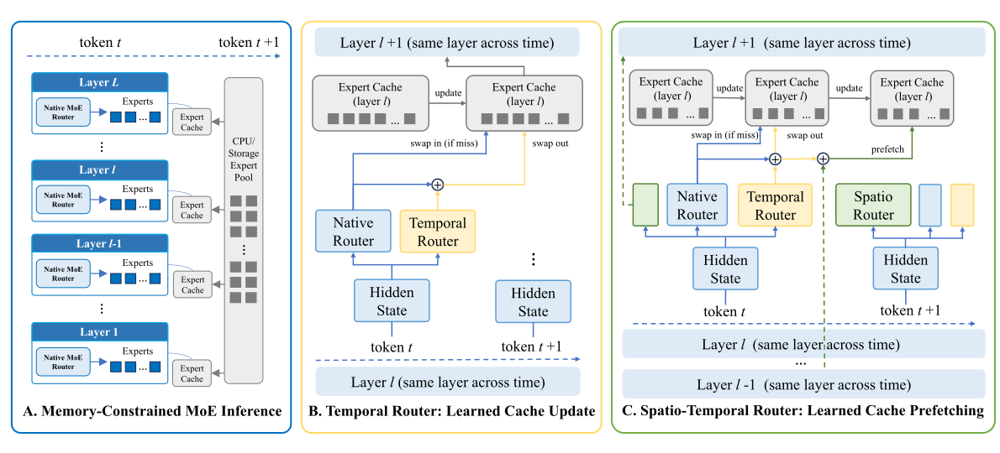](/assets/img/blog/moe-routing-granularity/cache-aware-router.svg)

*图 1：左侧是容量受限的 GPU 专家缓存；中间学习访问后的专家保留，右侧在访问前加入因果预取。实际 MoE 选择仍由 Native Router 完成。*

## 2. Block Diffusion 的块内选池：共享候选范围

LLaDA2.2、DES 和 dMoE 都面向 block diffusion MoE。一次去噪前向已经给出了当前块各位置的 hidden states，因此可以在这一层汇总整块路由分数，再限制各位置的候选范围。

最直接的设计是为整组位置选择候选专家池 $\mathcal C(\mathcal B)$，然后让各位置在池内选自己的专家：

$$
S_i=\operatorname{TopK}_{e\in\mathcal C(\mathcal B)}q_{i,e},
\qquad
|U(\mathcal B)|\le |\mathcal C(\mathcal B)|.
$$

$q_{i,e}$ 是用于选择的路由分数。若候选池大小为 $C\ge k$，本轮专家并集就有上界 $C$。例如候选池为 $\lbrace 0,1,2\rbrace$、每位置 top-2 时，不同位置仍可分别选择 $\lbrace 0,1\rbrace$、$\lbrace 0,2\rbrace$ 和 $\lbrace 1,2\rbrace$，混合权重也各不相同。

这里的块级设计发生在路由：一组位置共享候选范围，进入池内的普通 FFN expert 仍逐位置计算 $f_e(h_i)$，内部没有增加跨 token 的序列计算。

### 2.1 LLaDA2.2：Max 聚合与固定容量

[LLaDA2.2 报告第 2.2 节][llada-report]及其[公开实现][llada-code]给出了一个明确配置：flash 模型有 256 个 routed experts，路由 block 大小为 32，候选池容量为 48，每个位置仍选择 top-8。模型另有一个 shared expert，下文的集合只统计 routed experts。[配置文件][llada-config]中的 `expert_capacity` 对应候选专家数量。

公开实现先计算 sigmoid 分数，并加上专家选择偏置：

$$
q_{i,e}=\operatorname{sigmoid}(z_{i,e})+b_e.
$$

随后对块内位置取 max，再选 top-$C$ 专家：

$$
a_e=\max_{i\in\mathcal B}q_{i,e},
\qquad
\mathcal C(\mathcal B)=\operatorname{TopC}_{e}(a_e).
$$

报告将这个 max 聚合称为 token racing。一个专家即使只被某个位置强烈需要，也有机会凭该位置的高分进入候选池。池外分数被屏蔽后，各位置再独立选择 top-8。输出混合权重取自未加选择偏置的 sigmoid 分数，经归一化和 scaling 后使用。

[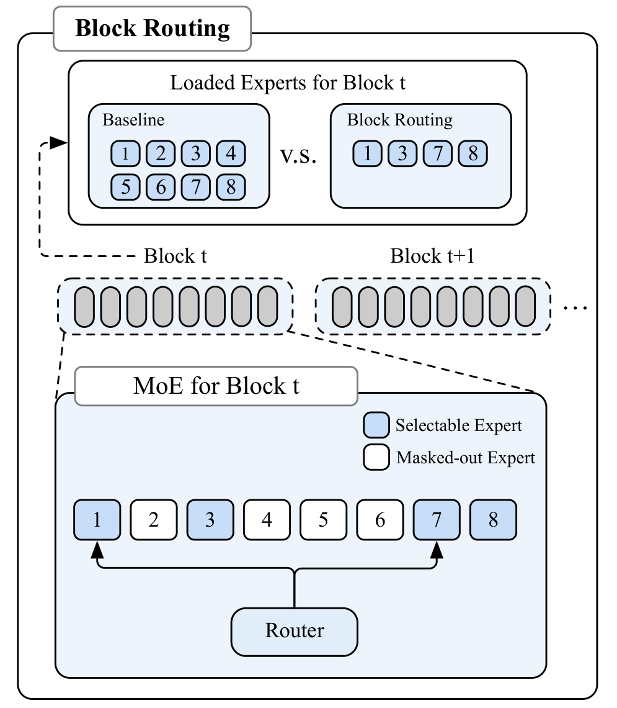](/assets/img/blog/moe-routing-granularity/llada22-block-routing.png)

*图 2：LLaDA2.2 以 8 个专家的示例说明 block routing：整块先保留 1、3、7、8，再在这个范围内逐位置选择。蓝色专家可选，白色专家被屏蔽。*

因此，这 32 个位置的专家并集最多为 48，逻辑调用次数仍是 $32\times8=256$。实际并集可以小于 48，候选容量也没有把每个位置的调用数改成 48。

这层约束是模型设计的一部分，报告通过 continued pretraining 适应新的路由范围。公开函数还会根据本次前向的分数重新选池；同一 diffusion block 在下一次去噪迭代中，可以得到不同的候选集合。

### 2.2 DES 与 dMoE：跨位置投票与动态池大小

[Dynamic Expert Sharing（DES）][des]在 LLaDA2.0-mini-preview 与 LLaDA-MoE 的块并行解码中评估两阶段结构：先形成共享候选池（coreset），再做池内逐位置选择。其 DES-Seq 收集各位置少量高分专家的并集；DES-Vote 则保留各位置的局部 top-k 分数，对专家做跨位置加权投票，再按预算选池。

[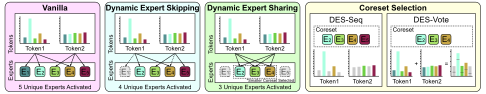](/assets/img/blog/moe-routing-granularity/des-shared-pool.svg)

*图 3：逐位置少选专家，仍可能留下较大的整块并集；DES 先选共享候选池，再让各位置在池内选择。右侧对比局部高分专家并集与跨位置投票。*

max 与 sum 聚合对应不同的偏好。下面是一组用于比较排序的示意分数，候选容量设为 2：

| 专家 | 位置 1 | 位置 2 | Max | Sum |
|---|---:|---:|---:|---:|
| A | 0.60 | 0.00 | 0.60 | 0.60 |
| B | 0.22 | 0.49 | 0.49 | 0.71 |
| C | 0.18 | 0.51 | 0.51 | 0.69 |

max 选择 A、C，保留位置 1 对 A 的强偏好；sum 选择 B、C，更重视两个位置累积的需求。候选池越紧，这种聚合差别越直接地影响哪些位置被迫改选专家。

[dMoE][dmoe]以 LLaDA2.0-mini 为基础，进一步让池大小随当前路由分布变化。其算法聚合各位置经过 top-k mask 的专家分数，归一化后按 top-p 累计质量阈值选择 coreset，再在池内执行逐位置 top-k。分数集中时用小池，分散时扩大池。它保留每位置的选择数量，将主要约束施加在独立专家总数上。

[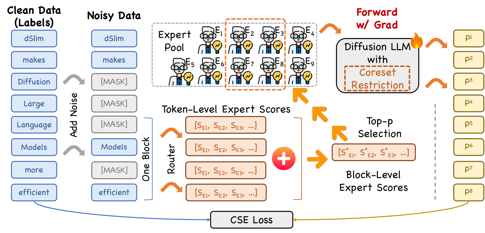](/assets/img/blog/moe-routing-granularity/dmoe-block-expert-pool.png)

*图 4：dMoE 将 token-level 分数汇成 block-level 分数，以 top-p 选择专家池，并在受限路由的前向过程中训练。*

dMoE 通过微调与自蒸馏适应受限专家池。DES 直接作用于已有 checkpoint，不更新参数，但池内选择同样会改变原始模型的路由路径。

固定容量给出明确的集合上界，top-p 则让池大小随需求的集中程度变化。top-p 约束的是累计分数质量，部署时仍需根据最终专家池换算权重字节量。

## 3. Block Diffusion 的跨迭代复用：支持集与缓存

Block diffusion 还有一个时间维度：同一组位置会经过多次去噪前向。候选专家池、各位置的专家 ID、混合权重和专家输出，具有不同的变化速度。复用候选范围，不等于复用上一轮的路由结果。

### 3.1 TEAM：按位置状态分配计算与专家

[TEAM][team]主要在 SDAR-30B-A3B 这一 block diffusion MoE 上研究位置之间和去噪迭代之间的相关性。新解码位置用已确定的 token 再前向一次，随后复用其 KV，避免后续反复执行完整计算。

对仍被 mask 的位置，置信度较高或靠近已解码位置的 token 归为 hot，其余归为 cold。模型先为新解码位置和 hot tokens 路由，得到专家集合，再让 cold tokens 只从中选择。它还为 hot tokens 尝试额外解掩码分支，以增加每轮最终接受的 token 数。

[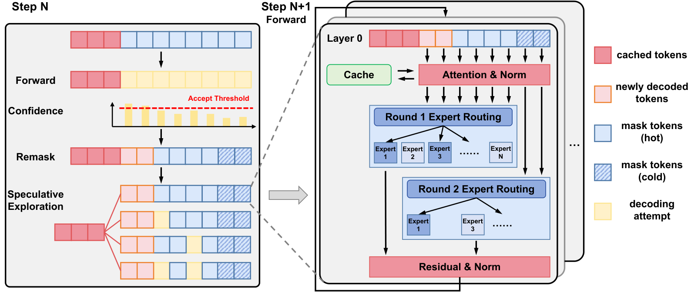](/assets/img/blog/moe-routing-granularity/team-overview.png)

*图 5：TEAM 对已解码位置延迟一步缓存，对 hot mask 位置探索更多解掩码分支，并让 cold mask 位置复用第一轮路由形成的专家集合。*

cold tokens 因而不会单独扩大本轮专家工作集，但其专家资格发生了变化；已解码状态的缓存则依赖表示近似稳定的观察。

### 3.2 Epoch：复用支持集，按位置刷新计算

[Epoch][epoch]面向 LLaDA-MoE、LLaDA2.0-mini 与 LLaDA2.0-Flash 的 block diffusion serving。其 Expert Atlas 为每层维护可选专家集合（active support），后续迭代可以复用集合掩码；需要重新计算的位置仍根据当前状态生成 gate logits、专家 ID 和权重。执行层还根据缓存年龄等条件选出本轮需要重算的位置，并只为这些 token–expert 项传递 dispatch/combine 载荷。

[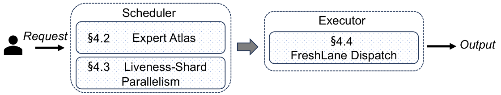](/assets/img/blog/moe-routing-granularity/epoch-overview.png)

*图 6：Epoch 在调度侧管理专家支持集与位置状态，在执行侧通过 FreshLane Dispatch 传递本轮需要重新计算的 token–expert 项。*

复用专家支持集，保留的是候选资格；复用专家输出，保留的是上一轮的计算值。前者可能排除本轮自然路由需要的专家，后者可能因状态变化而过时。Epoch 分别讨论 support 截断与缓存年龄的边界。已解码 token 即使不再需要新的输出 logits，也仍可能参与双向 attention 的上下文。

## 4. AR MoE 的 Chunk 稀疏性与局部性训练

AR MoE 做 chunk-level 路由，主要是为了把逐 token 的稀疏计算转化为实际推理加速。对端侧 decode，即使每步只激活少量专家，若相邻步骤不断换入非驻留权重，加载仍可能主导延迟。让连续几步更多地复用专家，可以提高有限缓存的命中率，减少加载等待。这种需求在普通 AR 解码中就存在。

prefill 和投机验证中，多个位置可以在一次前向内处理，又有另一种成本：专家选择越分散，每个专家分到的输入行就越少，需要读取的独立权重也越多。增加块内重叠，可以让一份权重服务更多位置，形成更大的矩阵乘。这种加速可以在 token–expert 调用次数不变时获得，依靠的是权重复用和执行效率。

这里的 chunk 是用于约束路由的连续窗口，AR 的因果生成顺序仍然保留。普通 decode 尚未得到未来 token，无法像 block diffusion 那样先汇总整块真实 hidden states 再选池；可以在训练时让局部激活更集中，或在推理时参考前一步的选择。BlockFFN 将局部复用要求同时写进专家结构、训练损失和执行内核。

### 4.1 BlockFFN 同时调整 Expert、Router 与训练目标

[BlockFFN（COLM 2025）][blockffn]直接区分 token-level sparsity（TLS）与 chunk-level sparsity（CLS）。若只统计是否激活专家，并令 $n=\lvert\mathcal B\rvert$，两者可写为：

$$
\mathrm{TLS}=1-\frac{\sum_{i\in\mathcal B}|S_i|}{nE},
\qquad
\mathrm{CLS}=1-\frac{|U(\mathcal B)|}{E}.
$$

第 1 节的例子中，如果 $E=8$，两种路由的 TLS 都是 75%，CLS 则分别为 75% 和 0%。每个 token 都很稀疏，整组位置仍可能访问全部专家。

BlockFFN 的 expert 采用细粒度、非门控的 MLP；router 使用线性变换、ReLU 和 RMSNorm。ReLU 产生精确零值，各位置激活专家数可以变化；后续 RMSNorm 调整幅度。它与固定 top-k MoE 的选择规则不同。

训练中，activation locality loss 鼓励相邻位置的软激活模式接近；chunk sparsification loss 则直接针对局部并集。对归一化的非负激活量 $p_{i,e}$，后者使用如下可微代理：

$$
\widetilde u_e=1-\prod_{i\in\mathcal B}(1-p_{i,e}),
\qquad
\mathcal L_{\mathrm{cs}}=\frac1E\sum_e\widetilde u_e.
$$

它对应“专家在块内至少被一个位置使用”的平滑形式。这里的 $p_{i,e}$ 来自激活量归一化，公式作为训练代理使用，不把它当作任意相关路由下真实并集概率的精确计算。

[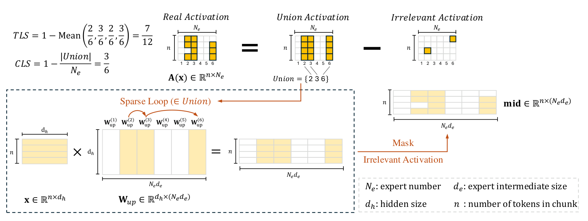](/assets/img/blog/moe-routing-granularity/blockffn-chunk-kernel.png)

*图 7：BlockFFN 读取 chunk 专家并集对应的权重，让整块输入参与规则矩阵乘，再屏蔽不属于原激活模式的中间结果。*

BlockFFN 为并集中的专家计算整块输入，包含一部分之后会被 mask 的行，用额外计算换取规则的矩阵形状和权重复用。TLS 与 CLS 接近时，这部分额外工作较少；差距很大时，补算量就会增加。

### 4.2 相邻路由的软约束与硬选择

[StickyMoE][sticky]惩罚相邻 gate 概率向量的平方距离。对长度为 $m$ 的窗口，设 $p_i$ 为位置 $i$ 的 gate 概率向量，其软一致性损失为：

$$
\mathcal L_{\mathrm{cons}}=\frac1{m-1}\sum_{i=2}^{m}\|p_i-p_{i-1}\|_2^2.
$$

这个损失鼓励相邻分布接近，却不保证 top-k 集合不变。例如 $(0.501,0.499)$ 与 $(0.499,0.501)$ 很接近，top-1 仍选择不同专家。

[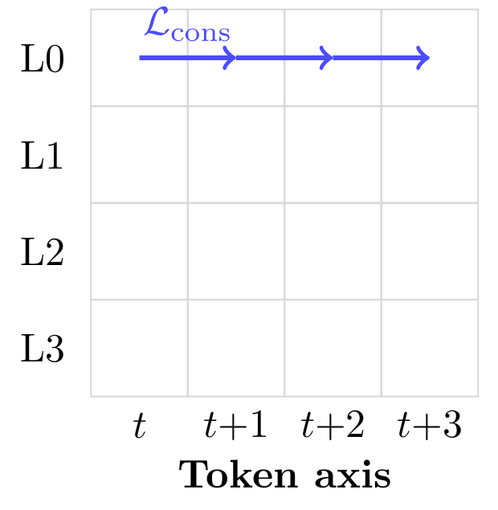](/assets/img/blog/moe-routing-granularity/sticky-token-consistency.png)

*图 8：StickyMoE 在同一层比较相邻位置的 gate 分布，蓝色箭头对应被一致性损失约束的位置对。*

[Expert Coactivation][coactivation]则同时修改训练目标和选择规则，结合 global load balancing、shared experts、相邻 router 一致性损失与 autoregressive expert selection。它允许局部窗口集中使用少量专家，同时在更大的训练 batch 上约束总体使用率，避免每个小窗口都被要求平均覆盖所有专家。

[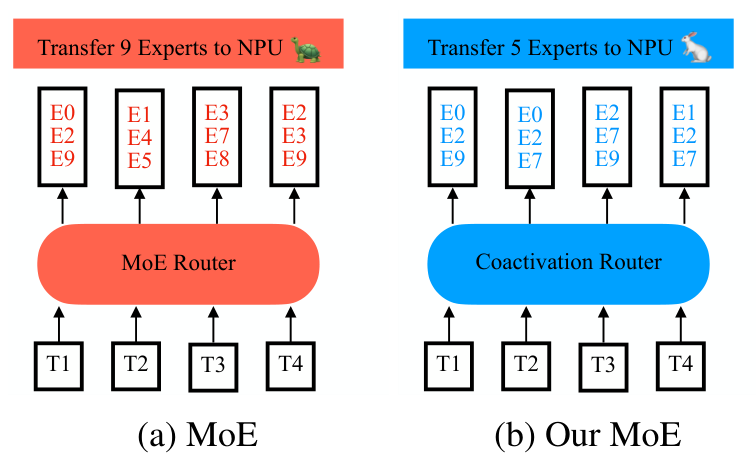](/assets/img/blog/moe-routing-granularity/coactivation-expert-reuse.png)

*图 9：四个位置各选三个专家，逻辑调用数同为 12。Coactivation 的示意路由增加了位置间重叠，需要搬入 NPU 的独立专家从 9 个降到 5 个。*

其中，autoregressive expert selection 在同一个窗口内，让后一个位置保留前一个位置至少 $k-r$ 个专家，再按自己的分数补齐其余选择。若：

$$
|S_i\setminus S_{i-1}|\le r,
$$

则规则生效的长度 $m$ 窗口内有：

$$
|U(m)|\le\min(E,k+(m-1)r).
$$

例如 top-8、每步至多引入一个新专家时，八位置窗口最多触及 15 个专家，而独立选择的上界为 64；两者的逻辑调用次数同为 64。这个保证来自选择规则，窗口重新初始化的位置需要单独处理。

### 4.3 局部复用与负载均衡的取舍

[Not All Models Suit Expert Offloading][locality]分析了不同 MoE 的局部路由一致性，区分固定专家集合对一段 token 的覆盖能力与有限缓存的命中能力，并发现局部均衡与局部一致性存在张力。全局负载均衡可以允许不同局部窗口使用不同专家组。

[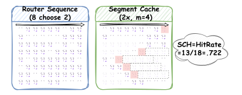](/assets/img/blog/moe-routing-granularity/local-routing-cache-oracle.svg)

*图 10：SCH 用未来窗口中的专家访问频率指导逐出，衡量路由序列中可利用的缓存局部性。图中的 oracle 需要未来信息，属于分析参照，不能直接作为在线缓存策略。*

[Similarity Preserving Routers（SimBal）][simbal]关注均衡训练对输入相似关系的影响：相似 token 若被反复分散到不同专家，容易增加知识冗余。它采用近正交初始化，并对 router 权重的 Gram 矩阵施加接近单位阵的正则，目标是兼顾负载均衡与相似输入的专家偏好。这里约束的是 router 几何，不直接限制相邻位置的专家变化或 chunk 专家并集。

[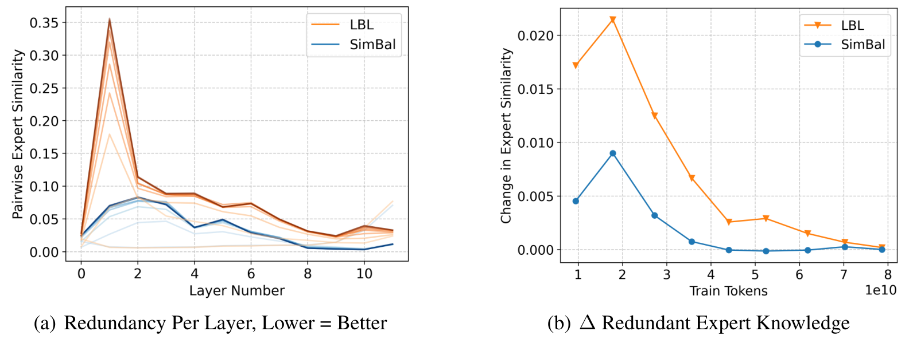](/assets/img/blog/moe-routing-granularity/simbal-expert-redundancy.png)

*图 11：SimBal 以成对专家相似度（PES）比较专家冗余：左侧按层统计，右侧显示训练中的变化；蓝线对应 SimBal，橙线对应常规负载均衡。*

相邻路由变得更一致，也可能带来质量代价。StickyMoE 的证据来自小规模模型；[Cacheable by Design?][negative]在多域 137M 模型上，未能同时达到预设的缓存 miss 改善要求与困惑度增幅不超过 1% 的标准。

[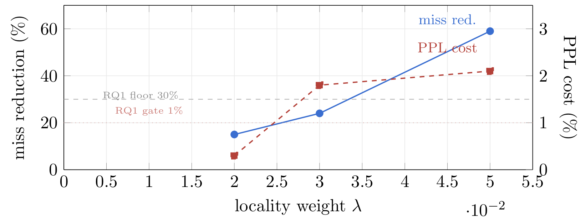](/assets/img/blog/moe-routing-granularity/cacheable-quality-locality.png)

*图 12：局部性权重增大时，LRU miss 降幅（蓝，左轴）和困惑度代价（红，右轴）一起上升；图中没有同时满足 30% miss 降幅与 1% 困惑度增幅门槛的点。*

## 5. AR MoE 的投机树验证：专家并集与提交路径

AR 投机解码先生成一组候选，再交给 target MoE 并行验证。候选可以按链或树组织；树中各分支代表不同前缀。一次 verify 支付所有保留节点的计算和权重准备，最后提交的 draft tokens 通常只来自一条路径。

设候选树为 $\mathcal T$，第 $\ell$ 层节点 $v$ 的专家集合为 $S_{\ell,v}$，则：

$$
U_\ell(\mathcal T)=\bigcup_{v\in\mathcal T}S_{\ell,v}.
$$

树宽扩大后，不同分支可以各自引入新专家。仅限制父子之间的路由变化，也未必能控制整棵树的工作集。

[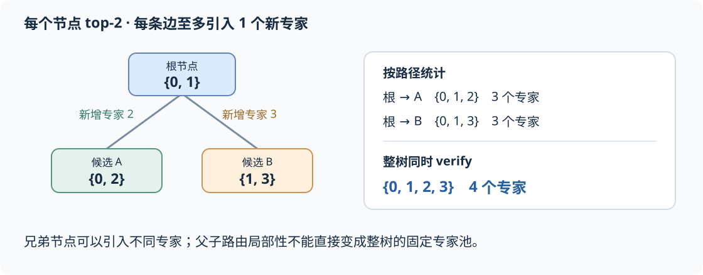](/assets/img/blog/moe-routing-granularity/tree-expert-union.svg)

*图 13：每条父子边只引入一个新专家，两条根到叶路径各覆盖三个专家，整棵树仍覆盖四个。*

在图中，每个节点使用两个专家、每条边至多引入一个新专家。推广到一般情形，含 $d$ 个节点的路径有上界 $k+(d-1)r$，而含 $N$ 个节点的整棵树只能据此得到 $k+(N-1)r$ 的上界，二者都与 $E$ 取最小值。路径局部性与跨分支复用需要分别设计；张量中相邻存放的两个节点也未必有父子关系。

### 5.1 根据边际专家成本选择候选

如果现有专家并集为 $\lbrace 0,1\rbrace$，新增节点 A 使用 $\lbrace 0,1\rbrace$、节点 B 使用 $\lbrace 2,3\rbrace$，两者各增加两次调用，新增独立专家数分别为 0 和 2。假设两者的提交概率接近，且祖先都已选入，两个节点仍有不同的边际验证成本。

更深的节点还必须连同未选中的祖先一起加入。令 $P(v)$ 表示节点 $v$ 及这些祖先，新增独立权重需求为：

$$
\Delta W(v\mid\mathcal T)=\sum_\ell
\sum_{e\in U_\ell(P(v))\setminus U_\ell(\mathcal T)}W_{\ell,e}.
$$

在固定节点路由的条件下，已选集合越大，一个候选引入的新专家只会减少或不变。同一个节点的边际成本随已选专家变化，逐节点固定计费会遗漏这种共享。

验证之前还没有所有候选的真实 target routes，需要预测器、draft 路由代理或平均 profile 来估计成本。几种近期方法选择了不同的信息来源：

| 方法 | 候选选择依据 | 成本信息 |
|---|---|---|
| [EVICT][evict] | 对按累计置信度排序的节点，选择收益/成本最好的前缀规模 | 初始化时测量不同节点数的平均整轮成本 |
| [EcoSpec][ecospec] | 结合路径概率与新增专家成本，选择具体候选路径 | 训练好的 expert predictor；动态记录已覆盖专家 |
| [SpecFit][specfit] | 在有界候选池中搜索祖先闭合子树，联合选择身份、数量与 drafting depth | 逐层专家并集估计及校准的时间模型 |

EVICT 优化验证节点数。累计分数沿路径不增，排序时让祖先优先于同分后代，取排序列表的前若干节点便能构成合法子树；成本表反映平均的 MoE 扩张效应。

[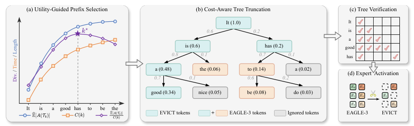](/assets/img/blog/moe-routing-granularity/evict-selection.png)

*图 14：EVICT 先比较预计接受长度与测得的验证成本，选择验证规模，再截取祖先闭合的候选子树；保留节点一起进入 target 前向。*

EcoSpec 进一步根据专家重叠选择具体路径：已选路径覆盖某些专家后，共享它们的其它路径变得更便宜。其 Global Expert Buffer 记录预测覆盖集合，不代表这些权重已经驻留。

[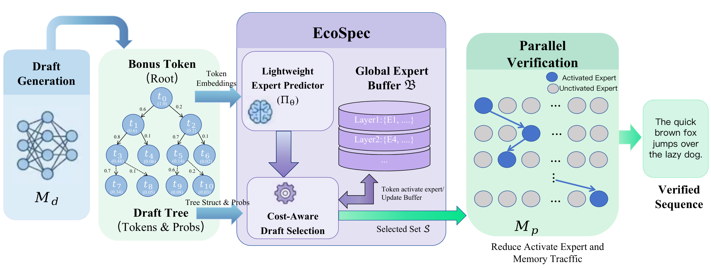](/assets/img/blog/moe-routing-granularity/ecospec-overview.png)

*图 15：EcoSpec 从候选树预测逐层专家需求，结合已有覆盖集合选择待验证节点，再交给 target MoE 并行验证。*

SpecFit 将预计提交收益除以预计整轮时间，在小候选池内枚举合法子树。论文当前使用参考前缀上预先取得的 route atlas，获取过程不计入请求计时；文中测试了模拟预测误差并估计 predictor 成本，在线 predictor 训练仍留待后续。这组测量隔离了集合选择器的作用，包含在线路由预测的吞吐收益仍需单独实测。

[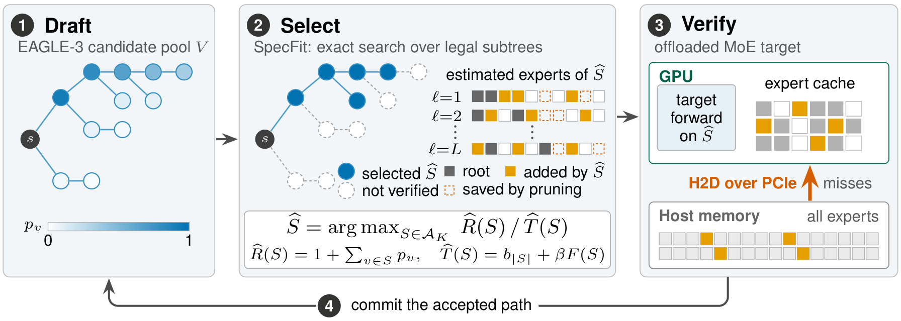](/assets/img/blog/moe-routing-granularity/specfit-selection.png)

*图 16：SpecFit 从 draft 候选池中搜索祖先闭合子树，用预计收益与整轮时间的比值评分。选中的节点交给原 target 路由执行，缺失专家按需从主机内存加载。*

这一组方法通过调整待验证节点降低成本，选中节点仍执行 target 原有路由。路由预测误差主要影响候选选择和执行效率。

### 5.2 S²-MoE 与 DraftExpert：联合优化 Draft 和 Verify

[S²-MoE][s2moe]先用路径置信度估计接受收益，以 self-draft 路由预测新增专家，再把专家扩张换算为校准的时间成本。继续扩展的收益需要覆盖 drafting 与验证的边际成本。

它还在 verify 中聚合不同候选的 target gating logits，以置信度加权选出 preferred experts，再给这些专家增加路由 bias，促使各节点在 top-k 边界附近更多选择共有专家。

[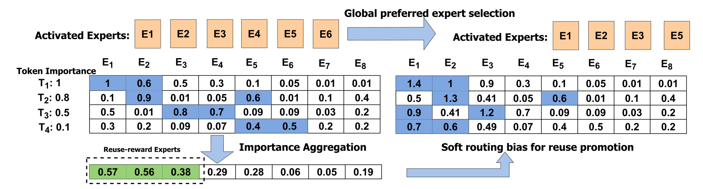](/assets/img/blog/moe-routing-granularity/s2moe-reuse-gating.svg)

*图 17：S²-MoE 聚合四个候选位置的需求，为 E1–E3 增加软偏置。右侧仍有位置选择 E5，说明 preferred set 并非排他性的专家池。*

这里的 `cap` 限制获得 bias 的专家数，池外专家仍可被选择，所以它没有提供 $\lvert U\rvert\le\mathrm{cap}$ 的硬保证。这与 LLaDA2.2 的池外屏蔽不同，也与单独调整候选集合的方法不同：完整 S²-MoE 会改变 target 路由，其收益包含路由近似带来的质量取舍。

[DraftExpert][draftexpert]用 draft 路由预测 target 的专家需求，结合候选置信度与新增专家数决定在哪里截断草稿。后续候选即使有一定接受机会，若需要引入过多专家，也可能不值得继续扩展。它的常驻草稿路径、训练与预取如何降低整轮执行成本，见[第六篇](#34-降低-draft-成本按收益选择验证长度)。

[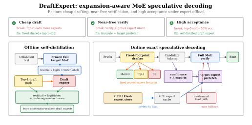](/assets/img/blog/moe-routing-granularity/draftexpert-architecture.svg)

*图 18：DraftExpert 左侧离线训练小型 draft expert，右侧用固定权重占用的路径生成草稿，再按置信度和新增专家需求截断，并为完整 target 验证预取权重。*

### 5.3 直接限制 Verifier 的专家资格

[MoE-Spec][moe-spec]保留候选集合，在每层选固定预算的专家 shortlist。原始 top-k 落在池外时，截断其贡献或使用池内替代专家，从而限制验证器的专家工作集。

[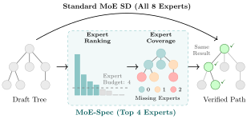](/assets/img/blog/moe-routing-granularity/moe-spec-budget.svg)

*图 19：MoE-Spec 在相同候选树上按聚合路由分数筛选专家，示例将专家集合从 8 个缩至 4 个。原选择落在池外的位置需要截断贡献或改选池内专家。*

[AcceptMoE][acceptmoe]在此基础上加入最终提交概率：深层和旁支被提交的机会不同，聚合需求时不应等权。它用离线估计的提交概率加权 target-router 分数。选池时，先以根位置自然选择的 top-k 作为初始专家集合；对其余专家的需求分布计算熵，再取指数决定追加数量。需求集中时追加较少，需求分散时追加较多。卸载时还会根据驻留状态裁剪低收益的非驻留成员，包括初始集合中的非驻留专家。

[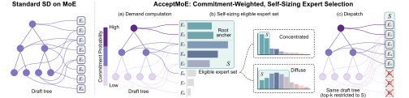](/assets/img/blog/moe-routing-granularity/acceptmoe-expert-set.svg)

*图 20：AcceptMoE 保留候选树，按提交概率汇总专家需求；以根位置专家作为初始集合，再随需求的集中程度调整追加专家数。图中展示驻留裁剪之前的选池过程。*

与 block diffusion 的块级选池相比，这里也让多个位置竞争一组可用专家，但每个候选还带有不同的提交收益。池外屏蔽、截断或替代都会改变 verifier 的输出概率，接受步骤使用的也已经是修改后的 verifier 概率。

## 6. 语义与序列分组：专家组、生成块和调用预算

前面的窗口主要由执行方式划定：同时计算的一段输入、一个去噪块或一棵候选树。若希望专家分工贴合句子或任务，也可以根据输入语义划分专家组。不过，语义 chunk 还可能用于组织生成；sequence-level 也可能只表示在整条序列上分配调用预算，需要结合具体模块理解。

### 6.1 AR 指令模型的语义专家组：MoCE

[MoCE（Mixture-of-Clustered-Experts）][moce]用独立 encoder 提取输入序列表示，经 k-means 聚类后分配专家组，再在组内执行 token-level adapter expert 路由。语义相近的输入先共享专家组，逐位置路由再处理组内差异。这里的专家是用于指令微调的 adapter，独立 encoder 还会增加输入编码开销。

[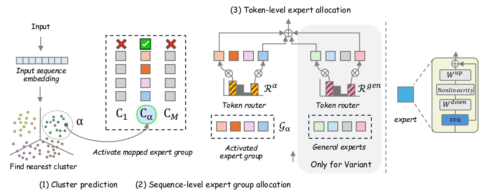](/assets/img/blog/moe-routing-granularity/moce-hierarchical-routing.png)

*图 21：MoCE 先根据输入序列表示找到语义簇并激活对应专家组，再执行组内逐 token 路由。灰色分支是额外加入通用专家的变体。*

### 6.2 Block Diffusion 的语义分组：DCDM

[Dynamic Chunking Diffusion Model（DCDM）][dcdm]改变的是 block diffusion 的分组依据。固定块按“每连续若干个位置一组”划分，可能拆开相互依赖的代码位置或同一实体的不同提及。DCDM 根据隐藏状态学习分组，让相关位置有机会进入同一个去噪单元；一组可以大小不一，也可以包含不连续的位置。

一次前向先经过一个 DiT block，再由 Chunking Attention 同时输出更新后的隐藏状态与每个位置的 chunk 编号。后续 DiT blocks 共享这些编号构造的 attention mask，完成去噪预测。图 22 中间展开的是分组层内部的计算，右侧颜色表示得到的位置组。

[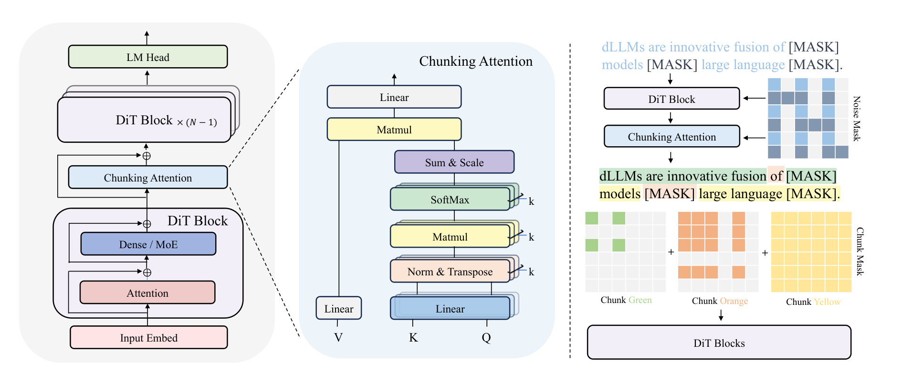](/assets/img/blog/moe-routing-granularity/dcdm-semantic-chunks.png)

*图 22：Chunking Attention 用可学习子空间处理当前隐藏状态，产生连续输出与离散分组；后续层根据分组使用 chunk-causal attention。右侧同色位置可以不连续。*

#### 从隐藏状态得到 Chunk 编号

设位置 $i$ 的隐藏状态为 $h_i\in\mathbb R^d$，共有 $K$ 个簇。每个簇用一个可学习矩阵 $\mu_k\in\mathbb R^{d\times r}$ 表示，其中 $r$ 是低维子空间的维度。分组层把同一个位置映射到各个子空间，取映射后向量的长度作为分数：

$$
\begin{aligned}
p_{k,i}&=\mu_k^\top h_i,\\
s_{i,k}&=\lVert p_{k,i}\rVert_2,\\
c_i&=\arg\max_k(s_{i,k}+b_k).
\end{aligned}
$$

$c_i$ 是位置 $i$ 的 chunk 编号。$b_k$ 只校正硬分组的负载：训练中按统计使用率下调过载簇的偏置，上调低使用率簇的偏置。模型比较的是对多个子空间的契合程度，分组参数随训练更新，不需要预先标注句子边界或语义类别。

但只输出 `argmax` 编号，去噪损失无法通过这个离散操作训练分组。Chunking Attention 还为每个簇计算一张位置之间的 attention 矩阵：

$$
\begin{aligned}
A^{(k)}_{ij}&=\frac{p_{k,i}^{\top}p_{k,j}}{\sqrt r},\\
T^{(k)}_{ij}&=\operatorname{softmax}_{j}\!\left(A^{(k)}_{ij}\right).
\end{aligned}
$$

每张矩阵都沿 key 位置归一化，再将各簇结果加和、按 $1/\sqrt K$ 缩放，通过共享的 value/output 投影更新隐藏状态。这样，同一组 $\mu_k$ 同时决定连续的 attention 输出和离散编号：去噪损失沿连续输出回传，编号则交给后续层生成 mask。训练还使用序列内均衡损失和跨 batch 的偏置调整，避免大量位置长期挤进少数簇。这里写的是未施加可见性限制的分数形式；训练时还会加入下述 noise mask。

#### 分组怎样改变 Attention

得到编号后，第 $k$ 个 chunk 就是所有满足 $c_i=k$ 的位置。推理时，查询位置 $i$ 能读取位置 $j$ 的条件为：

$$
M^{\mathrm{chunk}}_{ij}=\mathbf 1[c_j\le c_i].
$$

同组编号相等，可以双向注意；编号较大的组能读较小的组，反向不可见。这里的先后按 chunk 编号定义，不按文本位置定义。

例如六个位置的编号为 $c=(1,2,1,3,2,3)$。固定长度为 2 的位置块原本会是 `[1,2]`、`[3,4]`、`[5,6]`，这次分组则给出：

| 查询位置 | Chunk 编号 | 按 chunk-causal mask 可读取的位置 |
|---|---|---|
| 1、3 | 1 | 1、3 |
| 2、5 | 2 | 1、2、3、5 |
| 4、6 | 3 | 全部六个位置 |

因此，位置 2 和 5 虽然不相邻，却能在同一组里互相提供去噪上下文，并以组 1 的内容为条件；它们不能读取组 3。这个例子固定了一次前向的编号，只解释信息可见性。原文给出了推理 mask，但没有展开跨去噪轮次固定或刷新分组的完整采样调度。

#### 训练时的可见性与 MoE 专家选择

训练使用带噪序列与干净序列拼接的双流输入，以干净的较早 chunk 为条件，同时预测带噪位置。分组阶段另有 noise mask：已知位置只读已知 key，当前被 mask 的位置可以读已知 key 和自身；相同的噪声标记也施加到干净半边。作者用这个限制阻断分组阶段经由其他待预测位置真实值形成的信息通路。

后续去噪层的 mask 分开处理两条流：带噪 query 读取同组的带噪 key，以及严格较早组的干净 key；干净 query 只读取同组或较早组的干净 key。前面表格展示的是推理时的单流规则，训练时不能直接把它复制成一个不加区分的双流 mask。

这些 chunk 编号控制的是 attention 的可见位置。DCDM-MoE 另将 decoder 的 MLP 替换为带 shared expert 的逐 token top-k MoE；这个 router 选择 FFN 专家，和输出 chunk 编号的分组层是两个模块。同一个语义 chunk 内的位置仍可选择不同专家，论文没有给它们设置类似 LLaDA2.2 的共享专家池。DCDM 对本篇的启发是学习位置分组；若要进一步用这些组约束专家搬运，还需要增加专家集合层面的设计。

### 6.3 AR MoE 的序列级调用预算：SeqTopK

[SeqTopK][seqtopk]把总计 $Tk$ 个 token–expert 对的预算交给整条序列分配，让不同位置获得不同数量的专家计算。其直接控制的是：

$$
\sum_i|S_i|,
$$

而块级专家池直接控制 $\lvert\bigcup_iS_i\rvert$。前者分配计算量，后者限制独立权重范围。SeqTopK 还需要在线推理机制处理 AR 生成时未来位置尚不可见的问题；不能将训练时的整序列竞争直接当成可提前执行的真实未来路由。

[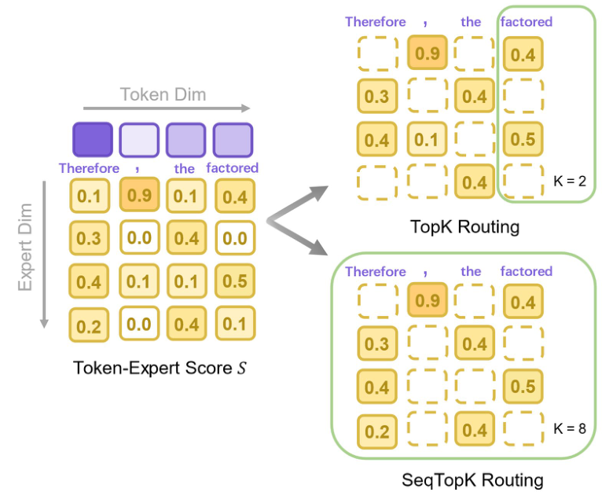](/assets/img/blog/moe-routing-granularity/seqtopk-budget-allocation.png)

*图 23：SeqTopK 的训练示意。总调用预算相同，逐位置 top-k 让各列保留相同数量的专家；SeqTopK 跨位置比较分数，让不同位置获得不同数量的专家计算。*

## 7. 各类工作的模型范围与执行单元

| 模型与执行场景 | 代表工作 | Block、Chunk 或分组的含义 |
|---|---|---|
| AR MoE 的局部性、均衡与端侧执行 | BlockFFN、StickyMoE、Expert Coactivation、SimBal、Cache-Aware Joint Router Adaptation | 连续 token 的路由窗口、投机验证窗口或跨步缓存工作集 |
| AR MoE 的投机解码 | S²-MoE、EcoSpec、EVICT、SpecFit、MoE-Spec、AcceptMoE、DraftExpert | 同一轮交给 AR target 验证的候选链或树 |
| **Block diffusion MoE：块内选池** | **LLaDA2.2、DES、dMoE** | **一次去噪前向内，当前生成块所有位置共同使用的专家集合** |
| **Block diffusion MoE：跨迭代复用** | **TEAM、Epoch** | **同一个生成块在多轮去噪间的专家支持集、位置状态与计算复用** |
| Block diffusion 的语义生成分组 | DCDM | 用学习到的 semantic chunk 替代固定位置块；MoE 变体另有 token-level 专家路由 |
| AR 指令模型的语义专家组 | MoCE | 根据已有输入的序列表示选专家组，再做组内 adapter expert 路由 |
| AR MoE 的序列级计算分配 | SeqTopK | 在序列内分配 token–expert 调用预算，并为 AR 解码设计在线选择机制 |

Block diffusion 可以在当前块内选池，并在去噪迭代之间复用结构；AR 卸载要应对跨步缓存变化；投机树还要为最终没有提交的旁支控制成本。每个 token 激活相同数量的专家，仍可能因这些执行方式而产生不同的权重流量和延迟。

## 参考资料

- [LLaDA2.2: Enabling Agentic Diffusion Language Models via Levenshtein Editing][llada-report]，2026 年 7 月；[模型实现][llada-code]、[配置][llada-config]。
- [Dynamic Expert Sharing: Decoupling Memory from Parallelism in Mixture-of-Experts Diffusion LLMs][des]，v2，2026 年 11 月。
- [dMoE: dLLMs with Learnable Block Experts][dmoe]，v2，2026 年 6 月。
- [TEAM: Temporal-Spatial Consistency Guided Expert Activation for MoE Diffusion Language Model Acceleration][team]，v3，2026 年 8 月。
- [Epoch: Compiling Diffusion Blocks for Sparse MoE Serving][epoch]，2026 年 9 月。
- [BlockFFN: Towards End-Side Acceleration-Friendly Mixture-of-Experts with Chunk-Level Activation Sparsity][blockffn]，COLM 2025。
- [Efficient Mixture-of-Experts with Speculative Decoding via Expert Coactivation][coactivation]，2026 年 9 月。
- [Sticky Routing: Training MoE Models for Memory-Efficient Inference][sticky]，2026。
- [Load Balancing Mixture of Experts with Similarity Preserving Routers（SimBal）][simbal]，v1，2025 年 6 月。
- [Not All Models Suit Expert Offloading: On Local Routing Consistency of Mixture-of-Expert Models][locality]，v4，2026 年 2 月。
- [Cacheable by Design? Training Mixture-of-Experts Routers for Locality Against the Edge Memory-Bandwidth Wall][negative]，2026 年 8 月。
- [Cache-Aware Joint Router Adaptation for Memory-Efficient MoE Inference][cache-aware]，v2，2026 年 9 月。
- [Making Every Verified Token Count: Adaptive Verification for MoE Speculative Decoding（EVICT）][evict]，v2，2026 年 9 月。
- [Less Experts, Faster Decoding: Cost-Aware Speculative Decoding for Mixture-of-Experts（EcoSpec）][ecospec]，2026 年 7 月。
- [SpecFit: Not All Draft Tokens Cost the Same in Offloaded MoE Inference][specfit]，2026 年 10 月。
- [S²-MoE: Enabling Efficient Self-Speculative Decoding for Mixture-of-Experts on Edge Devices][s2moe]，v2，2026 年 8 月。
- [DraftExpert: Expansion-Aware Self-Speculative Decoding for End-Device MoE Inference][draftexpert]，2026 年 7 月。
- [MoE-Spec: Expert Budgeting for Efficient Speculative Decoding][moe-spec]，2026 年 2 月。
- [AcceptMoE: Commitment-Weighted Self-Sizing Verifier Expert Sets for Efficient MoE Speculative Decoding][acceptmoe]，2026 年 8 月。
- [Mixture-of-Clustered-Experts: Advancing Expert Specialization and Generalization in Instruction Tuning][moce]，EMNLP 2025。
- [Dynamic Chunking for Diffusion Language Models][dcdm]，2026 年 5 月。
- [Route Experts by Sequence, not by Token][seqtopk]，v2，2026 年 3 月。

[llada-report]: https://github.com/inclusionAI/LLaDA2.X/blob/main/LLaDA2_2_tech_report.pdf
[llada-code]: https://huggingface.co/inclusionAI/LLaDA2.2-flash/blob/9b78da3f9149f1e239fb6d15f20a326fde574b9f/modeling_llada2_moe.py
[llada-config]: https://huggingface.co/inclusionAI/LLaDA2.2-flash/blob/9b78da3f9149f1e239fb6d15f20a326fde574b9f/config.json
[des]: https://arxiv.org/html/2602.00879v2
[dmoe]: https://arxiv.org/html/2605.30876v2
[team]: https://arxiv.org/html/2602.08404v3
[epoch]: https://arxiv.org/html/2609.09748v1
[blockffn]: https://arxiv.org/html/2507.08771v2
[coactivation]: https://arxiv.org/html/2609.22471v1
[sticky]: https://arxiv.org/html/2607.08780v1
[simbal]: https://arxiv.org/html/2506.14038v1
[locality]: https://arxiv.org/html/2505.16056v4
[negative]: https://arxiv.org/html/2608.18261v1
[cache-aware]: https://arxiv.org/html/2609.04895v2
[evict]: https://arxiv.org/html/2605.00342v2
[ecospec]: https://arxiv.org/html/2607.12696v1
[specfit]: https://arxiv.org/html/2610.15417v1
[s2moe]: https://arxiv.org/html/2608.15018v2
[draftexpert]: https://arxiv.org/html/2607.24434v1
[moe-spec]: https://arxiv.org/html/2602.16052v1
[acceptmoe]: https://arxiv.org/html/2608.02989v1
[moce]: https://aclanthology.org/2025.emnlp-main.718/
[dcdm]: https://arxiv.org/html/2605.15676v1
[seqtopk]: https://arxiv.org/html/2511.06494v2
