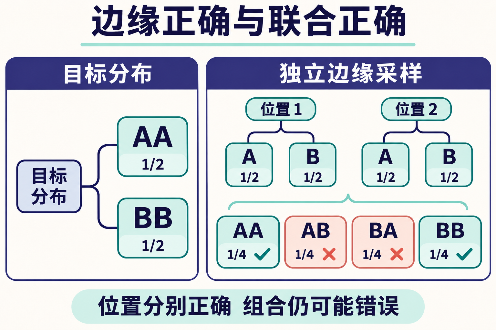
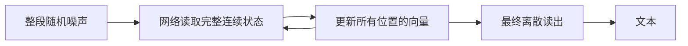

做离散 dLLM 时，你已经熟悉“破坏句子—预测原文—更新状态”的流程。连续语言模型沿用这个框架，把反复更新的对象换成实数向量，最终再读出离散 token。本篇先解释：这种状态变化为什么可能帮助并行生成，以及它怎样保留位置间的依赖。

本篇从你熟悉的逐位置交叉熵（CE）、条件概率和并行采样出发。

## 连续状态与连续时间要分别看

一个离散模型完全可以用连续时间马尔可夫链描述：时间参数可取任意实数，状态仍是 token 或 mask。反过来，连续模型在计算机上也要用有限步运行，每步更新的是实数向量。

| 维度 | 离散 dLLM 的常见情况 | 本系列讨论的连续模型 |
| --- | --- | --- |
| 中间状态 | token mask 或其他离散符号 | 有噪声的向量 |
| 网络输出 | 每个位置的 token 概率 | token 概率 干净向量 或速度 |
| 一次更新 | 抽样替换或揭示 token | 按速度或去噪预测移动向量 |
| 最终读出 | 状态已经是 token | 需要 argmax 最近邻或 decoder |

所以，看到论文写 continuous time，先检查它的状态。也不要凭损失是 CE 还是 MSE 来分类：连续生成同样可以使用逐位置 CE。

## 把一条长度为二的句子当作一个随机变量

令 W=(W¹,W²)，每个位置只能取 A 或 B。联合分布 p(W¹,W²) 给四种组合分配概率；第一个位置的边缘分布则把第二个位置的可能性加起来。

$$
p(W^1=A)=p(AA)+p(AB),\qquad
p(W^2=A)=p(AA)+p(BA).
$$

这一步叫边缘化。它保留各位置分别出现 A、B 的概率，却丢掉了组合关系：AA、BB 各一半，与四种组合各四分之一，有相同的单位置边缘分布，但联合分布不同。

条件分布保留的信息取决于条件里已经知道什么。如果先知道 W¹=A，在 AA/BB 的数据中就能确定 W²=A；如果两个位置都是 mask，这个条件不存在。两种输入状态下，正确预测应当不同。

因此，比较模型的条件独立性时，必须把“给定什么状态”写出来。对于标准的一次并行更新，常见近似是给定当前状态 x 后，各个新 token 独立：

$$
q(w^S\mid x)=\prod_{\ell\in S}q_\ell(w^\ell\mid x).
$$

S 是这一步准备更新的位置集合。这条式子描述的是这一次转移的分解，不等于说整个多轮生成模型在最终分布中只能产生独立 token。

## 少步并行生成为什么困难

考虑一个教学分布，只包含 AA 和 BB，各占一半。第一个位置取 A 或 B 的概率都是一半，第二个位置也一样。如果把这两个正确的边缘分布独立采样，会得到下面的结果。

| 结果 | 真实概率 | 独立边缘采样概率 |
| --- | --- | --- |
| AA | 1/2 | 1/4 |
| AB | 0 | 1/4 |
| BA | 0 | 1/4 |
| BB | 1/2 | 1/4 |

图 1 教学分布只有 AA、BB 两种合法组合。分别正确的边缘概率，在独立采样后仍会产生 AB、BA。图为概念示意，不是实验结果。

问题出在采样时没有保留两个位置应当一致的关系。Transformer 看过全句，也不自动消除这个问题：在完全相同的输入状态下，两个输出头可以给出正确概率，后面的独立随机抽样仍会拼出错误组合。

多轮生成允许先确定的 token 成为之后的条件，缓解这一误差；把过程压成很少几轮，就减少了建立这些依赖的机会。这里讨论的是采用条件独立并行更新的采样器，不是对所有离散方法的能力限制。[Flow Map Language Models §2](https://arxiv.org/html/2602.16813v1#S2) 讨论了这一动机。

## 用一个式子定位误差

把 AA 或 BB 的真实联合分布记成 p，把两个边缘分布的乘积记成 q。在这个例子中，q(AA)=q(BB)=1/4，而 p(AA)=p(BB)=1/2。即使分类头没有预测误差，q 与 p 仍然不同。

KL 散度可以衡量真实联合分布与边缘乘积的差异。下式使用自然对数，结果为 ln 2，约 0.693 nat；换成以 2 为底的对数，就是 1 bit。即使分类头的边缘预测完全正确，这部分依赖信息仍会在独立采样中丢失。

$$
\mathrm{KL}(p\|q)
=\sum_{w\in\{AA,BB\}}\frac12\log\frac{1/2}{1/4}
=\log2.
$$

同一网络换一种协调采样方式，可能修复这类错误；单纯提高已经正确的边缘概率，则无从修复。因此研究少步生成时，评估单位需要包括网络和采样器。

### 用两次更新完整生成 AA 或 BB

第一步只抽第一个位置，A、B 各一半。第二步读取已抽出的 token：若第一位是 A，就确定生成 A；若第一位是 B，就确定生成 B。最终 AA 与 BB 各一半，不会生成交叉组合。

这个过程既可以叫一种有次序的两轮填充，也可以用联合概率的链式法则描述：

$$
p(w^1,w^2)=p(w^1)\,p(w^2\mid w^1).
$$

少步并行生成的难点，是同时决定许多未知位置，又不显式列出全部组合。一次更新 m 个位置时，联合类别表有 V 的 m 次方项，逐位置输出头却只给出 m×V 个值。要恢复组合关系，采样阶段还需要协调机制。

共享潜变量（latent）、联合转移、候选组合选择、重采样和连续状态，都可以承担协调作用。它们的取舍取决于训练难度、采样预算和任务。

## 有注意力为什么还不够

可以把一次前向理解成两段：注意力负责汇总上下文，各位置的输出头给出概率。后面的 sampler 决定怎样把这些概率变成一次具体决定。

如果输入是两个 mask，数据又完全对称，正确网络就应该在两个位置都给出一半 A、一半 B。注意力没有额外证据可用。想保持相关性，采样阶段必须使用一个共同决定，或者先产生一个结果，再让另一位置条件于它。

连续方法让尚未确定的位置携带持续变化的向量。后续更新能读取整段状态中的细微差异，逐步形成协调决定。怎样把这种能力学出来，是后面训练与采样章节的重点。

## 连续向量怎样保留句子之间的关系

连续模型从整段高斯噪声开始，让网络读取完整的有噪声序列，再一起更新所有位置。即使初始噪声各维独立，后续的联合变换也可以产生相关性。

一个不涉及神经网络的例子就能说明这一点：取两个独立标准高斯数 ε₁、ε₂；如果它们的和为正，就输出 AA，否则输出 BB。两个合法句子各占一半，且不会产生 AB 或 BA。随机性来自输入噪声，依赖来自对噪声的联合处理。

这个例子证明了联合映射能表示该分布。怎样训练出这个映射、怎样用少量网络调用算出来，还需要分别解决：第 3 篇介绍局部动力学，第 7 篇介绍有限时间映射。

## 连续状态为什么不等于一个软 token

用 A=(1,0)、B=(0,1) 表示两个 token。一个分类器的 softmax 输出可能是 (0.6,0.4)，它有明确的概率意义。但对 one-hot 数据加高斯噪声以后，状态可能是 (−0.3,1.4)；它仍是合法的连续中间状态，却不是概率向量。

这里有四个需要区分的对象：有噪输入 x、网络输出的词表 logits、softmax 后的概率预测 D，以及采样器更新得到的新状态。概率预测可以转成干净表示的均值，再用于移动 x；把这些张量分开，才能看清信息怎样流动。

上面用噪声和的符号产生 AA 或 BB，展示了一个直接联合映射。流模型则把这种变换分成许多小步，通过连续速度逐渐安排噪声与输出的对应关系。第 3 篇会给出可手算的例子。

### 为什么逐位置损失没有自动定义逐位置采样

训练损失告诉我们希望网络预测什么统计量，sampler 决定怎样使用它。一个 softmax 输出可以用于抽 token，也可以用于计算 embedding 的期望，或用于构造连续速度。

例如同样的 p(A)=0.6、p(B)=0.4，可以直接抽 A/B，也可以形成均值 (0.6,0.4)，再让当前向量向它移动一小步。这两种操作的输出分布和后续信息流都不同。

因而“使用 CE”只说明一个监督接口，不能单独决定模型是离散还是连续。相似地，“网络用了双向注意力”只说明条件信息怎样融合，不能单独决定 sampler 是否保留了正确的联合依赖。

## 第二个动机是让控制信号能作用于中间状态

如果连续状态上的一个可微目标能评价“这句话是否满足要求”，就可以求它对状态的梯度，并据此协调多个位置的更新。[Diffusion-LM](https://arxiv.org/abs/2205.14217) 是理解这条路线的入口。

但最终的 argmax 不可微。真正可用的控制需要定义在有噪声状态、预测的干净向量或可微 decoder 上。离散模型也有 logits guidance 和候选重排等控制办法；比较时要看信号质量和计算成本。

## 连续生成的完整流程

流程图把连续状态、联合更新和离散读出分开了。后续方法的主要区别，就落在表示、训练目标、更新规则，以及如何把多步循环压缩成少步映射上。

## 用熟悉的离散模型术语建立对照

| 你熟悉的对象 | 连续路线中的对应问题 |
| --- | --- |
| Corruption kernel | 选择表示后定义高斯或其他概率路径 |
| Mask ratio 或离散时间 | 当前噪声水平及时间坐标 |
| 逐位置 token CE | 可能直接训练条件 token 概率并构造均值 |
| Reveal 或 resample 策略 | 数值积分 有噪更新或有限时间映射 |
| Token commitment | 何时把连续不确定性变成离散决定 |
| 多轮去噪 | 多次网络评估及对应的状态演化 |

这张对照表帮助你定位设计选择。改变表示或更新规则后，仍需检查相应的训练目标、噪声路径和读出接口是否匹配。

## 从头理解两条代表路线

**Diffusion-LM 这条路线**先把 token 转成可学习向量，对向量加高斯噪声，训练去噪模型，再把生成向量读回离散词。连续中间状态还提供了一个可微接口：目标函数可以对整段向量给出方向，影响后续生成。理解这条路线的关键，是表示、去噪、读出和控制四个环节如何衔接。

**One-hot flow 这条路线**用固定 one-hot 表示避免先学习词表几何，把 token 概率预测解释成干净表示均值，再通过速度场联合更新整段状态。它把你熟悉的分类训练接到连续采样。代价包括高维状态、时间调度和数值积分；少步时还需要进一步学习 flow map。

接下来，第 2、3 篇解释这两条路线共有的去噪统计量与动力学，第 4 篇再比较不同表示如何改变学习问题。

## 方法归纳与出处

[Diffusion-LM](https://arxiv.org/abs/2205.14217) 介绍 embedding 去噪与可微控制；[Flow Map Language Models](https://arxiv.org/abs/2602.16813) 给出 one-hot 流和少步映射的实现。复现实验时，可进一步核对对应的表示训练、时间日程与采样配置。

**自测：** 一个模型使用连续时间的 mask 跳变过程，它属于连续状态模型吗？两个独立噪声经过同一个联合函数后，输出还必须独立吗？这两个问题答清楚，就能进入下一篇。

## 自测参考答案

连续时间只描述时间索引，mask 状态仍然是离散的。独立高斯经过一个依赖整段输入的函数之后可以相关，例如用 ε₁+ε₂ 的符号同时决定两个输出。第一个问题帮你辨认模型类别，第二个问题说明联合变换为什么有表达依赖的机会。

检查自己的采样流程时，可以分别写出“一次前向提供什么”和“采样器怎样使用输出”。这能定位协调发生在哪个环节。

## 这一篇结束时应该形成的整体图景

生成模型最终要产生一整个句子的分布。离散与连续方法都可以逐位置预测，并都需要处理位置间依赖；它们把不确定性放在不同状态中，也用不同转移规则逐步消除它。

遇到一种新方法，只要能回答“每轮保存什么、网络预测什么、怎样更新、什么时候读成 token”，就能先定位它。下一篇会把这些对象中最常出现的高斯噪声、条件均值和 score 逐个推出来。

## 阅读导航

[返回总目录]() · [下一篇 第2篇 从高斯去噪理解 score]()
