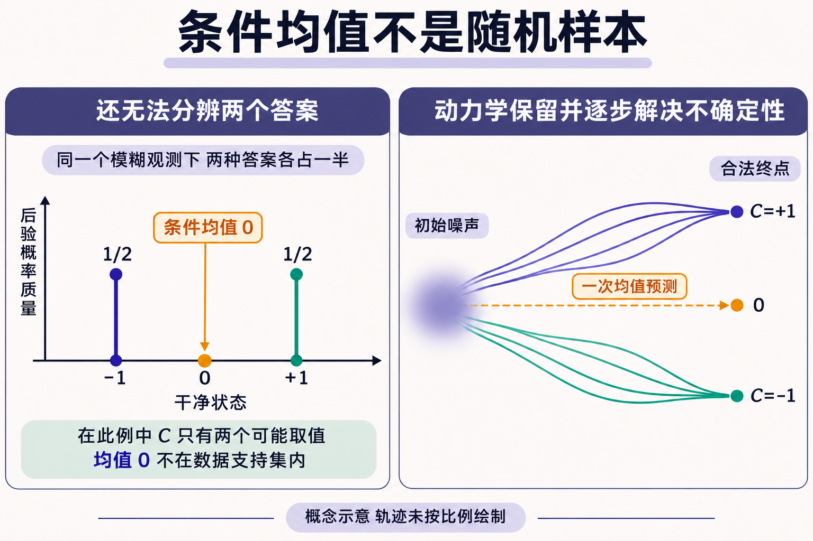

连续扩散可以从一个简单实验出发：缩放干净向量，混入高斯噪声，再训练网络根据观测猜原向量。由这个去噪任务，可以推导出条件均值、score，以及生成时的反向更新。本篇把这些关系逐步接起来。

建议先读第 1 篇。需要的知识：向量、基本导数和条件概率；本篇会解释高斯与条件均值。

## 先把概率记号读清楚

C 是干净表示这个随机变量：每抽一条训练文本并编码，就得到它的一个样本 c。Xₜ 是有噪观测，小写 x 表示某次观测值。αₜ、σₜ 是预先选择的信号与噪声系数。

条件分布 pₜ(x|C=c) 回答“原文确定为 c 时，可能观察到什么噪声状态”；后验 P(C=c|Xₜ=x) 回答“已经看到 x 时，原文更可能是什么”。两者的条件方向相反，训练去噪器要解决的是后一个问题。

即使 C 只有几个离散取值，只要 σ>0，Xₜ 也有连续密度。密度 pₜ(x) 需要对一个区域积分，才得到落在该区域的概率；它不是恰好取到实数 x 的概率。贝叶斯公式可以利用这个密度，计算离散 C 的后验。

条件期望 Dₜ(x)=E[C|Xₜ=x] 是一个函数，为每个观测给出可能干净答案的加权平均。神经网络近似的就是这条映射。D* 表示统计上的理想最优函数，Dθ 表示实际网络。

## 一条公式描述有噪声的数据

设 C 是干净表示，ε 是与 C 独立的标准高斯噪声。记号 N(0,I) 中的 I 是单位矩阵，表示噪声各坐标独立、方差均为 1。选定信号系数 αₜ 和噪声系数 σₜ，就能构造训练输入：

$$
X_t=\alpha_t C+\sigma_t\varepsilon,\qquad \varepsilon\sim\mathcal N(0,I).
$$

α 控制信号缩放，σ 控制噪声标准差。按本系列的时间方向，起点接近 α=0、σ=1，终点接近 α=1、σ=0。固定 C 后，Xₜ 的均值为 αC，协方差为 σ²I；再把不同 C 对应的高斯混合起来，就得到需要建模的有噪分布。

如果只取 α=t、σ=1−t，这就是下一篇使用的线性插值。其他曲线对应其他噪声路径；不能只看时间数值判断输入有多难。

## σ 表示标准差而不是噪声概率

在一维情况下，固定 C=c 后，有噪观测的密度可以直接写出来。注意分母中的 σ² 是方差：

$$
p_t(x\mid C=c)
=\frac{1}{\sqrt{2\pi\sigma_t^2}}
\exp\left[-\frac{(x-\alpha_tc)^2}{2\sigma_t^2}\right].
$$

若 σ 从 0.2 增加到 0.4，标准差加倍，方差从 0.04 增加到 0.16。它和“有 40% 的位置变成 mask”没有直接对应关系。一个坐标甚至会被高斯噪声推到 token 编码范围之外，连续状态允许这样的中间值。

## MSE 为什么学到条件均值

均方误差（MSE）衡量预测向量与真实向量的平方距离。把有噪输入记为 X，预测记为 D(X)，最优的 MSE 预测是给定 X 后干净数据的条件均值：

$$
D^*(X)=\mathbb E[C\mid X].
$$

可以用一个分解看清原因。把误差写成“预测减条件均值”加“条件均值减真实值”，平方展开；交叉项的条件期望为零，于是得到：

$$
\mathbb E\|D(X)-C\|^2
=\mathbb E\|D(X)-\mathbb E[C\mid X]\|^2
+\mathbb E\|C-\mathbb E[C\mid X]\|^2.
$$

第二项描述观测不充分造成的不确定性，无法靠改变 D 消除。最小化第一项就得到条件均值。这也解释了一个直觉冲突：当两个合法答案都可能时，去噪预测可能处在它们之间。这个预测适合提供下一步更新信息，却未必是可以直接输出的样本。

### 把条件均值最优性的中间步骤展开

固定一个观测 x，令 m=E[C|X=x]，a 是我们准备输出的预测向量。把 a−C 写成 (a−m)+(m−C)，再展开平方：

$$
\mathbb E[\|a-C\|^2\mid X=x]
=\|a-m\|^2+\mathbb E[\|C-m\|^2\mid X=x]
+2(a-m)^\top\mathbb E[m-C\mid X=x].
$$

最后一项是零，因为条件均值的定义保证 E[m−C|X=x]=0。第二项不随预测 a 改变，所以唯一需要最小化的就是第一项，最优解为 a=m。再对所有观测 X 取平均，就得到上一节的整体分解。

这也说明了一个学习事实：一次训练只给网络看某个真实答案 C，并不需要先为同一个 x 收集所有可能答案再计算平均。对随机样本反复做 MSE，整体最优解自然是条件均值。

假设 C 只取 ±1，正类后验为 0.8。条件均值是 0.6，最大后验答案是 +1，后验采样则以 0.8 的概率取 +1。这三种输出承担不同任务：去噪器的均值可用于构造更新方向，最终样本还要通过生成过程得到。

## score 是对当前位置求导

score 是对数密度关于当前状态的梯度，可理解为一组局部方向信息：

$$
s_t(x)=\nabla_x\log p_t(x).
$$

它说明从当前位置出发，往哪个方向微调会增加当前噪声水平下的密度。这里求导的变量是 x，不是网络参数 θ，也不是时间 t。

对上面的高斯条件分布求导，再对给定 Xₜ=x 时的 C 取平均，可以得到：

$$
s_t(x)
=\mathbb E\left[-\frac{x-\alpha_t C}{\sigma_t^2}\,\middle|\,X_t=x\right]
=\frac{\alpha_t D_t^*(x)-x}{\sigma_t^2},\qquad \sigma_t>0.
$$

这条公式把 score 与去噪器接了起来。若网络预测的是条件噪声均值，则同样有：

$$
\widehat\varepsilon_t(x)
=\frac{x-\alpha_tD_t^*(x)}{\sigma_t},
\qquad
s_t(x)=-\frac{\widehat\varepsilon_t(x)}{\sigma_t}.
$$

在 α、σ 均非零的区间，理想的干净预测、噪声预测和 score 可以按上述公式换算。但给三种输出都使用未加权 MSE，会改变不同噪声水平的训练权重，因此它们的优化效果未必相同。端点处需要单独处理。

### 从混合密度逐步推到 score

假设干净答案只有有限个 c，每个答案的先验概率为 π(c)。有噪密度是这些条件高斯的混合：

$$
p_t(x)=\sum_c\pi(c)\,p_t(x\mid c).
$$

先用 log 的求导规则，再把每项导数写成“原密度乘条件 score”，可以得到：

$$
\begin{aligned}
\nabla_x\log p_t(x)
&=\frac{\sum_c\pi(c)\nabla_x p_t(x\mid c)}{p_t(x)}\\
&=\sum_c\frac{\pi(c)p_t(x\mid c)}{p_t(x)}
\,\nabla_x\log p_t(x\mid c)\\
&=\sum_c P(C=c\mid X_t=x)\,
\nabla_x\log p_t(x\mid c).
\end{aligned}
$$

第二行的权重正是贝叶斯后验。于是，一个复杂混合分布的 score，可以由各个简单高斯的 score 按后验平均得到。若 C 连续，把求和换成积分即可，并需要满足相应的求导与积分交换条件。

固定 c 后，高斯对数密度中与 x 有关的项是 −||x−αc||²/(2σ²)，求导得到 −(x−αc)/σ²。后验平均时，x、α、σ 都已固定，只有 c 需要平均；其中 E[C|x] 正是去噪器 Dₜ(x)，于是得到前面的 score 公式。

训练因此不必直接访问未知的边缘密度 pₜ(x)。我们从已知加噪过程构造样本，用回归学习条件均值，再通过这条恒等式得到 score。

## 手算一个两个答案的去噪器



图 1 左图对应一个完全对称的模糊观测，C=−1 与 C=+1 的后验概率质量各为 1/2；橙色的均值 0 本身没有后验概率质量。右图为高维联合状态演化的投影示意，不能当作左侧标量的一维 ODE 轨迹。示意图中的曲线未按比例绘制。

令 C 只取 −1 和 +1，先验各一半。加噪观测来自两个均值相反、方差相同的高斯分布。后验赔率是“正类概率除以负类概率”，其对数 log odds 可由贝叶斯公式求出：

$$
\log\frac{P(C=+1\mid x)}{P(C=-1\mid x)}
=\frac{2\alpha_t x}{\sigma_t^2}.
$$

所以正类概率和条件均值分别为：

$$
P(C=+1\mid x)=\mathrm{sigmoid}\!\left(\frac{2\alpha_t x}{\sigma_t^2}\right),
\qquad
D_t^*(x)=\tanh\!\left(\frac{\alpha_t x}{\sigma_t^2}\right).
$$

取 α=0.6、σ=0.4、观测 x=0.2。正类后验约为 0.818，负类约为 0.182，条件均值约为 0.635。0.635 是一个很合理的平方误差预测，但干净数据只允许 ±1；它本身不是从后验中抽出的干净样本。

在对称观测 x=0 上，两类后验各一半，条件均值为零。零表示当前证据无法区分两个答案；干净数据本身仍然只有 ±1。图 1 用概率质量点与均值标记区分了这两个对象。

代入 score 关系，在 x=0.2 时得到约 1.132：

$$
s_t(0.2)
=\frac{0.6\times0.635-0.2}{0.4^2}
\approx1.132.
$$

这个正值只表示当前位置的密度上升方向朝正侧。真正的生成速度还与所选时间路径、ODE 或 SDE 系数有关；不能把 score 的数值直接当成 token 概率。

### 两个高斯的似然比怎样变成 sigmoid

在等概率 ±1 的例子里，两个高斯的归一化常数相同，先验也相同，所以计算后验比值时都能约掉。剩下的只是两个平方距离之差：

$$
\begin{aligned}
\log\frac{P(C=+1\mid x)}{P(C=-1\mid x)}
&=-\frac{(x-\alpha)^2}{2\sigma^2}
+\frac{(x+\alpha)^2}{2\sigma^2}\\
&=\frac{4\alpha x}{2\sigma^2}.
\end{aligned}
$$

记这个 log odds 为 r。若正类概率为 p，就有 p/(1−p)=exp(r)，解方程得到 p=1/(1+exp(−r))，这就是 sigmoid。条件均值则是 (+1)p+(−1)(1−p)=2p−1，化简以后得到 tanh。

| 观测 x | 正类后验 | 条件均值 | 最大后验答案 |
| --- | --- | --- | --- |
| −0.2 | 约 0.182 | 约 −0.635 | −1 |
| 0 | 0.5 | 0 | 两类并列 |
| +0.2 | 约 0.818 | 约 +0.635 | +1 |

表中固定 α=0.6、σ=0.4。观测从负侧移到正侧，平均预测平滑变化；硬类别决定却会在对称点附近切换。连续状态能利用这种平滑信息，正是后续动力学建模的一个基础。

## DDPM 如何使用噪声预测

[DDPM](https://arxiv.org/abs/2006.11239) 从许多小的高斯加噪步骤出发。它的重要便利是：训练时不必逐步跑完整条加噪链，可以直接抽一个噪声水平，一次构造对应输入，再训练噪声预测器。

DDPM 通常从干净的第 0 步开始计数，步数越大、噪声越多，与本系列的生成时间方向相反。先记住这个方向差异，再看“抽噪声水平—构造观测—预测噪声”的训练循环。

去噪器给出了构造反向过程所需的信息，但从预测得到下一状态还需要采样公式。单纯反复执行 x←D(x)，并不自动等价于一个正确的扩散采样器。

## DDPM 加噪链为什么能一次构造训练样本

为了与 DDPM 原文对照，这一小节暂用 z₀ 表示干净数据，k 越大表示越嘈杂。每一步的噪声强度是 βₖ，令 aₖ=1−βₖ，累计系数是这些 a 的乘积。

$$
q(z_k\mid z_{k-1})
=\mathcal N(\sqrt{a_k}\,z_{k-1},(1-a_k)I),
\qquad
\bar a_k=\prod_{j=1}^k a_j.
$$

独立高斯的线性组合仍是高斯，所以多步结果可以合并为：

$$
z_k=\sqrt{\bar a_k}\,z_0+\sqrt{1-\bar a_k}\,\varepsilon.
$$

这正是本篇开头的“信号加噪声”形式。训练不必真的先生成 z₁、z₂ 一直到 zₖ；只要抽 k、抽 ε，再直接计算 zₖ。之后回到本系列记号时，记住 z₀ 对应干净端 x₁。

## 把噪声预测接回完整的 DDPM 采样

继续使用 z₀ 为干净数据、k 越大噪声越多的记号，并令 aₖ=1−βₖ。先用噪声 MSE 训练网络 εθ(zₖ,k)：

$$
\mathcal L_{\mathrm{simple}}
=\mathbb E_{k,z_0,\varepsilon}
\left\|\varepsilon-\varepsilon_\theta\!\left(
\sqrt{\bar a_k}z_0+\sqrt{1-\bar a_k}\varepsilon,k
\right)\right\|^2.
$$

给定 zₖ 和真实 z₀ 时，上一时刻的条件分布可以用高斯公式精确计算。它的均值和方差是：

$$
\begin{aligned}
\widetilde\mu_k(z_k,z_0)
&=\frac{\sqrt{\bar a_{k-1}}\beta_k}{1-\bar a_k}z_0
+\frac{\sqrt{a_k}(1-\bar a_{k-1})}{1-\bar a_k}z_k,\\
\widetilde\beta_k
&=\frac{1-\bar a_{k-1}}{1-\bar a_k}\beta_k.
\end{aligned}
$$

推理时没有真实 z₀。把 z₀=(zₖ−√(1−āₖ)ε)/√āₖ 代入均值式，再用网络预测替代 ε，就得到常见反向均值：

$$
\mu_\theta(z_k,k)
=\frac1{\sqrt{a_k}}
\left(z_k-\frac{\beta_k}{\sqrt{1-\bar a_k}}
\varepsilon_\theta(z_k,k)\right).
$$

于是一次随机更新是 zₖ₋₁=μθ(zₖ,k)+σₖξ，其中 ξ 是新抽的标准高斯。反向方差 σₖ² 可以选取相应设计；一个常见选择是上述 β̃ₖ。最后一步通常不再添加新噪声。

```text
训练
  抽干净表示 z0、时间步 k、标准高斯 ε
  zk = sqrt(abar[k])*z0 + sqrt(1-abar[k])*ε
  对 epsilon_network(zk,k) 与 ε 做 MSE

生成
  z = 标准高斯
  从 k=K 递减到 1
    eps_hat = epsilon_network(z,k)
    mean = (z-beta[k]/sqrt(1-abar[k])*eps_hat)/sqrt(a[k])
    若 k>1，z = mean + reverse_std[k]*新高斯
    否则，z = mean
  将得到的干净表示按模型约定读回 token
```

精确的高斯公式描述的是 q(zₖ₋₁|zₖ,z₀)，其中真实干净端点已知。积分掉未知 z₀ 后，q(zₖ₋₁|zₖ) 一般是混合分布。DDPM 把学习的单步反向转移设为高斯，在小步条件下更合适；一次大跳的真实反向分布仍可能包含多个模式。

这套公式展示了网络、噪声目标和采样器之间的完整接口。[DDPM](https://arxiv.org/abs/2006.11239) 是这一组反向参数化与简化训练目标的出处；把它用于语言时，还需选择表示与离散读出。

## SDE 与 ODE 分别描述什么

常微分方程（ODE）描述按速度场移动的轨迹；随机微分方程（SDE）还加入持续的随机扰动。[Score SDE](https://arxiv.org/abs/2011.13456) 建立了相应 SDE 与 probability flow ODE 的联系：它们可以在每个时间具有相同分布，单条轨迹却不同。

在 ODE 中，起点给定后，后续轨迹由速度场决定；随机起点仍能产生一群不同轨迹。SDE 则在沿途继续抽取新随机量，即使从同一点出发，也可能走出不同路径。

### 不用随机积分也能先读懂 SDE 更新

在本系列的噪声到数据时间方向，一种 SDE 小步写法是：

$$
X_{t+h}\approx X_t+a_t(X_t)h+g_t\sqrt h\,\xi,
\qquad \xi\sim\mathcal N(0,I).
$$

a 是漂移，g 控制随机扰动；新噪声乘 √h，是因为时间为 h 的布朗增量方差为 h。若误写成 g·h·ξ，方差就会变成 h²，已经是另一个过程。

设 bₜ 给出目标概率路径的 ODE，sₜ 是该路径的准确 score。在密度和系数足够光滑等条件下，可以构造具有相同时间边缘分布的 SDE：

$$
\mathrm dX_t
=\bigl[b_t(X_t)+\eta_t s_t(X_t)\bigr]\mathrm dt
+\sqrt{2\eta_t}\,\mathrm dW_t,\qquad \eta_t\geq0.
$$

式中 η 只随时间变化。额外随机扩散使密度向外散开，额外的 η·score 漂移恰好抵消这部分散开；因此不能只加噪声、却保持漂移完全不变。η=0 就退回原来的 ODE。

这条对应关系可以用概率密度的演化方程验证。沿主线继续阅读时，需要掌握的是漂移怎样决定平均移动、随机增量为何乘 √h，以及随机初值与沿途加噪的区别。

## 训练只抽一次噪声，为什么采样有时每步又抽一次

构造 Xₜ=αₜC+σₜε 时，一次训练样本只需一份 C、ε 和 t；它是从一个已知边缘分布直接抽样，并没有模拟完整随机过程。

若为了画出同一条插值，把同一份 C、ε 放到不同 t 上，就得到一条光滑曲线。若改成每个 t 都重新独立抽 ε，只能得到各时间的人群快照，不能把它们连起来当作同一条轨迹。

SDE 里的逐步新噪声则有自己的缩放规律。长度 h 的 Brownian 增量方差为 h，所以随机位移为 g√h ξ。把长度 2h 的时间拆成两个 h，两份独立增量的方差相加，仍然是 2h；这就是 √h 缩放的可加性。固定一份 ε 乘上变化的 σₜ，与不断积累独立 Brownian 增量，不是同一种随机路径。

## 用概率守恒验证 score 修正

ODE 把概率密度沿速度 b 搬运，因此满足连续性方程：

$$
\partial_tp=-\nabla\cdot(pb).
$$

散度可以理解为一个小体积里流出的质量减去流入的质量。SDE 额外加入 Gaussian 扰动以后，还多出一个扩散项。对于本章的
dX=(b+ηs)dt+√(2η)dW，其中 η 只随时间变，密度演化为：

$$
\partial_tp
=-\nabla\cdot[p(b+\eta s)]+\eta\Delta p.
$$

Δp 是各坐标二阶导数的和。它描述随机扰动把密度峰向周围摊开。若 s=∇log p，那么 ps=∇p，代入得到：

$$
-\eta\nabla\cdot(ps)+\eta\Delta p
=-\eta\Delta p+\eta\Delta p=0.
$$

于是剩下原来的连续性方程。这就解释了“ODE 和某些 SDE 可以共享所有时间边缘分布”：新噪声使群体散开，score 漂移把同样的量补回来。

这个抵消是密度层面的结论，不要求两者逐样本走相同轨迹。随手在 Euler 更新后加 Gaussian，若缺少对应的漂移修正，通常会改变目标路径。

## Reverse SDE 的负号怎样在统一时间下确定

文献常把正向时间 τ 定义为数据到噪声：

$$
\mathrm dY_\tau=f(Y_\tau,\tau)\,\mathrm d\tau
+g(\tau)\,\mathrm dW_\tau.
$$

本系列使用相反方向 t=1−τ。令 Xₜ=Y₁₋ₜ，用 t 沿生成方向增加，反向 SDE 的漂移为：

$$
\mathrm dX_t
=\left[-f(X_t,1-t)
+g(1-t)^2s_t(X_t)\right]\mathrm dt
+g(1-t)\,\mathrm d\overline W_t.
$$

其中 sₜ 是 Y₁₋ₜ 的密度 score。对应的 probability-flow ODE 为：

$$
\frac{\mathrm dX_t}{\mathrm dt}
=-f(X_t,1-t)
+\tfrac12g(1-t)^2s_t(X_t).
$$

两式差了半个 g²score 与相应噪声，正好符合上一节 η=g²/2 的关系。文献若在递减的 τ 上写反向过程，公式外观会不同；判断正负应先明确积分时间在增加还是减少。

### VP 过程的一次代入

Variance-preserving SDE 的正向漂移为 f(y,τ)=−β(τ)y/2，噪声强度满足 g²=β。它使均值逐渐缩小、噪声逐渐增大。换成生成方向后：

$$
\begin{aligned}
\text{Reverse SDE: }\quad
\mathrm dX_t
&=\left[\tfrac{\beta}2X_t+\beta s_t(X_t)\right]\mathrm dt
+\sqrt\beta\,\mathrm d\overline W_t,\\
\text{PF ODE: }\quad
\dot X_t&=\tfrac{\beta}2X_t+\tfrac{\beta}2s_t(X_t),
\end{aligned}
$$

这里 β 取在 1−t 上。X 项把被压缩的信号尺度恢复，score 项根据当前密度调整方向；SDE 的额外散开还需要另半个 score 漂移抵消。

DDPM 的小步 Gaussian 链可以与这类连续过程联系起来，但实际有限步 DDPM、ODE 求解器和重新设计的随机 sampler 仍有不同离散误差。比较它们时，应先确认是否针对同一概率路径，再比较有限 NFE 下的结果。

## 为什么多模态密度的 score 不是“到最近答案的箭头”

以等概率的 C=±1 为例，在 α=0.5、σ=0.5 时，x=0 附近对两类同样可能，score 在对称点为零。这并不意味着数据分布在零点有一个合法答案；它只表示该位置的 log density 一阶导数恰好为零。

移到 x=0.2 后，后验 log odds 为 2αx/σ²=0.8，正类概率约为 0.6900，干净均值约为 0.3799。对应：

$$
s(x)=\frac{\alpha D(x)-x}{\sigma^2}
\approx-0.0401.
$$

正类后验已经较大，score 却仍略向左。这并不矛盾：score 描述当前噪声密度怎样变化，D 描述干净端点的条件平均，真正生成速度还要结合 α、σ 的变化。不能把三个对象都画成“指向最大概率 token 的同一支箭头”。

## 方法归纳与出处

[DDPM](https://arxiv.org/abs/2006.11239) 给出噪声预测、反向高斯参数化与简化训练目标；[Score SDE](https://arxiv.org/abs/2011.13456) 统一了扩散与连续时间采样。精确复现模型时，再核对其反向方差、损失权重和时间日程；研究 SDE 的严格存在唯一性时，再查相应定理。

**纸笔练习：** 固定一个 C，亲手对高斯对数密度求一次 x 的梯度。再把条件均值代进去。最后解释：为什么“均值预测位于两个答案之间”不等于整个生成分布必然变成模糊平均？下一篇会回答后半句。

## 自测参考答案

高斯 log density 中与 x 有关的项是 −(x−αC)²/(2σ²)，求导就是 −(x−αC)/σ²。再对 C 的后验平均，便出现 Dₜ。这里“平均”是用来得到局部统计量；生成器还会利用初始随机状态和正确的更新规则形成样本。

进一步考虑不均匀先验：把 C=+1、C=−1 的先验改成 0.9 和 0.1，再推一次后验赔率。下面给出结果。

### 先验不均匀与端点情况的答案

若 C=+1 的先验是 0.9、C=−1 是 0.1，后验 log odds 变成 log 9+2αx/σ²。即使观测 x=0，正类后验也应是 0.9，条件均值是 0.8；“模糊观测就各一半”只在本例先验对称时成立。

在纯噪声端 α=0 时，观测不含 C 的信息，Dₜ 等于先验均值，score 为 −x/σ²。在干净端 σ=0 时，之前涉及除以 σ 的公式不再适用；对离散 C，终点也不再拥有普通连续密度。实现会使用端点约定、时间截断或专门的离散读出。

高斯加噪定义了学习任务；条件均值把它接到 score 与反向更新；完整采样过程再把这些局部信息变成随机样本。

## 阅读导航

[返回总目录]() · [上一篇 第1篇 从离散状态走向连续状态]() · [下一篇 第3篇 从交叉熵走到 Flow Matching]()
