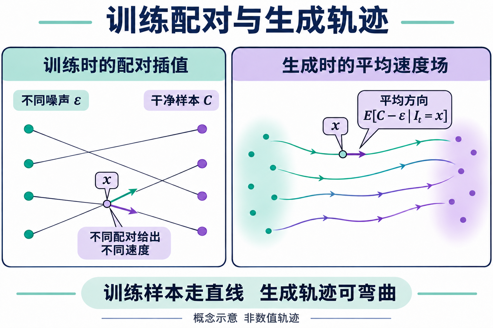
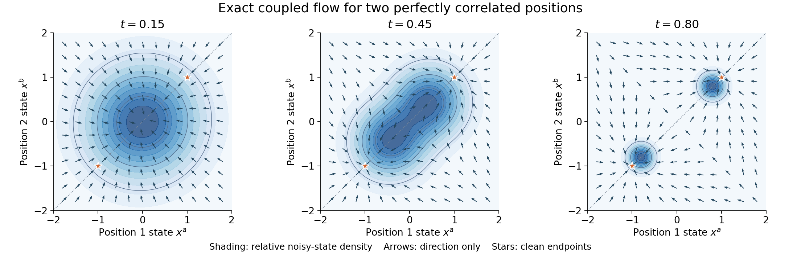

Flow Matching 把噪声到数据的生成过程写成一个随时间变化的速度场。本篇从直线插值推导这个速度，再说明熟悉的 token 交叉熵为何足以训练它。需要用到的数学只有第 2 篇的条件均值和基本求导。

建议先读第 2 篇。重点是从条件均值推到速度场，再把 token CE 接进来。

## 训练时连起噪声和数据

独立抽取标准高斯噪声 ε 和干净表示 C，定义中间观测 Iₜ。

$$
I_t=(1-t)\varepsilon+tC,\qquad
\frac{\mathrm d I_t}{\mathrm dt}=C-\varepsilon.
$$

固定一对噪声与数据后，插值轨迹是一条直线。推理时却没有配对的干净端点 C；网络必须根据当前位置和时间，判断所有可能配对的平均前进方向。

$$
b_t^*(x)=\mathbb E[C-\varepsilon\mid I_t=x].
$$

这就是条件 Flow Matching 的关键：训练时用容易计算的配对速度监督，平方回归会学到相应的条件平均速度。训练中不需要先数值求解完整生成轨迹。[Flow Matching](https://arxiv.org/abs/2210.02747) 给出了更一般的概率路径框架。

### 条件平均速度为什么是回归的答案

训练时每对样本都给出一个速度 U=C−ε。网络只能读取 Iₜ 和 t，因此在同一个观测 x 处，它不能知道实际来自哪对端点。按第 2 篇的条件 MSE 分解，回归 U 的最优函数正是 E[U|Iₜ=x]。

这不要求你能在训练数据里找到完全相同的浮点状态 x。条件期望描述总体的最优函数；神经网络用参数共享从附近样本学习这种关系，就像常见的监督回归一样。

不同训练配对的直线可能穿过同一片区域。在那里，网络学到各配对速度的条件平均；这个平均方向会随位置和时间变化，因此生成轨迹可以弯曲。



图 1 训练时，每对噪声与干净样本定义一条直线插值和对应速度；生成时，网络在给定位置、给定时间预测条件平均速度，积分轨迹可以弯曲。两幅图示意构造上的区别，左右样本不表示逐一对应的真实轨迹。右图的局部箭头沿生成曲线的切向，表示当前位置的平均速度。

## 用去噪器表示这个速度

由 Iₜ=(1−t)ε+tC，在 t<1 时可以消去 ε。代入上式：

$$
C-\varepsilon=\frac{C-I_t}{1-t},
\qquad
b_t^*(x)=\frac{D_t^*(x)-x}{1-t},
\qquad
D_t^*(x)=\mathbb E[C\mid I_t=x].
$$

Dₜ 给出当前观测下干净表示的条件均值。用它与当前位置的差除以剩余时间，就得到瞬时速度；沿这个速度移动整段状态，便得到下面的常微分方程。

$$
\frac{\mathrm dx_t}{\mathrm dt}=b_t(x_t),\qquad x_0\sim\mathcal N(0,I).
$$

ODE 的未知量是一整段序列的向量，不是某个位置的 token。实际计算需要采样器把这条方程离散成有限步，第 6 篇再展开。

## 用概率守恒说明这个速度为什么有效

要验证这个速度场，我们需要比较两群样本：直接按插值构造的 Iₜ，以及从噪声出发、沿 ODE 演化的 xₜ。目标是证明它们在每个时间具有相同分布。

取一个光滑函数 φ(x)，用它测量整群样本的统计量。它可以同时依赖多个位置，例如 φ(x)=xₐxᵦ 就能观察两个坐标的联系。沿训练插值使用链式法则，得到：

$$
\frac{\mathrm d}{\mathrm dt}\mathbb E[\varphi(I_t)]
=\mathbb E[\nabla\varphi(I_t)^\top(C-\varepsilon)]
=\mathbb E[\nabla\varphi(I_t)^\top b_t^*(I_t)].
$$

第二个等号用了条件期望：给定 Iₜ 后，∇φ(Iₜ) 已经确定，只需把速度 C−ε 对该条件取平均。

另一方面，若生成轨迹满足 dxₜ/dt=bₜ*(xₜ)，同样的链式法则给出：

$$
\frac{\mathrm d}{\mathrm dt}\mathbb E[\varphi(x_t)]
=\mathbb E[\nabla\varphi(x_t)^\top b_t^*(x_t)].
$$

两群样本从相同的初始分布出发，并遵守同一套对所有 φ 成立的演化规则。在速度场足够正则、相关期望存在且连续性方程解唯一的条件下，它们具有相同的时间边缘分布。这给出了 Flow Matching 的概率守恒解释。

如果愿意读一个紧凑的密度形式，它就是：

$$
\partial_t p_t(x)+\nabla_x\cdot\bigl(p_t(x)b_t(x)\bigr)=0.
$$

散度项描述概率质量如何流出或流入一个小区域。前面对统计量 φ 的推导称为这条密度方程的弱形式；理解主线时，先掌握链式法则与条件平均即可。

这里的“边缘分布”是指整段向量在某个时间 t 的分布，保留所有位置依赖；它不是把每个 token 的边缘概率单独拿出来。这两个不同用法值得特别分清。

## one-hot 表示把条件均值变成 token 概率

假设第 ℓ 个位置的干净表示是对应 token 的 one-hot 向量。这个向量的第 k 维只有在 token=k 时取 1，因此它的条件期望正好是 token 的后验概率。

$$
\mathbb E[C^\ell_k\mid I_t=x]
=P(w^\ell=k\mid I_t=x).
$$

训练网络输出每个位置的词表概率，并最小化逐位置 CE，就能在理想最优条件下得到这些边缘后验。把它们拼成 Dₜ，再代入速度公式，就得到完整状态的速度场。[Variational Flow Matching](https://arxiv.org/abs/2406.04843) 提供了这类分类式训练的变分视角。

对于固定词表 embedding，概率加权的 embedding 之和也可以给出干净向量的条件均值。[CDCD §3.1](https://arxiv.org/html/2211.15089v3#S3.SS1) 用类似思路从分类预测构造 score。CE、去噪器和连续动力学就在这里接上了。

### CE 最优解的三行推导

固定观测 x、时间 t 和一个位置 ℓ。令真实 token 后验为 rₖ=P(wℓ=k|x,t)，网络预测为 qₖ。条件 CE 为 −Σrₖlog qₖ，把 r 加进去再减去，就得到：

$$
-\sum_k r_k\log q_k
=-\sum_k r_k\log r_k
+\sum_k r_k\log\frac{r_k}{q_k}
=H(r)+\mathrm{KL}(r\|q).
$$

H(r) 不随网络预测变化，而 KL 非负，在 q=r 时为零。因此网络的统计最优预测就是这个位置的真实后验。one-hot 向量的每一维是一个类别指示变量，其条件期望就是相应 rₖ。

对每个位置求得这些后验，就得到整段干净表示的条件均值。由于线性插值的速度是 C 的仿射函数，只依赖 E[C|x]，构造速度场时便不必列出所有 token 组合的完整后验表。

但若你要直接从后验抽一整句，只有这些均值通常不够。能构造正确速度，与能进行一次精确联合离散采样，是两个不同的信息需求。这个区别解释了 CE 可以服务于联合流，却不能自动修复独立并行抽样的错误。

## 逐位置输出为什么没有强迫最终结果独立

第 ℓ 个位置的速度可以依赖完整的 x。也就是说，b 的第一个输出分量允许依赖第二个输入分量，反过来也一样。一个便于辨认耦合的信号是跨位置导数可能非零：

$$
\frac{\partial b_t^\ell(x)}{\partial x^j}\ne 0,\qquad j\ne\ell.
$$

这与“先预测两个边缘分布，再独立抽出两个 token”是不同的使用方式。后者立刻把不确定性变成离散决定；前者把预测用于移动当前联合状态，在后续位置和时间上继续交换信息。

独立高斯经过一个共同处理多个位置的映射，可以变成相关分布。连续流把这种联合映射分成许多小更新来学习，因此不必显式存储 V 的 L 次方种句子的概率。

## 用两个位置算出一个真正耦合的速度场

把第 1 篇的两个合法句子编码成 C=(Y,Y)，Y 等概率取 −1 或 +1；噪声 ε 的两个分量相互独立。线性插值为 Iₜ=(1−t)ε+tC。

给定当前位置 x=(xₐ,xᵦ)，两个候选类别的观测中心是 (+t,+t) 和 (−t,−t)，每个坐标的噪声方差都是 (1−t)²。与上一章相同地计算高斯似然比，就得到：

$$
P(Y=+1\mid I_t=x)
=\mathrm{sigmoid}\!\left(\frac{2t(x_a+x_b)}{(1-t)^2}\right).
$$

记下面的 m 为 Y 的后验均值：

$$
m_t(x)=\tanh\!\left(\frac{t(x_a+x_b)}{(1-t)^2}\right),
\qquad
D_t^*(x)=(m_t(x),m_t(x)).
$$

于是两个位置的速度分别是：

$$
b_t^a(x)=\frac{m_t(x)-x_a}{1-t},
\qquad
b_t^b(x)=\frac{m_t(x)-x_b}{1-t}.
$$

这里没有列举四个句子的联合概率表，但第一个位置的速度明确依赖第二个位置 xᵦ，反之亦然。当 xₐ+xᵦ 向正侧偏移，两处预测会一起朝正类调整。这就是联合动力学的一个可以手算的例子。

再把两条速度相减，会看到两个位置的差异沿着这条流收缩：

$$
\frac{\mathrm d}{\mathrm dt}(x_t^a-x_t^b)
=-\frac{x_t^a-x_t^b}{1-t}.
$$

两处速度的差使位置间差异收缩，而共同的后验均值决定正负分支。对称分界需要按动力学处理；从连续高斯抽初值时，恰好落在这条分界上的概率为零。



图 2 本节两位置例子的解析图。横纵轴分别是两个位置的连续状态；背景为该时刻的有噪密度，每幅图按自身最大值归一化。箭头只表示速度方向，长度不表示速度大小；星号是两个干净终点。这是由给定公式计算的图，不是训练模型的实验结果。

### 手动走一个会协调两个位置的小步

仍用 C=(Y,Y) 的例子。取 t=0.5，当前位置 x=(1.2,−0.2)。两个位置暂时指向不同符号，但 xₐ+xᵦ=1 让联合后验更偏向正分支。

$$
m=\tanh(2)\approx0.964028,\qquad
b^a\approx-0.471945,\quad b^b\approx2.328055.
$$

若取 h=0.05，一个 Euler 小步后得到约 (1.176403,−0.083597)。第一个位置略向下修正，第二个位置明显向上移动；两者正在协调到同一个正分支。

此时若按坐标符号提前读成硬 token，仍会得到不合法的交叉组合。连续状态尚未完成协调，应在约定终点再做离散读出。

这个例子也说明，生成速度不是各个位置各自追随当前最大类别那么简单。它依赖完整观测如何改变共同的后验判断。

## 理论保证与离散终点

前面的分布一致性结论依赖正确的速度场和准确积分。实际模型只近似条件均值，采样器也只做有限次更新；两类误差要分别检查。

精确离散分布把概率集中在孤立点上。一个在闭时间区间内始终光滑、可逆的常规流，不能把连续密度直接压成这些概率质量点。因此这里通常把离散终点理解为 t 趋近 1 的极限；实现时在接近终点处停止，再读出 token。

这也是为什么“理想联合动力学成立”和“用一两步就生成正确文本”之间还有距离。少步时的积分误差，需要额外处理。

## 把训练与采样写成两段伪代码

这段教学伪代码保留固定 one-hot 表示、CE 训练和 Euler 小步更新。时间分配与完整终止规则分别在第 5、6 篇展开。

```text
训练一次
  取一条真实 token 序列 w
  C = onehot(w)
  ε = 标准高斯噪声
  t = 抽取训练时间
  I = (1-t) * ε + t * C
  logits = network(I, t)
  loss = 各位置 token 交叉熵的平均

采样一个小步
  D = softmax(network(x, t))
  b = (D-x) / (1-t)
  x_next = x + h*b
```

训练输入 I 是直接构造的，所以这一步不用跑 ODE。采样中的 x 则由上一个更新得到，是模型真实经历的轨迹。两者的输入分布可能因网络和数值误差出现差距；少步时尤其不能忽略这个区别。

第二段是 Euler 示意，时间要避开 t=1 的除零点。最后怎样截断时间并读回 token，属于完整采样算法的一部分。

## 用一个统一训练循环接到真实模型

批大小为 B、序列长度为 L、词表大小为 V 时，one-hot 模型的状态张量为 B×L×V，输出 logits 具有相同形状。网络内部可以先投影到隐藏维度，再用 Transformer 处理，最后由输出头回到 V 类。

每批样本抽取时间与高斯噪声，直接构造 Iₜ，并把时间作为网络条件。CE 的标签仍是原 token ID，因此训练不需要把整句编码成 V 的 L 次方类之一。

噪声与数据怎样配对，称为 coupling（耦合或联合配对）。本篇采用独立配对，因而可以直接写出插值与监督速度。改变配对方式会改变中间路径和训练难度，也需要重新推导相应的速度。

实际网络容量有限、训练不完美、推理只用有限步，所以理论中的正确均值与准确积分都只能近似实现。这些误差要分别诊断：训练误差看逐时间预测，数值误差看同一网络不同步数，读出误差看连续终点附近的离散决策。

## 方法归纳与出处

[Flow Matching](https://arxiv.org/abs/2210.02747) 给出概率路径训练框架；[Variational Flow Matching](https://arxiv.org/abs/2406.04843)、[CDCD](https://arxiv.org/abs/2211.15089) 和 [Flow Map Language Models](https://arxiv.org/abs/2602.16813) 分别发展了分类式预测、连续去噪和语言流的接口。若改变概率路径或速度参数化，需进一步核对对应的条件均值关系与定理假设。

**自测：** 为什么网络能逐位置用 CE 训练，却不必独立采样 token？为什么训练配对的直线，不能直接用一个大 Euler 步替代？

## 自测参考答案

逐位置 CE 给出条件边缘后验，而它们对 one-hot 数据恰好等于逐位置条件均值。把这些均值代入速度公式，得到的是读取完整序列状态的向量场；生成时没有把它们立即独立抽成 token。

训练样本之间的配对直线只是构造概率路径的工具。不同配对可能经过相同区域，网络学的是该区域的条件平均方向；沿真正生成轨迹，这个平均方向会变化，所以一步直线外推一般不准确。

## 阅读导航

[返回总目录]() · [上一篇 第2篇 从高斯去噪理解 score]() · [下一篇 第4篇 文本应该放在哪个连续空间]()
