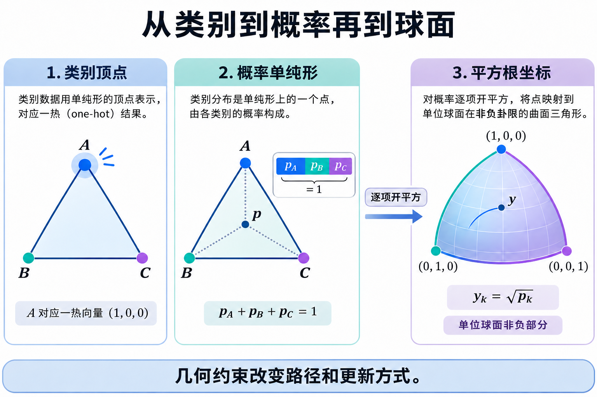

连续语言模型首先要决定：把文本放进哪个连续空间？可以从三个问题判断表示是否合适：它能否区分 token，加噪后能否恢复，以及生成结果怎样读回文本。语义相似度只是其中一个因素。

建议先读第 3 篇。重点是表示、可辨认性、状态成本和离散读出的接口。

## 先分清状态表示和网络内部特征

判断模型是否采用连续状态，要看采样器在相邻两轮之间保存并更新什么：离散 token，还是带噪向量。Transformer 内部使用实数隐藏特征，并不足以决定生成状态的类别。

词表 softmax 输出在概率单纯形（simplex）上，也就是分量非负、总和为 1 的空间。有噪状态未必受这个约束：one-hot 加高斯后的向量可以出现负数，各坐标之和也可以偏离 1。

## 编码和读出怎样组成一个语言模型

设编码器 f 把 token 序列 w 变成连续表示 C=f(w)，生成器在这个连续空间中建模，然后用 g 把生成结果读回文本。最基本的问题是 g(f(w)) 是否能恢复原文。

one-hot 配 argmax 可以在干净顶点上精确恢复 token。互不相同的词表 embedding，也能在无噪声时用最近邻恢复。压缩潜变量通常还要学习解码器（decoder），因此存在重建误差；若 decoder 输出一个分布，同一 latent 也可能对应多条文本。

最终文本分布由连续生成器与读出过程共同决定。判断系统质量时，要同时看表示能否生成、生成结果能否正确解码，以及最终文本的表现。

## 六种常见表示各自付出什么成本

| 表示 | 直观形式 | 主要收益 | 需要检查 |
| --- | --- | --- | --- |
| One-hot | 每个 token 是一个词表坐标顶点 | 身份清楚 不必训练编码器 | 状态维度随 V 增长 |
| Binary | 每个 token 是一串 bit | 单位置维度可降到约 log₂V | 编码安排及无效 bit 组合 |
| 词表 embedding | 一个 token 对应一个 d 维向量 | 状态紧凑 可以学习几何 | 范数 间距 坍塌及读出 |
| 上下文 embedding | 同一 token 在不同句子中表示不同 | 可利用上下文和预训练知识 | encoder 与 decoder 是否匹配 |
| 压缩 latent | 一小段 latent 表示更多 token | 减少扩散序列长度或状态量 | 压缩损失及 decoder 成本 |
| Simplex 或球面 | 状态受概率或几何约束 | 对结构作明确建模 | 更新是否满足空间约束 |

图 1 这里只展示类别顶点、概率点与平方根球面坐标的关系。逐项平方根改变坐标和对应度量，保留自由度；它与低维 embedding 的压缩作用需要分别理解。图为几何示意。

这些方案可以组合。球面 embedding 可以是低维的，概率 simplex 可以映射到球面，上下文编码也可以进一步压缩。后面的比较应围绕具体状态与接口展开。

## one-hot 是理解算法的好起点

one-hot 不要求先学语义空间，也不会把两个 token 编成同一个点。第 3 篇的条件均值与词表概率关系尤其透明。[Flow Map Language Models](https://arxiv.org/abs/2602.16813) 采用这一入口。

代价是采样状态有 L×V 个标量。网络内部投影可以降低隐藏特征的维度，词表维状态与输出头的存储、计算仍需分别统计。

[Analog Bits](https://arxiv.org/abs/2208.04202) 则展示了另一种编码思路：先把离散变量编码为 bit，把 bit 当连续数生成，最后阈值化。压缩维度以后，编码几何本身会影响学习难度。

## embedding 的距离会决定什么时候丢失身份

取两个 token 的向量 eₐ、eᵦ。高斯加噪后，两类中心的距离是 α 倍的原距离，而噪声尺度是 σ。粗略的可辨认程度可以用下面的比值理解：

$$
\frac{\alpha_t\|e_a-e_b\|}{\sigma_t}.
$$

比值很小，两类观测高度重叠；比值很大，局部向量本身就足够识别 token。如果大部分训练时间都落在特别容易识别或几乎没有上下文结构可用的区域，训练分配就可能低效。

联合学习 embedding 时，既要保留 token 身份，也要控制尺度。整体放大词向量会改变有效信噪比（SNR），因而会改变去噪任务本身。[CDCD §3.2](https://arxiv.org/abs/2211.15089) 通过归一化约束联合学习的词向量尺度。

## 从 embedding 的高斯观测推导 token 后验

先看单位置分类：token k 的先验为 πₖ，编码为 eₖ，观测为 x=αeₖ+σε。固定先验与所有词表向量后，由贝叶斯公式得到：

$$
P(w=k\mid x)
\propto \pi_k\exp\left[
\frac{\alpha e_k^\top x}{\sigma^2}
-\frac{\alpha^2\|e_k\|^2}{2\sigma^2}
\right].
$$

推导只需展开 −||x−αeₖ||²/(2σ²)。其中 −||x||²/(2σ²) 对所有类别相同，可以在归一化中约掉；剩下的就是内积、向量范数和先验。

若所有 embedding 范数相同、先验均匀，最优判别只比较 eₖ 与 x 的内积。若范数或先验不同，相应项也会影响决策；因此最近邻、内积最大与网络分类头不总是同一规则。

对于一整句，先验含跨位置依赖，不能把上面的单位置 πₖ 随意相乘当作真实句子后验。去噪 Transformer 的作用，就是利用完整有噪序列学习这些更复杂的条件概率。

如果网络给出各 token 后验 qₖ，干净 embedding 均值为：

$$
D_\theta(x)=\sum_{k=1}^{V}q_{\theta,k}(x)\,e_k.
$$

它是一个加权平均，可能位于多个词向量之间。最终读出可以另用分类头或最近邻；中间生成速度则可以直接使用这个均值。CDCD 的 score interpolation 正是把这种分类预测接到连续去噪统计量上的一条路线。

## 两类向量加高斯噪声时有多难区分

先看等先验的二类问题。两个 token 的 embedding 相距 dₑ，都加入相同的各向同性高斯噪声。最优分类器只需要比较观测在两中心连线上的投影。

两个加噪中心的距离为 αdₑ，中间的决策边界距离每个中心为 αdₑ/2。因此，在这个二类理想设置中，错误率为：

$$
P_{\mathrm{error}}
=\Phi\!\left(-\frac{\alpha_t d_e}{2\sigma_t}\right),
$$

这里 Φ 是标准正态分布的累计概率函数。它给出一个可解释的事实：噪声难度取决于信号间距与噪声尺度的比例，不能脱离表示谈一个通用的“好 schedule”。

例如两个中心距离为 2，α=0.6、σ=0.4，则错误率约为 Φ(−1.5)=6.7%。多词表和有上下文的真实模型更复杂，但这道小题适合检查 embedding 范数变化是否悄悄改变了任务难度。

## 大词表为什么会改变可辨认难度

在 one-hot 的单位置例子中，正确坐标有额外信号 α，其余坐标只有高斯噪声。即使每个错误坐标的噪声尺度固定，V 越大，就有越多机会出现一个极大的错误噪声坐标。

独立标准高斯的最大值，其典型尺度随 √(2 log V) 增长。竞争者越多，正确坐标就越难胜出；这个数量级关系解释了词表大小的影响，但不能替代精确错误率。

它说明两种难度可以分开变化：向量离干净点有多远，以及 token 身份还能否读对。对大 V 调 schedule 时，后者往往特别重要；这也为选读 A 的混合 corruption 设计提供了动机。

## 状态维度降低意味着多少存储

取 L=1024、V=32768，每个标量用 2 字节保存，则单份 L×V 的 one-hot 维状态占 64 MiB。若改为 d=128 的 embedding 状态，单份状态占 256 KiB。

这里仅统计一份状态张量，未计入网络权重、注意力激活、输出 logits、求解器临时状态或反向图。状态存储相差 256 倍，并不意味着端到端速度也相差 256 倍。

把这一项单独报告很有用：它说明方法到底在省状态存储，还是在省主干计算。对非常大的 V，词表概率头可能仍然是显著成本。

## 联合学习表示时的两个退化方向

如果只优化干净 embedding 的去噪 MSE，同时允许目标 embedding 自由变化，就存在坍塌解：所有 eₖ 都为零，去噪器也恒输出零，MSE 便可为零，但 token 身份已经丢失。

分类 CE 可以阻止把身份问题彻底藏起来，但又可能鼓励 embedding 范数不断增大：噪声尺度固定时，把类别中心推得很远，就更容易从本地观测认出身份。分类 loss 降低，未必表示句子层面的先验建模已经改善。

范数约束、重建目标、似然训练以及噪声日程的共同优化，都是为了限制这类退化，让模型学习有用的身份与分布结构。

### Binary 表示里的无效编码

例如三个 token 用 A=00、B=01、C=10 编码，11 就没有对应 token。连续 bit 最后阈值化时，需要考虑是否生成无效组合，以及用什么规则把它修复成有效 token。

也不能默认逐 bit 的最佳预测就等于最佳 token 预测。Bit 之间的关系以及 token 编码约定，都会影响最终错误类型。Binary 的状态更紧凑，但把一部分结构要求转移到了编码和联合 bit 建模中。

二进制编号也会改变编码几何。例如 011 与 100 的数值相邻，却有三个 bit 不同，Hamming 距离为 3。压缩 token ID 后，仍需检查编码安排如何影响错误类型，不能从编号相邻推断语义相近。

## latent 方法把一部分难题交给 decoder

[Latent Diffusion for Language Generation](https://arxiv.org/abs/2212.09462) 先训练语言自编码器，再在 latent 空间训练扩散，最后用 decoder 生成文本。质量取决于两个接口：生成器能否产出合适的 latent，decoder 能否稳定地把它解码。

## 压缩与可生成性是两个独立目标

一个 autoencoder 在真实文本上的重建很好，只说明 decoder 能处理 encoder 实际产生的 latent。扩散器生成的 latent 可能偏离这片区域；decoder 对这些点如何响应，才是生成阶段的接口问题。

可以把“真实文本编码后重建”“真实 latent 加噪后恢复”“纯噪声生成 latent”列成三组实验。若重建很好、纯噪声生成却差，就继续区分：latent 分布难学、噪声路径不合适，还是 decoder 对输入偏移过于敏感。

## Latent 模型的概率接口

若 z 是压缩 latent，pθ(z) 是连续生成器，pφ(w|z) 是文本 decoder，则完整模型是：

$$
p_{\theta,\phi}(w)=\int p_\theta(z)\,p_\phi(w\mid z)\,\mathrm dz.
$$

重建训练主要约束 encoder 给出的 z 与 decoder 的配合；扩散训练主要约束 pθ(z) 能否接近编码分布。两边都做得好，才有理由期待纯噪声生成的 z 能稳定解码。

若 decoder 很强，它可能在没有有效 z 的情况下也生成流畅文本。检查 latent 是否有用，可以比较正确 z、打乱 z 和移除 z 的行为；同时注意打乱可能制造分布外输入，最好和重新训练的控制实验配合。

对于带 AR decoder 的系统，要分别计算 latent 生成与文本实现的成本。减少扩散步数只能直接改善前者，整体延迟还取决于 decoder、缓存、输出长度和 batch。

对上下文 latent，还要检查编码覆盖的范围：它依赖单个 token、一个 block，还是整句？这个范围决定了生成器建模的单位，也影响长度控制和局部修改。

## Diffusion-LM 怎样把词向量训练成可生成的空间

[Diffusion-LM](https://arxiv.org/abs/2205.14217) 的基本流水线是：token 经可学习的词表 E 变成向量；在向量上加入高斯噪声；Transformer 预测干净向量；由最终连续向量恢复 token。它让词表几何与去噪网络一起学习。

这条路线的训练问题可以写成三项职责：

$$
\mathcal L
=\mathcal L_{\mathrm{denoise}}
+\lambda_{\mathrm{rec}}\mathcal L_{\mathrm{token}}
+\lambda_{\mathrm{norm}}\mathcal R(E).
$$

去噪项要求网络恢复正确向量；token 重建项要求不同词仍然能被读出来；尺度约束防止只靠放大向量让噪声相对变小。这里是职责的示意分解，具体扩散时间的边界项与权重由其概率模型确定。

为什么重建项不可省？假如把“猫”和“狗”的词向量都设成同一个点，向量 MSE 的任务会更容易，但生成器已经无法仅凭那个点知道应该输出哪一个词。相反，如果只训练带噪分类且不限制范数，把所有向量推得极远，也能降低分类难度，却没有学好跨 token 的组合关系。两个方向需要分别控制。

Diffusion-LM 的另一项关键设计是噪声层级上的可微分类器：分类器读取连续状态，梯度可以修正去噪方向。这也是早期连续文本模型先在可控生成上发挥作用的原因。表示、重建和引导在这条方法中是同一套连续接口的不同用途。

## CDCD 把向量回归换成类别后验，再由后验恢复 score

[CDCD](https://arxiv.org/abs/2211.15089) 的接口更接近离散 dLLM：网络直接预测 token 概率 qθ(k|Xₜ,t)，用真实 token CE 训练。它不让网络自由输出任意干净向量，而是令：

$$
D_\theta^i(X_t,t)
=\sum_{k=1}^{V}q_\theta^i(k\mid X_t,t)E_k.
$$

对于高斯观测，score 可以由这个条件均值解析得到。于是训练过程在类别空间，生成过程在连续向量空间。假设某位置预测“猫”0.6、“狗”0.4，给求解器的干净估计就是 0.6E猫+0.4E狗，而不是先随机选猫或狗；后续整段状态继续变化，再逐渐选择最终答案。

这有两个实现后果。第一，q 的 V 个输出仍然存在，但连续状态只需要 d 个坐标。第二，CE 与 E 共同训练会倾向于把向量分开，因此 CDCD 对词向量做归一化，阻止通过范数增长降低噪声难度。它还从训练 CE 拟合时间变换，让快速丢失 token 信息的噪声区间得到更多训练和采样节点；第 5 篇会给出具体算法。

CDCD 因而不能简单归类为“Diffusion-LM 换了一个 loss”：输出参数化、几何约束和时间分配是联动的。

## SED 的固定词表与上下文表示有什么不同

[SED](https://arxiv.org/abs/2211.04236) 从预训练 BERT 的词表取得向量，固定 E，并将其范数调整到与高斯尺度相配合。它用向量 MSE 训练去噪器，再训练一个词表 readout 把最终向量转换为 token；readout 的重建 CE 不回头改变固定 E。

这里用的是“预训练模型提供的词表向量”：给同一个词 ID 查表，不同句子仍然返回同一个向量。它有预训练几何，但不是“这个词在当前句子中的整层 hidden state”。两者经常都被称为 embedding，训练任务却不同。

固定 E 让扩散网络面对一个稳定目标，避免表示在训练中漂移。代价是：预训练时对分类或语言理解有用的距离，未必最适合从高斯噪声逐渐生成；扩散损失不能再调整它。SED 加入 self-conditioning，让网络沿采样步骤重复修正干净向量预测，这是对推理过程的改进，并没有把固定词表变成一个联合学习的上下文编码器。

## ELF 把上下文向量去噪与最后一次解码放进同一个网络

[ELF v3](https://arxiv.org/abs/2605.10938v3) 的一条主要配置使用 T5 编码器的上下文表示 C=Enc(w)。Cᵢ 已经受整段句子影响：同一个词出现在不同上下文，可以对应不同向量。这把一部分语言结构放进了生成目标。

ELF 使用线性插值 Xₜ=tC+(1−t)ε，并让网络输出干净向量 Dθ，而非直接回归高维 Gaussian 速度。其 flow-matching 平方误差可以等价写为：

$$
\left\|
\frac{D_\theta(X_t,t)-X_t}{1-t}-(C-\varepsilon)
\right\|^2
=\frac{\|D_\theta(X_t,t)-C\|^2}{(1-t)^2}.
$$

这说明“预测干净向量”与“优化速度误差”可以同时成立；把右侧的时间权重丢掉，则是另一个训练目标。

它还需要把上下文向量还原成文字。ELF 让同一个网络有 denoise、decode 两种模式：普通时间处理连续去噪；最终 decode 模式接 unembedding 矩阵，输出所有位置的 token logits，用 CE 训练。解码分支的输入也施加专门的扰动，让它学习处理不完美的向量，而非只会复制理想编码器输出。

完整推理因此是：

~~~text
X = Gaussian noise [L,d]
对每个积分节点 t：
    C_hat = net(X,t,mode=denoise)
    用 (C_hat-X)/(1-t) 更新连续状态
h = net(X,1,mode=decode)
tokens = argmax(unembed(h))
~~~

成本差别体现在最终的 decode 与 unembedding。ELF 不必在每个中间步骤计算完整词表 head，但终点需要一次解码调用。它与“每步预测 q，再用 E 加权”的 CDCD、LangFlow 接口不同，也与需要额外 AR decoder 的压缩 latent 模型不同。

## LD4LG 把长度和维度一起压缩，再交回 AR decoder

[LD4LG](https://arxiv.org/abs/2212.09462) 先建立一个可重建文本的压缩接口。预训练 BART 或 T5 编码器把 L 个 token 变为 L 个 hidden states；少量可学习的 latent queries 通过 cross-attention 汇聚这些状态，再投影到更低维空间。

论文的单语实验使用 32 个 latent、每个 64 维，状态一共 2,048 个标量。一个对照例子是 L=128、d=768 的逐 token 上下文状态，需要 98,304 个标量。这个对比只算流动的状态，不包含网络参数和 decoder，也不保证相应的计算就按 48 倍缩小。

重建过程先把低维 latent 投回预训练 decoder 所需的特征宽度，再让 AR decoder 通过 cross-attention 逐 token 生成原句。单语配置默认固定预训练编码器、decoder，只学习压缩和重建模块；随后在所得 latent 分布上训练扩散模型。

其生成流程是：

$$
\varepsilon\in\mathbb R^{32\times64}
\xrightarrow{\text{latent diffusion}}z
\xrightarrow{\text{reconstruction network}}h
\xrightarrow{\text{AR decoder}}w.
$$

这是一种很具体的分工：扩散负责整句的低维全局信息，decoder 负责把它实现为流畅的 token 序列。若把 latent 生成压到一步，文字生成仍然可能是串行的。因此评价这条路线，需要分别统计 latent denoiser 的 NFE、decoder 的串行长度，以及两部分的参数和缓存。

## LDLM 的联合训练具体改了哪些梯度

固定 autoencoder 的潜在问题是：重建文本学得很好，但扩散所产生的微小表示误差恰好跨过 decoder 的敏感边界。只继续加大去噪器，不一定能改善这个接口。[LDLM v2](https://arxiv.org/abs/2605.07933v2) 让表示跟随扩散目标调整，并把重建监督分成两层。

先由固定语言编码器得到上下文 h，再由可训练编码器 Aφ 得到 z；latent decoder Bψ 重建 h，token decoder Pω 读出文字：

$$
h=E_{\mathrm{frozen}}(w),\qquad
z=A_\phi(h),\qquad
\widehat h=B_\psi(z+\sigma_{\mathrm{dec}}\xi).
$$

它的三项训练信号是：

$$
\begin{aligned}
\mathcal L_{\mathrm{diff}}&=
\mathbb E\|D_\theta(z_t,t)-z\|^2
\quad\text{带相应时间权重},\\
\mathcal L_h&=\mathbb E\|\widehat h-h\|^2,\\
\mathcal L_w&=
-\mathbb E\log P_\omega(w\mid\operatorname{sg}(\widehat h)).
\end{aligned}
$$

关键是最后的 sg：token CE 只训练文字读出，不把“每个 token 必须极容易区分”的梯度继续传回 latent encoder。表示主要由 hidden-state 重建与扩散共同塑形。否则在带噪重建下，CE 会强烈推动相似词的 latent 分离，未必有利于连续生成。

联合学习还会产生早期拉扯。重建倾向于扩大表示以抵抗扰动，去噪 MSE 则可能推动表示缩小。LDLM 因此先让重建建立可读出的空间，再逐渐打开扩散损失流向 latent encoder 的梯度；扩散网络本身可以从开始就训练。随着表示变化，它还重新估计有用的噪声区间。

解码器输入噪声 σdec 也有明确职责：迫使重建使用稳定信息，并让 decoder 在训练时见过偏离理想 latent 的状态。推理时，直接解码扩散生成的 latent，不再额外加入这份训练扰动。是否压短序列由编码器配置决定，“联合训练 latent”本身并不等于“一定把 L 压成很短的 M”。

## Cola DLM 把连续先验和文字实现分成两层

[Cola DLM](https://arxiv.org/abs/2605.06548) 的核心概率接口为：

$$
p(w,z)=p_{\mathrm{dec}}(w\mid z)p_{\mathrm{flow}}(z),
\qquad
p(w)=\int p_{\mathrm{dec}}(w\mid z)p_{\mathrm{flow}}(z)\,\mathrm dz.
$$

训练时的 encoder qφ(z|w) 用来把数据放进 latent 空间，推理时不必存在：生成只需要先验和 decoder。它先预训练带辅助 masking 任务的 causal VAE，再联合训练 latent flow，并用参考编码器限制表示漂移。连续先验按块组织：已完成的 latent blocks 提供因果上下文，当前块内部则并行去噪。

从一个普通 VAE 的目标出发，可以理解它为何需要共同调整两部分：

$$
\mathbb E_{q_\phi(z\mid w)}
[-\log p_{\mathrm{dec}}(w\mid z)]
+\mathrm{KL}(q_\phi(z\mid w)\|p_{\mathrm{flow}}(z)).
$$

第一项要求 latent 保留重建需要的信息；第二项要求这些 latent 的分布能由先验产生。在实际实现中，连续先验的学习通过 flow matching 完成，不能把“用了 FM”直接等同于每个理论 KL 都被精确算出。固定 latent 时，先验只能追赶已有分布；联合训练时，encoder 也可以把数据分布整理成更好生成的形状。

## Binary 路线到底节省了什么

one-hot 用 V 个坐标代表一个词，binary 只需要 b=⌈log₂V⌉ 个 bit。但计算节省取决于网络怎样组织这些 bit。[CoBit](https://arxiv.org/abs/2605.07013) 将 bitstream 分组送入 Transformer，用小的 bitwise head 替代每位置的 V 类 head，并利用单个带噪 bit 的解析后验，再学习上下文修正。

这可以用一个 bit 的手算看懂。令干净 bit B∈{−1,+1}，观测 Y=αB+σε，先验等概率，则：

$$
\Pr(B=+1\mid Y=y)
=\operatorname{sigmoid}\!\left(\frac{2\alpha y}{\sigma^2}\right).
$$

这个式子只使用本 bit 的证据。语言网络额外需要利用其他 bit 和其他词，修正“某个 bit 单独看来很像 1，但与整句或同一词的其他 bits 不协调”的情况。直接分别训练、分别抽所有 bit，会产生 bit 组合间的依赖问题，不能因 head 变小就忽略它。

编码还会引入人为几何：编号相邻的词可能相差许多 bit，语义无关的词也可能只差一个 bit。H-CoBit 额外建模预训练词向量聚类的代码，为 bitstream 加入语义层次。这说明从 one-hot 换成 binary，并非纯粹的无损矩阵压缩；噪声距离与学习任务也随之改变。

## 怎样判断一个表示真的更适合扩散

除了理想编码状态的重建率，至少要比较三类输入：真实编码、加上受控扰动的编码，以及模型实际生成的状态。前两类之间的落差反映局部 decoder 稳定性；第二、三类之间的落差反映真实生成误差是否落在训练覆盖的方向。

例如两个 decoder 都能完美重建训练编码。把编码沿生成器常见的误差方向移动 0.01，甲仍然输出原句，乙却换了关键词。只报告 clean reconstruction，二者完全相同；实际生成中则可能差很多。LDLM 的 noisy decoding、ELF 的解码扰动和不同 latent 训练方法，正是在处理这种接口误差。

低有效秩也不能直接当作 collapse。真正的 collapse 是任务所需的信息变得不可恢复；低秩空间仍可能把所有词和句子分清。[RePlaid](https://arxiv.org/abs/2605.18530v3) 的观察尤其值得区分：额外 CE 将表示“摊得更开”以后，其 likelihood bound 反而变差。评估表示时，应检查它支持的生成与读出，而不是单凭秩、距离更均匀或重建更容易就判定优劣。

## 怎样为自己的实验做选择

若想研究采样或少步映射，先用易于解释的 one-hot 路线，比较容易隔离变量。若受状态内存限制，embedding 更值得投入。若目标是利用现有 encoder decoder 或缩短扩散序列，再考虑上下文与压缩 latent。

先按实验问题选择表示，再增加几何约束。Simplex 与球面方法在选读 B 展开。

## 方法归纳与出处

[Diffusion-LM](https://arxiv.org/abs/2205.14217)、[CDCD](https://arxiv.org/abs/2211.15089)、[Analog Bits](https://arxiv.org/abs/2208.04202) 与 [LD4LG](https://arxiv.org/abs/2212.09462) 提供了 embedding、bit 与 latent 的具体方案。复现某一系统时，再核对其编码器、压缩率、预训练权重和读出实现。

**自测：** 一篇论文说使用 pretrained embedding，你会检查它是固定词表表项、上下文 encoder 输出，还是压缩 latent 吗？它的 decoder 是逐位置读出，还是需要再跑一个生成模型？

## 自测参考答案

先定位采样器每轮保存的状态，再看 encoder 和 decoder。词表 embedding 对同一个 token 总是给出同一个向量；上下文 embedding 会随上下文变化；压缩 latent 还可能改变序列长度。这些路线对可辨认性、重建和推理成本提出不同要求。

如果只想复现动力学，先用身份清楚的表示；如果研究表示本身，就固定动力学和预算，单独比较恢复难度、重建上限与最终生成。

## 阅读导航

[返回总目录]() · [上一篇 第3篇 从交叉熵走到 Flow Matching]() · [下一篇 第5篇 连续模型怎样训练好]()
