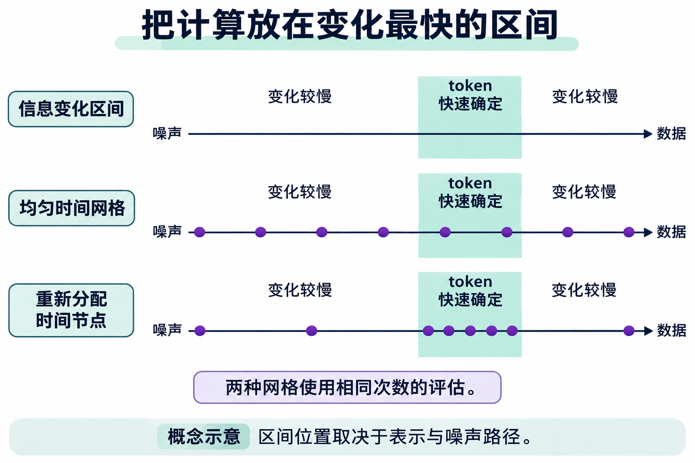
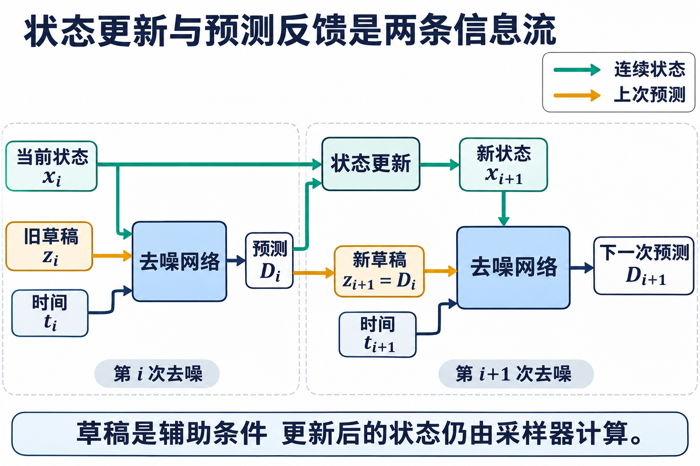

表示和动力学确定以后，训练还要决定：预测什么、把预算分给哪些噪声水平，以及是否保留上一次预测。本篇分别解释这些选择，让每项改动的作用都能落到具体训练环节上。

建议先读第 4 篇。重点是把目标、噪声路径、训练权重和辅助输入分开分析。

## 先看预测对象再看损失函数

| 目标 | 网络学习的量 | 常见训练形式 |
| --- | --- | --- |
| 干净表示 | 条件均值 Dₜ | 向量 MSE 或 token CE 后映射 |
| 噪声 | 条件噪声均值 | 噪声 MSE |
| 瞬时速度 | bₜ | Flow Matching 回归或去噪重参数化 |
| Score | 对数密度对状态的梯度 | Denoising score matching |
| 似然 | 一个完整概率模型给文本的概率 | 变分界及相应加权项 |

有些扩散模型把 v prediction 定义为 αε−σC 一类特定组合，它未必等于当前时间坐标下的 dx/dt。遇到 v 时，应先检查定义，再判断它是否表示瞬时速度。

CE 和 MSE 在理想条件下有时能提供同一个均值所需的信息，但有限模型、噪声权重和 embedding 联合学习，会让它们的实际效果不同。选择损失还必须与表示的可训练参数一起分析。

## 换一个预测目标也会换训练权重

在线性插值下，把同一个干净预测 Dθ 换成速度预测 bθ=(Dθ−x)/(1−t)。训练配对的真实速度是 u=C−ε=(C−x)/(1−t)，所以每个样本都有：

$$
\|b_\theta-u\|^2
=\frac{\|D_\theta-C\|^2}{(1-t)^2}.
$$

这意味着，未加权的速度 MSE 与未加权的干净预测 MSE，并不是同一个训练目标。前者在这个参数化下，等于额外用 1/(1−t)² 加权后者。接近终点时，这个权重会很大。

这条等式比较的是两种 MSE 参数化。更换预测目标时，还应检查输入输出缩放、损失权重和时间采样，否则无法区分收益来自预测对象，还是来自隐含的重加权。

## 用目标函数看清训练任务

先固定表示和噪声路径。在 token CE 的设置中，一个一般目标为：

$$
\mathcal L(\theta)
=\int_0^1 \lambda(t)\,
\mathbb E_{w,\varepsilon}\left[
-\frac1L\sum_{\ell=1}^L
\log q_\theta(w^\ell\mid X_t,t)
\right]\mathrm dt.
$$

λ(t) 指定哪些噪声水平在目标中更重要，训练时抽取 t 的分布决定怎样估计这个积分；二者可以有意配合，也可以通过重要性补偿分开。

固定时间与观测后，CE 等于真实后验熵加上预测与真实后验的 KL。高 CE 既可能来自观测信息不足，也可能来自网络误差；因此分配训练预算时，要区分不可消除的不确定性与尚未学好的部分。

把模型预测熵、真实后验熵和 CE 混用也会误判。前者只描述网络自己有多不确定；一个过度自信但经常答错的网络，可以有很低的预测熵和很高的 CE。

## 为什么语言的噪声 schedule 需要单独设计

对图片而言有用的噪声区间，不一定适合 token 身份恢复。词表大小、向量间距和范数会影响 token 在何时变得可识别。第 4 篇的距离与噪声比，解释了这种依赖。

固定表示尺度后，常用下面的系数比标记信噪水平，称为 SNR。其绝对含义仍与表示的归一化约定有关：

$$
\mathrm{SNR}(t)=\frac{\alpha_t^2}{\sigma_t^2}.
$$

log SNR 与 log NSR 的符号相反：后者是噪声与信号的比。统一时间方向时，也要一起核对这个符号，避免把更干净与更嘈杂读反。

## 三种调整不能混成一件事

第一种是改变路径 αₜ、σₜ，也就是每个时间对应什么分布。第二种是改变训练中抽取 t 的频率或损失权重。第三种是保持模型不变，只改变推理时有限步的落点。这三者可以有关联，但作用不同。

比如，若原目标是积分 λ(t)ℓ(t)，改为从 q(t) 采样，为保持同一个积分目标，需要对应的重要性权重：

$$
\int_0^1\lambda(t)\,\mathbb E[\ell(t)]\,\mathrm dt
=\mathbb E_{t\sim q}\left[\frac{\lambda(t)}{q(t)}\ell(t)\right].
$$

改变抽样分布而不补偿，会改变训练权重；加入相应补偿，则可以保持原积分目标，只改变估计方式。[CDCD §3.3](https://arxiv.org/abs/2211.15089) 的 time warping 可在这个框架下理解。

[LangFlow §4](https://arxiv.org/abs/2604.11748) 根据去噪过程中信息变化的区间分配训练与采样预算。核心问题是 CE 随噪声水平在哪里变化最快，以及把计算移到这些区域后，是否改善了生成。

## 时间重参数化会怎样同时影响训练和采样

令 τ=F(t) 单调递增，并保持两端对应。若在 τ 上均匀抽样，诱导到 t 上的密度为 F′(t)。若沿 τ 写 ODE，则速度也需要链式法则：

$$
\frac{\mathrm dx}{\mathrm d\tau}
=b_t(x)\,\frac{\mathrm dt}{\mathrm d\tau}.
$$

在 τ 上均匀取点，会在原来的 t 轴上得到非均匀网格。这样可以展开狭窄的 token 识别过渡区，让时间条件和有限步求解都更充分地利用它。

重参数化必须同时处理抽样密度、损失权重和速度的链式法则。遗漏相应变换，就可能改变训练目标或生成动力学。

### 用信息曲线理解 schedule 的目标

把平均剩余不确定性记为 H(t)。沿噪声到数据方向，它总体上下降。若希望各步消除近似相同的信息，可以把更多节点放在 −H′(t) 较大的区间，也就是不确定性下降最快的地方。

关键在于变化率。纯噪声端的 H 可能很高，但时间稍变时几乎没有新信息；值得增加节点的，是信息快速改变的过渡带。



图 1 相同节点预算下，均匀时间网格可能只有少数节点落在信息快速变化的区间；重新安排时间，可以在该区间分配更多节点。两行各有 8 个节点。过渡带位置仅作示意，实际应由表示、路径和统计量确定；这张图解释节点分配的直觉，不代表某篇方法的测量结果。

CDCD 的 time warping、FLM 的 token 可辨认性日程、LangFlow 的信息分配原则，都在重新安排去噪进度。它们采用的统计量和优化方式不同，合适的节点仍要结合表示与任务验证。

## self-conditioning 让网络带着上一次判断继续工作

普通去噪器只读取当前状态和时间。Self-conditioning 额外输入一次旧预测：

$$
\widehat C_i=D_\theta(x_{t_i},t_i,z_i),\qquad z_{i+1}=\widehat C_i.
$$

直觉上，它给网络保留了一份“上次认为答案是什么”的草稿。连续状态本身仍然更新，草稿只作为辅助条件。



图 2 Self-conditioning 的推理信息流。青色通道是由采样器更新的连续状态，琥珀色通道是传给下一轮的干净状态预测草稿。两处网络框表示同一组权重在不同时间的调用。草稿与连续状态承担不同作用；训练时如何生成无梯度草稿，见下文伪代码。

一种常见训练做法，是随机为部分样本增加辅助预测：先做一次无梯度前向，再把结果作为草稿输入有梯度的预测分支。推理时，第一轮从空草稿开始，后续轮次使用上一步预测。

[Analog Bits](https://arxiv.org/abs/2208.04202) 使用了这种预测反馈技巧，LangFlow 则研究了它在语言模型中的作用。评估时既要统计额外前向成本，也要观察错误草稿是否导致重复或过早确定。

## self-conditioning 的训练接口长什么样

下面是一种教学用的训练结构。detach 把第一份预测当作常量输入，使第二次前向的梯度不再穿过它。具体启用概率与输入形式可以随实现变化。

```text
z = 全零辅助输入
以一定概率执行
  在不记录梯度的条件下
    z = network(noisy_state, time, zeros)
  z = detach(z)

prediction = network(noisy_state, time, z)
loss = 对 prediction 计算训练目标
只对有梯度的预测分支反向传播
```

若训练时的草稿总来自同一时间的一次预测，采样时却来自上一时间步，模型面对的条件分布会有差异。步数变少或步长很不均匀时，这个差异值得专门检查。

另一个常见混淆是把 self-conditioning 等同于缓存。它存的是预测信息，不一定让下一轮少算注意力；如果为了构造草稿额外跑一次网络，计算成本还会增加。

## ELBO 先理解它为什么出现

连续潜变量模型通常不能像 AR 一样，直接把一串 next token 概率相乘得到文本似然。一个办法是定义包含潜变量的完整概率模型，再优化数据对数似然的下界。

$$
\log p_\theta(w)\geq \mathrm{ELBO}(w),
\qquad
-\log p_\theta(w)\leq-\mathrm{ELBO}(w).
$$

取负号后，ELBO 对应一个 NLL 上界。它由完整概率模型的重建、先验、中间噪声路径与权重共同决定。[Plaid](https://arxiv.org/abs/2305.18619) 采用了这类似然训练路线。

下面先推导下界的方向，再说明它与真实似然相差什么。若模型还使用 self-conditioning，似然评估也要明确草稿条件如何构造，保证评价的是所定义的概率模型。

## 用 Jensen 不等式看懂 ELBO 的方向

用 z 统称潜变量，q(z|w) 是你选的辅助分布。把数据似然改写为 q 下的期望，再利用 log 是凹函数，就得到：

$$
\begin{aligned}
\log p_\theta(w)
&=\log\mathbb E_{q(z\mid w)}
\left[\frac{p_\theta(w,z)}{q(z\mid w)}\right]\\
&\geq
\mathbb E_{q(z\mid w)}
\left[\log p_\theta(w,z)-\log q(z\mid w)\right].
\end{aligned}
$$

右侧就是 ELBO。扩散模型中的 z 可以表示一串有噪状态；展开联合概率后，重建、先验和中间转移项就把去噪训练连接到完整概率模型。

## ELBO 与真实似然之间的差距

在刚才的 Jensen 下界中，代入真实后验 pθ(z|w)，可进一步整理出恒等式：

$$
\log p_\theta(w)
=\mathrm{ELBO}(w)
+\mathrm{KL}\!\left(q(z\mid w)\|p_\theta(z\mid w)\right).
$$

KL 非负，说明下界与真实 log p(w) 之间还有一段距离。负 ELBO 改善，可能来自模型概率提高，也可能来自辅助后验更接近真实后验。比较不同方法时，必须明确这段差距由什么决定。

在一个有噪状态链的模型中，常见负 ELBO 会分成三类：干净端的文本重建项、中间转移分布之间的 KL、噪声端与所选 prior 的匹配项。高斯条件下，有些 KL 可以化成带时间权重的 MSE；这就是似然目标与去噪回归之间的一条连接。

若随意丢掉这些时间权重，新的目标可能更适合某种样本质量，却不再是同一条严格似然界。看到 loss 名称相似，要检查它在概率模型里到底对应哪一项。

### 一份可独立理解的基础训练方案

教学基线可以这样组织：固定 one-hot 表示；定义 Xₜ=(1−t)ε+tC；用带时间条件的双向 Transformer 输出词表 logits；按选定时间分布计算 token CE；推理时用同一 denoiser 构造速度。

先固定表示，可以减少联动变量。训练时间避开数值奇异点，CE 使用稳定的 log-softmax，已知上下文按训练约定输入；这套基线首先用于检查数据、时间条件与速度转换是否连通。

若加入 self-conditioning，要在训练中显式让模型见过附加草稿，并记录多出的前向成本。若改用可学习 embedding，要同时加入避免几何退化的约束或概率目标；若改用 latent，再补重建与 decoder 训练。

训练后至少检查三种曲线：逐噪声区间预测误差、真实数据上的概率指标或其界、固定采样预算下的质量与多样性。它们分别回答训练难度、分布建模和生成使用效果，不能用其中一个替代另外两个。

### 代表方法各自改变了什么

| 方法 | 在本篇框架中的主要选择 |
| --- | --- |
| CDCD | 分类预测构造 score 联合词表 embedding 与 time warping |
| Plaid | 从完整概率模型出发进行似然界训练 并优化相关表示和日程 |
| LangFlow | 连接 embedding 连续模型与 flow 训练 改善信息分配和 self-conditioning |
| One-hot FLM | 固定身份编码 用 CE 预测均值 并重新分配 token 识别进度 |

把每种方法拆到这些选择上，就能看清其改进落在哪里。完整效果仍由表示、主干、目标、日程和采样器共同决定。

## 方法归纳与出处

[CDCD](https://arxiv.org/abs/2211.15089)、[Plaid](https://arxiv.org/abs/2305.18619)、[LangFlow](https://arxiv.org/abs/2604.11748) 与 [FLM](https://arxiv.org/abs/2602.16813) 提供了相关实现。逐项复现发布模型时，再核对其损失系数、时间拟合器与训练配置。

**建议的小实验：** 固定表示和网络，只画逐噪声区间的 CE、token 恢复率和梯度尺度，再分别改变时间采样和 self-conditioning。先找训练预算落在哪里，比同时引入五个技巧更容易解释结果。

## 自测参考答案

保持积分目标不变时，非均匀抽 t 需要 λ(t)/q(t) 的补偿；不补偿通常是在改变训练权重。Self-conditioning 则改变了网络的条件输入，和这两种时间选择并非同一个改动。

判断训练是否变好，可以先固定主干、表示和预算，分开画不同噪声区间的预测误差。再看整体似然和采样结果，避免只因一个总体 loss 下降就判定机制正确。

## 阅读导航

[返回总目录]() · [上一篇 第4篇 文本应该放在哪个连续空间]() · [下一篇 第6篇 连续模型怎样采样和控制]()
