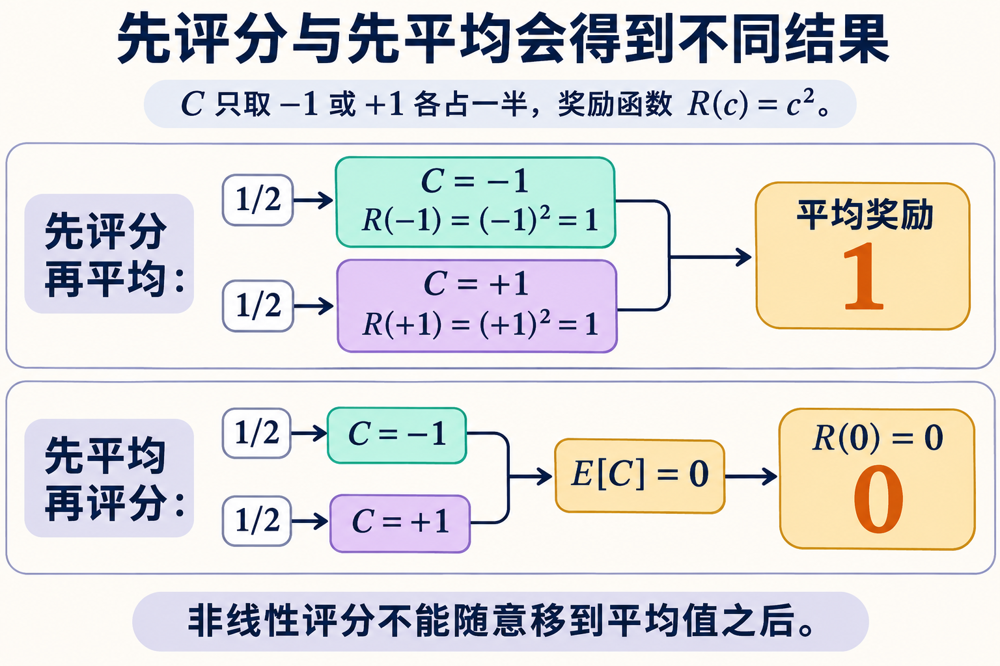

去噪器或速度网络提供局部预测，采样器负责把它变成文本。沿用同一个训练目标，更换更新规则、步数或随机性，也可能得到很不相同的样本。本篇逐步说明这些选择怎样影响质量、控制能力和计算成本。

建议先读第 5 篇。重点是把预测变成实际采样，再计算控制和解码的完整成本。

## Euler 方法把速度变成位移

给定当前状态、当前时间和下一时间，最简单的更新是用当前速度走一小段。在线性插值的去噪参数化下：

$$
x_{t+h}=x_t+h\,b_\theta(x_t,t)
=x_t+\frac{h}{1-t}\bigl(D_\theta(x_t,t)-x_t\bigr).
$$

速度描述当前时刻的移动方向。用它外推一个大步，会忽略沿途速度的变化，因此少步生成可能受到积分误差限制。

一次求解步可能查询网络多次。比较求解器时，应同时报告网络评估次数（NFE）与实际时间；高阶方法的循环步数通常不能直接与 Euler 对齐。

## 从积分定义推到 Euler 更新

ODE 的准确更新是“沿真实路径把每个时刻的速度加起来”：

$$
x_{t+h}=x_t+\int_t^{t+h}b_r(x_r)\,\mathrm dr.
$$

Euler 用区间起点的速度近似整段积分，因此得到 h·bₜ(xₜ)。误差来自两个变化：时间 r 本身变了，状态 xᵣ 也沿轨迹变了。Heun 等高阶方法会额外查询速度，近似这些变化。

在速度场足够光滑的区间，Euler 的单步局部误差通常为 h² 量级，固定总时间的整体误差通常为 h 量级。离散终点附近速度可能急剧变化，误差常数也会增大，因此还要检查具体时间区间与节点分配。

在线性插值去噪形式里，更新系数 h/(1−t) 还说明了相对步长：同样的 h，在接近终点时占剩余时间的比例更大。合适的时间网格要考虑这种变化。

## 用一个极端例子区分去噪均值与生成样本

在线性插值起点 t=0，输入是与数据独立的噪声，所以理想 D₀(x) 是无条件数据均值。如果直接取 h=1，上面的 Euler 更新就变成：

$$
x_1^{\mathrm{Euler}}=D_0(x_0)=\mathbb E[C].
$$

所有初始噪声都会被一步送到同一个均值。若干净数据只有 AA 和 BB，这个均值就不是合法硬样本。这个反例说明：普通去噪器提供的局部统计量，不能直接替代有限时间的联合生成映射。

## 时间网格和随机性怎样影响结果

当 token 不确定性集中在一个狭窄区间变化时，非均匀节点可以把更多评估放在那里。是否改善采样，应在固定 NFE 下与均匀网格比较。

有噪更新需要把随机扰动与漂移一起设计。第 2 篇已给出一组匹配的 ODE 与 SDE；只向原 ODE 额外加入高斯噪声，会改变它的边缘分布。[Score SDE](https://arxiv.org/abs/2011.13456) 给出了相关连续时间框架。

注意两种随机性：初始噪声已经能让确定性 ODE 产生不同样本；逐步随机扰动则进一步改变轨迹。确定性采样不意味着每次生成同一句话。

## 为什么高阶求解器要按 NFE 比

以 Heun 方法为例，先用当前速度预测下一点，再在预测点重新算速度，最后取两个速度的平均：

$$
\begin{aligned}
\widetilde x&=x+h\,b_\theta(x,t),\\
x_{\mathrm{next}}&=x+\frac h2
\left[b_\theta(x,t)+b_\theta(\widetilde x,t+h)\right].
\end{aligned}
$$

它通常比单个 Euler 步更准确，但这里用了两次网络评估。固定四个循环步去比较 Euler 与 Heun，会把后者多用的计算混进去。应先固定 NFE，再比较质量与实际时间。

带 self-conditioning 的模型还需要规定：Heun 第二次查询读取哪份草稿。求解器的状态因此可能同时包含当前向量和历史预测，仅写 b(x,t) 还不够描述完整实现。

## 一份可逐行追踪的基础采样器

下面给出 one-hot CE 模型的教学版确定性采样。它使用 N 个 Euler 更新，并在截断时间后额外做一次干净预测；所以总 NFE 是 N+1。

```text
输入 训练好的去噪网络 D、序列长度、时间节点
     0=t[0]<t[1]<...<t[N]=T，且 T<1
x = 与 one-hot 序列同形状的标准高斯

对 i=0,...,N-1
  mean = softmax(network(x,t[i]))
  velocity = (mean-x)/(1-t[i])
  x = x + (t[i+1]-t[i])*velocity

final_prob = softmax(network(x,T))
tokens = 各位置 argmax(final_prob)
返回 tokens
```

截断时间 T 可以接近 1，具体值与节点分配需要验证。最后一次 final_prob 查询定义了这里的终止近似；改用 x 的直接读出或复用旧预测，会同时改变近似方式与调用次数。

若模型使用 self-conditioning，就在每轮保存预测并作为下一轮草稿；若使用有噪更新，则按相应漂移和噪声系数计算。本段伪代码只展示确定性 Euler 的基本接口。

### 一个有条件生成的完整接口

设已知 prompt 为 c，需要生成的部分是 w。训练时应让网络看到对应的条件 c 和有噪目标 Xₜ，并预测 w。推理时只为未知部分抽噪声，已知部分按训练约定作为固定条件输入。

在同一序列内填空时，训练和推理都应明确固定位置与加噪位置，并向网络提供一致的区分方式。这样，干净上下文才是模型学过的条件，而不是推理时突然加入的新输入形式。

输出长度可以是给定值，也可以由模型决定。若先生成 L 个位置，再按 EOS 截断，就要让训练中的 EOS 与 padding 处理和这一终止规则一致。

## guidance 在哪里发挥作用

设 c 是生成条件。若有当前噪声水平上的准确分类器，可以用贝叶斯关系分解条件 score：

$$
\nabla_x\log p_t(x\mid c)
=\nabla_x\log p_t(x)+\nabla_x\log p_t(c\mid x).
$$

这解释了 classifier guidance 的来源：原 score 加上条件概率的梯度。在转换成 ODE 或 SDE 漂移时，还要带上对应的时间系数。

无分类器引导（classifier-free guidance，CFG）混合条件预测与无条件预测。用速度记号，常见形式为：

$$
b_{\mathrm{guided}}
=b_{\mathrm{uncond}}+\omega\bigl(b_{\mathrm{cond}}-b_{\mathrm{uncond}}\bigr).
$$

### CFG 的代数形式和它的适用范围

条件预测与无条件预测可以由两个网络给出，也可以通过训练时随机丢弃条件，在同一网络里获得。若在 score 空间使用 sᵤ+ω(s꜀−sᵤ)，并假设两者都是准确 score，则固定时刻的向量场形式对应：

$$
(1-\omega)\nabla\log p_t(x)+\omega\nabla\log p_t(x\mid c)
=\nabla\log\left[p_t(x)^{1-\omega}p_t(x\mid c)^\omega\right].
$$

这条等式说明固定时刻的 score 形式。要进一步得到某个精确终点分布，还必须让整条概率路径与漂移匹配；不能只凭各时刻的代数混合，就推断生成过程也精确实现了该分布。

ω=1 还原条件预测，ω>1 强化两种预测的差别，也可能减少模式覆盖。两分支 CFG 会增加评估成本；把引导蒸馏进单网络时，应把额外训练成本与推理节省分别统计。

### 温度改变的首先是哪个分布

对一组 logits ℓ 施加温度 τ，会把 softmax 变成 qₖ∝exp(ℓₖ/τ)。若原概率是 q，则新概率与 qₖ 的 1/τ 次方成正比。

这改变的是当前分类头的局部概率。对各位置、各时间都调温，未必等于把最终整句分布提升到同一个幂次。Logit 温度、score 温度与初始噪声缩放作用于不同对象，比较时应分别说明。

## 奖励梯度需要连接到连续接口

例如先用去噪器预测干净表示，再把它送入可微奖励接口，梯度可以从奖励回传到当前有噪声状态。这条链条经过哪些模块，会决定方向是否有用，以及每步要付出多少计算。

奖励模型若只见过干净文本，可能没有校准有噪向量或离散支持集之外的连续点；硬 argmax 又会切断普通梯度。因此，使用预测干净状态的奖励引导需要近似与接口设计。[Diffusion-LM](https://arxiv.org/abs/2205.14217) 和 [ELF](https://arxiv.org/abs/2605.10938) 展示了两类可微控制路线。

## 奖励倾斜的精确对象为什么更难

若想把终点分布按 exp(λR(C)) 加权，一个准确的中间控制量会涉及给定当前状态的指数奖励期望。它可以写成：

$$
h_t(x)=\mathbb E\!\left[\exp(\lambda R(C))\mid X_t=x\right].
$$

相应的有噪边缘分布与 pₜ(x)hₜ(x) 成正比，所以它的 score 会多出 ∇log hₜ(x)。这说明，终点奖励如何在当前噪声水平上体现，通常需要平均所有可能终点。

常见近似是先用 Dₜ(x) 代表所有可能终点，再用 exp(λR(Dₜ(x))) 近似 hₜ(x)。它把“对每个终点评分再平均”换成了“先取均值再评分”。R 与指数都是非线性运算，这个次序通常不能交换。

例如 C 只取 ±1，R(C)=C²。两个合法终点的奖励都为 1，所以准确的奖励加权不会改变目标分布。若当前观测对称、D=0，先对均值评分却得到 R(D)=0，低估了这些可能终点的奖励。图中先去掉指数，仅用 R 展示这个差异。



图 1 非线性奖励通常不能与条件平均交换。C=±1 且等概率时，先计算 R(C)=C² 再平均得到 1；先取均值 D=0 再评分得到 0。图中只画出奖励这一层非线性；完整控制量仍是正文中的 E[exp(λR(C))|Xₜ=x]，而非 exp(λR(Dₜ(x)))。

因此要同时检查控制成功率、文本质量与额外梯度成本。可微说明这条接口能计算导数；这个导数是否近似了所需的分布控制信号，还要由方法和任务验证。

## 解码次序和终止也属于算法

最后一刻可以按位置 argmax、寻找最近 embedding，或使用 decoder。每一步都先 round 回 token 则改变了整个状态更新过程，需要作为另一个采样算法评估。

长度也需要处理：模型可以固定输出长度、预测长度、使用 EOS，或采用分块和扩展状态的设计。判断效率时，把长度选择、条件编码、guidance、最终 decoder 和可能的重复计算全部计入。

## 把误差与成本一起定位

| 观察到的问题 | 优先检查的环节 |
| --- | --- |
| 很多步也不能得到正常样本 | 表示 训练目标 时间条件与网络预测 |
| 多步正常 少步急剧变差 | 时间网格 数值误差及是否需要映射训练 |
| 连续终点接近合理区域 读成 token 却差 | 分类头 最近邻 decoder 与终止约定 |
| 控制成功但文本重复 | Guidance 强度 奖励偏差与多样性 |
| NFE 很少但实际延迟高 | 全序列计算 双分支 反传 decoder 和缓存 |
| 条件生成比无条件生成差很多 | 条件接口与训练推理状态是否匹配 |

做诊断时固定其他环节，每次只改变一个因素，再观察质量与成本如何变化。这样才容易判断哪种解释得到支持。

完整采样器包括六个环节：抽取初值、查询网络、更新状态、安排随机扰动、决定终止、读出文本。记录每个环节的输入与成本，就能比较不同实现。

## 方法归纳与出处

[CDCD](https://arxiv.org/abs/2211.15089)、[Score SDE](https://arxiv.org/abs/2011.13456)、[Diffusion-LM](https://arxiv.org/abs/2205.14217) 与 [ELF](https://arxiv.org/abs/2605.10938) 提供相关采样和控制实现。复现时，重点核对节点表、随机更新、草稿传递与引导调用次数。

**自测：** 一个方法说用四步生成，你会继续问它用了几次前向、是否计算奖励梯度、是否还运行 AR decoder 吗？为什么确定性 ODE 仍然能输出不同句子？

## 自测参考答案

固定随机初值之后，ODE 轨迹可以确定；换一个初值仍会换一个结果，所以确定性 ODE 也能生成分布。四个求解步可能调用网络八次，若再做双分支 CFG 或奖励反传，实际成本更高。

读采样代码时建议记三列：每轮保存什么状态、每轮调用网络几次、最后还运行什么模块。这个记录比只记一个步数更接近部署时的实际问题。

## 阅读导航

[返回总目录]() · [上一篇 第5篇 连续模型怎样训练好]() · [下一篇 第7篇 从多步流走向一步生成]()
