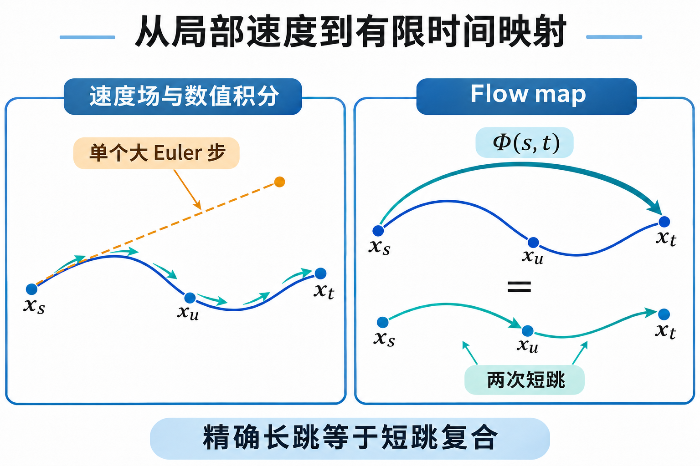
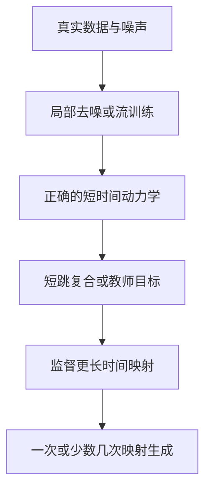

一步 Euler 把所有噪声送到均值，暴露的是局部预测与整段变换之间的差距。Flow map 直接学习有限时间内的移动，尝试用一次或少数几次网络调用，替代许多局部积分步骤。

建议先读第 6 篇。重点是从局部速度跨到有限时间映射；这是少步生成的数学桥梁。

## 速度场和 flow map 回答不同问题

速度场 bₜ(x) 回答“现在朝哪里走”。精确 flow map Φₛ,ₜ(x) 回答“从时间 s 的位置 x 出发，到时间 t 会在哪里”。它是 ODE 的解映射，由沿途速度的积分决定。

$$
\Phi_{s,t}(x_s)
=x_s+\int_s^t b_r(x_r)\,\mathrm dr.
$$

积分中的 xᵣ 在不断变化，因此把积分直接换成 (t−s)bₛ(xₛ) 只是一个近似。如果训练一个网络逼近 Φ，就有机会用一次评估代替许多局部积分步骤。

终点分布离散时，Φ 的终点同样涉及极限或离散读出约定。它应与第 3 篇的端点处理一起理解。



图 1 左侧沿局部速度多次更新，单个大 Euler 步可能偏离轨迹终点。右侧的大箭头代表有限时间解算子给出终点，轨迹本身仍然可以弯曲。精确映射满足短跳复合关系；学习得到的近似映射需要检验误差。

## 用一个可以精确解出的 ODE 比较

暂时离开语言，考虑标量方程 dx/dt=x。它的解是指数函数，因此从 s 到 t 的精确映射为：

$$
\Phi_{s,t}(x)=e^{\,t-s}x.
$$

若 x₀=1，从 0 走到 1，精确终点是 e≈2.718。一个 Euler 大步得到 2；两个长度为 0.5 的 Euler 步得到 2.25；四个长度为 0.25 的步得到约 2.441。

| 方法 | 在这道标量例题中的终点 |
| --- | --- |
| 精确映射 | 2.718 左右 |
| 单个 Euler 步 | 2 |
| 两个 Euler 步 | 2.25 |
| 四个 Euler 步 | 2.441 左右 |

增加局部步数可以缩小这道例题的求解误差。直接学习 flow map，则要学会有限时间内的整体变化，也就是这里的“乘以 exp(t−s)”。训练监督必须约束这个长时间变换。

这道标量题把瞬时导数与有限时间变化分开了。图 1 中的大 Euler 步与沿途积分，也在展示这一差别。

## 多一个时间输入是因为移动距离也变成了任务

普通去噪器读取当前时间 t；一般 flow map 还需要知道目标时间。模型既要处理“小跳”，也要处理“从噪声直接跳到终点”。

精确映射具有三条直观性质：

$$
\Phi_{s,s}(x)=x,
\qquad
\left.\partial_t\Phi_{s,t}(x)\right|_{t=s}=b_s(x),
\qquad
\Phi_{s,t}=\Phi_{u,t}\circ\Phi_{s,u}.
$$

第一条要求时间不变时保持原样；第二条要求无穷短跳与局部速度一致；第三条要求先到 u 再到 t，与直接到 t 相同，称为复合一致性，也常称 semigroup 条件。

最后一条尤其适合形成训练信号：用短跳的复合监督长跳。但只要求复合一致还不够，因为恒等映射也满足它；训练还必须连接到真实数据和正确的局部动力学。

## 为什么出现 two time denoiser

在线性插值下，可以把有限时间映射写成当前位置与一个双时间预测 δ 的组合：

$$
\Phi_{s,t}(x)
=\frac{1-t}{1-s}x+\frac{t-s}{1-s}\delta_{s,t}(x),
\qquad s<t\leq1,\ s<1.
$$

在对角线 s=t 上，δ 还原普通去噪预测 Dₛ；从 s=0 跳到 t=1 时，它承担终点映射。双时间预测虽然也可输出词表概率向量，学习任务却已经从局部条件均值扩展到了有限时间变换。

对这里的 one-hot 线性插值路径，精确双时间预测可写成沿生成轨迹的去噪预测的加权平均，因此各位置仍位于概率 simplex 内。这使映射学习可以使用分类式参数化与目标。[Flow Map Language Models §3.3](https://arxiv.org/abs/2602.16813) 给出了相应推导。

## 从短跳复合推导双时间预测的监督目标

给定 s<u<t，先将两次短跳代入 flow map 的线性组合形式。第一段的系数为 (1−u)/(1−s) 和 (u−s)/(1−s)；第二段也有相同结构。展开以后，x 的系数仍然是 (1−t)/(1−s)。

把剩下的项和直接长跳相比较，可以解出双时间预测的关系：

$$
\delta_{s,t}(x)
=\gamma\,\delta_{s,u}(x)
+(1-\gamma)\,\delta_{u,t}(\Phi_{s,u}(x)),\qquad
\gamma=\frac{(1-t)(u-s)}{(1-u)(t-s)}.
$$

对于 s<u<t<1，γ 在 0 与 1 之间。因此右侧是两个概率向量的凸组合，仍然非负且和为 1；这给出了用软标签 CE 训练长跳预测的机会。

记教师给出的右侧目标为 r，学生长跳预测为 q。软标签 CE 为 −Σrₖlog qₖ，与 KL(r||q) 只相差目标熵 H(r)。当 r 停止梯度时，两者对学生给出相同梯度。

一个教学用的自蒸馏结构可以这样写：

```text
抽 s<u<t，以及时间 s 的有噪状态 x
teacher_first = delta_target(x,s,u)
xu = map_target(x,s,u)
teacher_second = delta_target(xu,u,t)
r = stop_gradient(gamma*teacher_first+(1-gamma)*teacher_second)
q = delta_student(x,s,t)
loss_long = soft_cross_entropy(r,q)
另取对角线样本 s=t，用真实 token CE 训练局部预测
```

target 可以来自冻结教师、缓慢更新的目标网络，或停止梯度的当前分支。数据 CE 约束局部预测，复合目标连接长短时间间隔；只保留复合关系，仍可能学到错误动力学。

当 t=1 时，γ=0，关系简化为“长跳的终点预测，等于沿短跳到达中间点后的终点预测”。这也帮助理解 endpoint consistency 的直觉。不过不同论文施加的端点、时间导数和一致性目标并不完全相同。

## 蒸馏到底在对齐什么

| 路线 | 主要监督来源 | 阅读时的关键问题 |
| --- | --- | --- |
| 预训练教师蒸馏 | 一个已有的多步流或去噪器 | 学生在逼近轨迹 端点 还是分布 |
| 自蒸馏 | 同一模型的局部预测 短跳或目标分支 | 哪些项连接数据 哪些项提供一致性 |
| 直接分布训练 | 数据分布与生成分布之间的目标 | 如何提供模式覆盖和稳定梯度 |

自蒸馏可以省去单独预训练的教师，但仍需要真实数据监督或正确的局部动力学来约束映射。否则错误的映射也可能与自己一致。

[Categorical Flow Maps](https://arxiv.org/abs/2602.12233) 也使用端点参数化学习少步生成，但其一致性目标与 FMLM 并不相同。下面分别说明两种流程，区分端点预测、复合关系与时间变化的约束。

## 一致性监督为什么需要数据锚点

若模型把所有时间间隔都定义为“保持 x 不变”，直接跳与两次短跳当然一致，模型却没有生成数据。更一般地，许多不正确动力学也能各自形成一致的映射族。

所以训练通常需要两种互补信号：在很短时间间隔或相同时间的对角线上，用真实数据建立正确的局部预测；在非零时间间隔上，再约束长跳与短跳或教师结果匹配。

停止梯度或目标网络用于稳定监督分支，数据分布则来自真实标签或已有的正确局部模型。检查训练流程时，可以分别标出“连接数据”的损失与“连接不同时间”的损失。

下面的流程概括这两类监督怎样衔接；随后再展开 FMLM 与 CFM 的具体区别。



## FMLM 的两阶段蒸馏

先有一个训练好的基础流 b。第一阶段不让新网络从零学习整个有限跳跃，而是在一个 Euler 步上增加残差修正：

$$
\widehat\Phi_{s,t}(x)
=x+(t-s)b_s(x)
+\frac12(t-s)^2\psi_\theta(x,s,t).
$$

由于修正项乘了时间差的平方，时间差为零时自动保持 x，时间差趋近零时自动保留基础流的一阶速度。这样可以把训练重点放在“怎样修正大步积分误差”。

冻结基础流以后，修正网络通过复合目标学习。第一阶段的映射仍需要基础流与修正网络共同计算，因此还要进一步压缩推理接口。

第二阶段用一个网络表示映射，例如 Yθ(x,s,t)=x+(t−s)uθ(x,s,t)，让它回归第一阶段教师映射的结果。教师在这一步固定，学生拟合已经形成的长跳能力，从而减少推理时需要保留和查询的模型。

[FMLM](https://arxiv.org/abs/2602.16813) 也讨论双时间概率预测与 CE 训练；其两阶段实现还使用了 Euler 残差修正与 MSE 回归。因此，要分别辨认参数化提供的训练选择，以及具体实现各阶段采用的目标。

### Categorical Flow Maps 的对应思路

CFM 让同一模型兼顾局部端点预测和有限时间映射。它把状态运输到较晚时间，再用那里的预测监督原状态的部分去噪预测，从而建立跨时间一致性。

端点预测位于 simplex 内，使这类监督可以采用分类式目标。严格控制动力学残差，还需要约束预测随时间的变化；仅有某一次端点预测一致，未必足以保证整条动力学正确。

这与 FMLM 先冻结基础流、再修正并压成单模型的流程有区别。二者共同关注同一个接口：学习可组合的有限时间转换，使少数次网络调用仍然协调整段状态。

## 一步生成的随机性仍然在输入里

一个确定函数 G 只要作用于随机噪声，就能产生分布。比如第 1 篇的 AA 或 BB 分布，可以由噪声和的符号来选择分支。问题在于怎样学到一个覆盖数据模式、保持质量且计算便宜的 G。

## 一步 CE 为什么需要有意义的噪声数据配对

设输入 ε 与训练答案 C 独立。如果只要求网络从 ε 预测 C，最优分类器就会忽略 ε，输出无条件 token 概率。这个结论是 CE 的统计最优解，不是训练不够久。

要学习随机输入到具体样本的联合变换，必须有能决定“这份噪声应当对应哪类输出”的信息。教师轨迹能构造一种配对；特定 coupling 也能构造配对；分布层面的目标则可以直接约束生成总体。不同路线各自付出不同的训练成本和假设。

一步模型需要额外的训练约束，而不只是把多步模型的步数设为 1。判断一种训练方案时，先找出它如何建立噪声与输出的配对，或者如何直接约束生成分布。

## 为什么一步模型仍可能需要额外反馈

有限时间映射近似不准确时，多做几次短跳可以减少一次跳过太多区域的误差。若模型还使用 self-conditioning，后续调用也可能修正第一次对全局答案的判断。这是少步系统常见的质量与预算取舍。

终点接口相似的方法，学习对象可能不同。Flow map 要与一条动力学的时间转换一致；直接生成器只要求把噪声分布经映射变成目标分布，这称为推前（pushforward），未必还定义任意中间时间的转换。

蒸馏还可能继承教师的偏差。若只在教师常访问的状态上学习，极少步学生进入其他区域时可能失稳；因此评估需要同时看学生的实际轨迹、模式覆盖和下游成功率，而不只是教师目标上的回归误差。

## 一步结果要连同多样性一起看

少步模型可能通过集中生成少量常见句式，获得更好的外部语言模型评分。因此还要同时检查多样性、重复、任务成功率与端到端成本；第 8 篇会用反例说明这些指标为何需要分开。

## 方法归纳与出处

[FMLM](https://arxiv.org/abs/2602.16813) 与 [Categorical Flow Maps](https://arxiv.org/abs/2602.12233) 分别提供教师蒸馏与分类式自蒸馏的实现。复现时，再核对参数共享、时间采样、残差权重和监督分支；研究严格唯一性时，再检查对应的定理条件。

**自测：** 为什么 Φ₀,₁(ε) 可以是随机样本，而普通 D₀(ε) 在独立噪声设置下只是无条件均值？为什么只训练映射复合一致性可能得到平凡解？这两题是理解一步语言模型的关键。

## 自测参考答案

独立噪声在 t=0 不含真实训练答案的信息，因此普通去噪器的最优解是无条件均值。Flow map 则通过局部动力学、教师或分布约束学习一个把不同噪声送往不同样本的联合映射。两者的输入看起来相似，监督目标和输出含义却不同。

恒等映射满足复合一致性，所以仅靠复合关系无法选中目标流。真实数据监督或正确的切向条件，是避免这种平凡解的关键。

## 阅读导航

[返回总目录]() · [上一篇 第6篇 连续模型怎样采样和控制]() · [下一篇 第8篇 从论文结果走向研究判断]()
