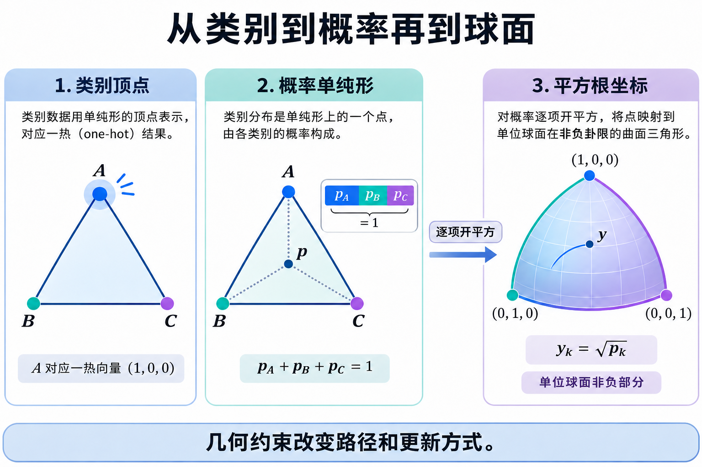
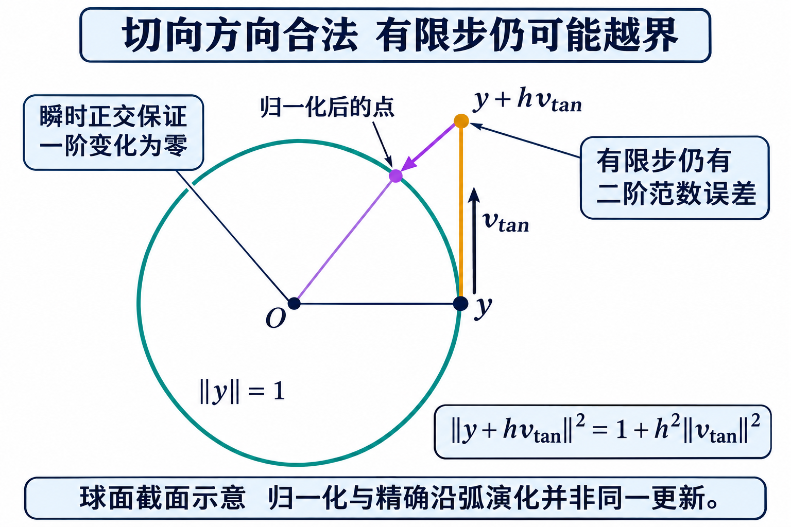

如果中间状态本身就是概率向量，更新就必须保持非负、总和为 1；如果状态在单位球面上，更新就必须保持范数。本篇从这两类约束出发，推导 Dirichlet 路径、概率的平方根坐标与球面流，说明几何结构怎样改变训练目标和采样器。

建议在第 4 篇之后阅读。切空间、度量和测地线都会在用到时解释，无需预先学习黎曼几何。

## Simplex 是概率向量的空间

V 类概率向量各分量非负，总和为 1。它们构成 V−1 维 simplex。

$$
\Delta^{V-1}
=\left\{p\in\mathbb R^V:p_k\geq0,\ \sum_{k=1}^V p_k=1\right\}.
$$

当 V=3 时，它是一个三角形：顶点代表确定类别，边上表示两个类别的混合，内部允许三个类别都有概率。一个位置的状态如果被约束在这个三角形内，每一步更新都需要尊重边界。

在 simplex 内部，速度各分量之和必须为零，才能保持总概率不变；在边界，已经为零的分量还不能继续减小。先走任意欧氏步再归一化，会改变更新规则，通常只能视作一种数值近似。

## 输出概率与概率状态的区别

第 3 篇的 one-hot 加高斯模型中，去噪器 Dθ 的输出可以是概率向量，但有噪声的状态 x 通常不在 simplex 内。Simplex 流约束的是状态本身。还有一类方法在 logits 上加噪，再通过 softmax 转成概率；判断方法属于哪一种，要追踪噪声究竟加在哪里。

[SSD-LM](https://arxiv.org/abs/2210.17432) 和 [TESS](https://arxiv.org/abs/2305.08379) 提供了语言生成中的具体设计。下面先用数值例子区分概率状态与 logits，再讨论直接定义在 simplex 上的路径。

### 用三类向量区分 simplex 与 logits

取 p=(0.5,0.3,0.2)，它是合法概率点。向量 z=(2,1,−1) 则不是概率，因为有负数、总和也不为 1；但它可以作为 logits，经 softmax 变成一个概率向量。

这两个空间的路径不一样。给 z 加高斯噪声后再 softmax，会得到一条由 softmax 诱导的概率路径；直接在 p 上做受约束更新，则要保持非负与和为 1。它们不能只因最后都输出概率就视为同一个过程。

还有一个参数化特点：给每个 logit 加同一个常数 c，softmax(z+c) 不变。同一个概率向量因此对应许多组 logits；分析 logit 空间的噪声与温度时，需要考虑这种冗余。

## 用一个有限更新检查 simplex 约束

取 p=(0.5,0.3,0.2)，方向 v=(0.1,−0.04,−0.06)，v 的分量和为零，因此 p+h·v 的总和始终是 1。但 h=4 时第三维变成 −0.04，已经不再是合法概率。

这说明质量守恒与非负约束需要分别检查。内部切向方向只保证瞬时总和不变，有限步不能越过边界；在零概率坐标处，方向还不能继续向外。

把向量除以其分量总和，无法消除负数。Softmax 能产生合法概率，但它重新定义了从输入到概率的映射，也会改变路径。选择哪种处理方式，需要与所建模的 ODE 一起确定。

## Dirichlet 分布为什么自然

高斯分布方便描述欧氏空间中的随机向量；Dirichlet 分布则直接生成非负且和为 1 的概率向量。改变其参数，可以控制样本靠近 simplex 的中心、边缘或某些顶点。

[Dirichlet Flow Matching](https://arxiv.org/abs/2402.05841) 用 Dirichlet 混合构造概率路径，并在 DNA 序列生成中研究控制与蒸馏。下面依次解释分布、分类训练接口和条件速度；速度公式中的特殊函数可以从分位数守恒推导出来。

Dirichlet FM 讨论了其设定下朴素 simplex 线性路径的问题。把这一结论用于其他方法之前，需要核对源分布和状态空间；欧氏空间中的高斯到 one-hot 插值采用了不同的设定。

### Dirichlet 密度怎样控制概率点

对 simplex 内部的 p，Dirichlet 密度与各分量幂次的乘积成正比：

$$
f(p;\boldsymbol a)
=\frac1{B(\boldsymbol a)}
\prod_{k=1}^{V}p_k^{a_k-1},
\qquad a_k>0,\quad
\mathbb E[p_k]=\frac{a_k}{\sum_j a_j}.
$$

所有 aₖ=1 时，密度在 simplex 上均匀。只增大某个 aₖ，会提高对应类别的平均概率；把所有参数按同一倍数放大，则保持均值不变，让样本更集中在均值附近。

一个朝类别 k 顶点的条件路径可以设为：

$$
p_t(\,\cdot\mid C=k)
=\mathrm{Dirichlet}(\boldsymbol1+\kappa(t)e_k),
\quad \kappa(0)=0,\quad
\kappa(t)\longrightarrow\infty\ \text{as }t\to1.
$$

例如三类情况下 κ=9，目标类别的均值为 10/12，另外两类各为 1/12。κ 越大，概率质量越靠近目标顶点。

原始 Dirichlet FM 可以直接把逐渐增大的浓度作为时间变量。本篇用 κ(t) 把它换成统一的 0 到 1 时间坐标；例如 κ(t)=t/(1−t)。这个例子用于说明重参数化，数值实现仍需截断终点并选择合适节点。

### 条件路径混合以后怎样学后验

在单个类别变量、先验为 πₖ 的情况下，上面各条件 Dirichlet 的归一化常数相同，差别只有 pₖ 的 κ 次方。因此：

$$
P(C=k\mid p,t)
=\frac{\pi_k p_k^{\kappa(t)}}{\sum_j\pi_j p_j^{\kappa(t)}}.
$$

对序列，类别先验还包含跨位置关系。网络需要读取整段多 simplex 状态，才能预测每个位置的后验；上面的单变量公式只用于解释局部机制，不能据此把整句的先验拆成独立类别。

和欧氏 one-hot 流一样，CE 可以学习这组后验。但这里的采样速度不再普遍是 (D−p)/(1−t)：条件概率路径换了，正确的条件速度也要重新构造。

## 从分位数守恒推导 Dirichlet 速度

固定目标类别 k，令 r=pₖ。Dirichlet 的这个坐标具有 Beta 边缘分布：r∼Beta(a,V−1)，其中 a=1+κ(t)。其密度与累计分布分别记为 fₐ(r)、Fₐ(r)。

$$
f_a(r)=\frac{r^{a-1}(1-r)^{V-2}}{B(a,V-1)},\qquad
F_a(r)=\int_0^r f_a(u)\,\mathrm du.
$$

给每个样本固定一个分位数 u，让 r(t)=Fₐ₍ₜ₎⁻¹(u) 随分布变化而移动。直觉上，一个始终位于第 70 百分位的样本，会跟着分布向目标顶点靠近。由于 Fₐ₍ₜ₎(r(t))=u 不变，对时间求导，再用链式法则：

$$
0=\dot a(t)\,\partial_aF_a(r)+f_a(r)\dot r,
\qquad
\dot r=-\frac{\dot a(t)\,\partial_aF_a(r)}{f_a(r)}.
$$

这就得到了目标坐标该怎样移动。其余坐标按当前相对比例缩小，便能保持总和为 1：对 j≠k，令 ṗⱼ=−ṙ·pⱼ/(1−r)。合起来可以写为：

$$
u_t^{(k)}(p)
=c_k(p,t)(e_k-p),
\qquad
c_k(p,t)=\frac{\dot r}{1-r}.
$$

系数 cₖ 同时依赖时间和当前位置。方向 eₖ−p 指向目标顶点，系数决定沿这个方向移动多快，才能恰好实现指定的 Dirichlet 分布变化。Beta 函数承担的是计算速度大小的工作。

这个构造还利用了 Dirichlet 的一个性质：给定 pₖ 后，其余坐标除以 1−pₖ 得到的相对比例，服从不随 κ 变化的条件 Dirichlet 分布。因此保持这些比例、只改变目标坐标，就能实现所需的条件路径。

最后按目标类别的后验平均各个条件速度：

$$
b_\theta(p,t)
=\sum_{k=1}^{V}q_\theta(C=k\mid p,t)\,u_t^{(k)}(p).
$$

在序列中，每个位置的后验读取整段状态，因此仍可以产生跨位置协调。训练分类头时可直接采样 Dirichlet 状态并做 CE；条件速度的 Beta 计算主要出现在构造采样更新时。

至此，路径、训练与采样已接起来：采样带类别标签的 Dirichlet 状态，用 CE 学后验，再把后验代入条件速度的加权和。实现时主要需要处理特殊函数导数、边界极限和数值稳定性。

## 为什么概率会对应到球面

图 1 概率 simplex 与单位球面非负部分之间的平方根映射。内点与弧线仅示意位置和空间关系，具体数值例子以正文计算为准。

把概率逐项开平方，得到 yₖ=√pₖ，则平方和自动为 1，且各坐标非负：

$$
y_k=\sqrt{p_k},
\qquad
\sum_{k=1}^V y_k^2=\sum_{k=1}^V p_k=1.
$$

于是概率 simplex 可以对应到单位球面的非负部分。这个变换特别有用，是因为它还联系了概率分布的 Fisher–Rao 度量。只在 pₖ>0 的内部看微小变化：

$$
\mathrm ds_{\mathrm{FR}}^2
=\sum_k\frac{(\mathrm dp_k)^2}{p_k}
=4\sum_k(\mathrm dy_k)^2.
$$

右边等于球面上欧氏长度的平方再乘 4。也就是说，在概率分布上用 Fisher–Rao 度量测量局部变化，等价于在平方根坐标的球面上测量，再调整一个常数尺度。[Fisher Flow Matching](https://arxiv.org/abs/2405.14664) 利用这一联系构建离散数据的连续流。

## 把平方根坐标的例子算出来

对 p=(0.5,0.3,0.2) 逐项开平方，得到 y≈(0.7071,0.5477,0.4472)。三个坐标的平方和仍是 1。这里没有减少维度，只是换了一种坐标和对应的距离理解。

Fisher–Rao 度量中的 1/pₖ 表示：相同的绝对概率变化，发生在较小的 pₖ 上时会贡献更大的距离。下一节从 KL 的局部展开说明这个权重来自哪里。

内部公式要求 pₖ>0。到了零概率边界，需要用内部路径、边界极限或专门参数化处理；直接把 one-hot 顶点代入 1/pₖ 会超出这个表达式的适用范围。

## 从 KL 展开理解 Fisher–Rao 度量

从两个很接近的分布 p 和 p+dp 出发，要求 Σdpₖ=0。展开 KL 中的 log(1+dpₖ/pₖ)：

$$
\begin{aligned}
\mathrm{KL}(p\|p+\mathrm dp)
&=-\sum_k p_k\log\left(1+\frac{\mathrm dp_k}{p_k}\right)\\
&\approx-\sum_k\mathrm dp_k
+\frac12\sum_k\frac{(\mathrm dp_k)^2}{p_k}\\
&=\frac12\sum_k\frac{(\mathrm dp_k)^2}{p_k}.
\end{aligned}
$$

线性项因为总概率守恒而消失，二次项就给出局部 Fisher–Rao 几何。这个展开在内部且相对变化足够小时适用，不能直接把零概率边界代进去。

平方根变换 pₖ=yₖ² 后，dpₖ=2yₖdyₖ，于是二次形式化为 4Σdyₖ²；再配合 Σyₖ²=1，便得到球面上的距离结构。

这个二次形式描述了相近概率分布的局部可区分性。平方根坐标把随 pₖ 变化的权重化成常数，因而可以把一部分概率几何问题转到球面上处理。

## 球面最短路为什么是弧

在单位球面上，一条连起两点的欧氏直线段一般会穿过球内部，而合法状态必须留在表面。测地线给出沿空间本身定义的局部最短路径。

设两单位向量的夹角为 θ，在非退化情况下，球面插值可以写成：

$$
y(t)
=\frac{\sin((1-t)\theta)}{\sin\theta}y(0)
+\frac{\sin(t\theta)}{\sin\theta}y(1),
\qquad
\theta=\arccos(y(0)^\top y(1)).
$$

θ 接近零时，两点几乎重合，要使用对应极限或稳定实现。对非负坐标的单位向量，夹角不超过 π/2，短弧公式中的系数非负，所以弧仍留在非负部分。公式的作用是连接两点，同时保持球面约束。

## 球面上的速度需要沿切面走

若状态 y 在单位球面上，对 y 的范数平方求导，可以得到：

$$
\frac{\mathrm d}{\mathrm dt}\|y_t\|^2
=2y_t^\top\dot y_t=0.
$$

因此，合法的瞬时速度要与半径正交，这样的方向组成当前位置的切空间。三个常见术语分别对应三项操作：tangent projection（切向投影）把向量变成合法方向；geodesic（测地线）描述沿曲面移动的最短路径；retraction（回缩）把一个切向近似步送回曲面。

另外，给词表 embedding 做单位范数归一化，并不自动等于把生成状态始终约束在球面上。高斯噪声、输入归一化和几何 flow 各自改变哪个对象，仍要逐项检查。

## 为什么切向速度仍需要合适的数值更新

若给任意向量 v 去掉沿半径方向的分量，可以得到一个切向向量：

$$
v_{\mathrm{tan}}=v-(y^\top v)y,
\qquad \|y\|=1.
$$

但即使 y 与 vₜₐₙ 正交，一个有限 Euler 步也通常离开单位球面，因为：

$$
\|y+h\,v_{\mathrm{tan}}\|^2
=1+h^2\|v_{\mathrm{tan}}\|^2.
$$

图 2 切向速度与半径正交，但有限 Euler 步会落到单位圆外。径向归一化可以把近似点送回圆上，这是一种回缩；它通常不同于按相同步长沿球面精确积分。图中的整圆用于解释范数约束，概率平方根表示还需另外满足坐标非负。

切向条件保证瞬时导数不改变范数，有限 Euler 步仍会产生二阶误差。归一化回缩、指数映射或其他几何求解器，可以把数值更新留在球面上；它们对应的路径、精度和成本有所不同。

单位范数与坐标非负是两项约束。如果目标空间是球面的非负部分，除保持范数外，还必须避免越过坐标为零的边界。

## 把球面 flow 的训练和采样接起来

一条典型几何 flow 路线，先选球面上的源分布和目标表示，再用合法的球面路径连接样本；训练网络预测该路径的条件速度，并把输出投到对应切空间。

在单位球面的坐标中，可用相应切向量的欧氏范数表示诱导度量下的速度误差；若从 Fisher–Rao 坐标对应过来，还要注意前面的常数尺度。生成时使用保约束更新，再把终点按表示约定解码。

概率的平方根表示要求非负球面部分；低维 spherical token embedding 则是另一种设计，未必与 V 类概率 simplex 一一对应。两者都可能叫 spherical，但状态维度、解码接口和几何含义不同。

Dirichlet 与 Fisher Flow 在 DNA 等小词表序列上也有应用。它们说明几何建模可以有用，但小词表任务的结果不能直接替代大词表自然语言的扩展证据。

区分几何方法时，依次确认状态的约束、条件路径的定义，以及数值步如何保持约束。这三项决定了训练和采样真正实现的过程。

## 方法归纳与出处

[Dirichlet FM](https://arxiv.org/abs/2402.05841) 与 [Fisher Flow](https://arxiv.org/abs/2405.14664) 是本篇两类方法的出处。正文已给出理解机制所需的路径、后验、速度与度量推导。复现特定特殊函数近似、几何最优传输 coupling 或边界处的严格证明时，再按需要查阅原文和代码。

**纸笔练习：** 从 p=y² 推导度量变换；再对球面约束求导。只要这两步算清楚，许多几何论文中的符号就有了明确对象。

## 练习参考答案

由 pₖ=yₖ²，有 dpₖ=2yₖdyₖ。代入 (dpₖ)²/pₖ 就得到 4(dyₖ)²。再对 y 的范数平方求导，得到 y 与速度正交的条件。

这两步分别解释了坐标变换后的度量，以及合法瞬时运动的方向。有限步的范数还会出现二阶误差，所以理解完几何定义以后，仍需继续看采样器怎样实现它。

## 阅读导航

[返回总目录]() · [上一篇 选读A 连续与离散的混合模型]()
